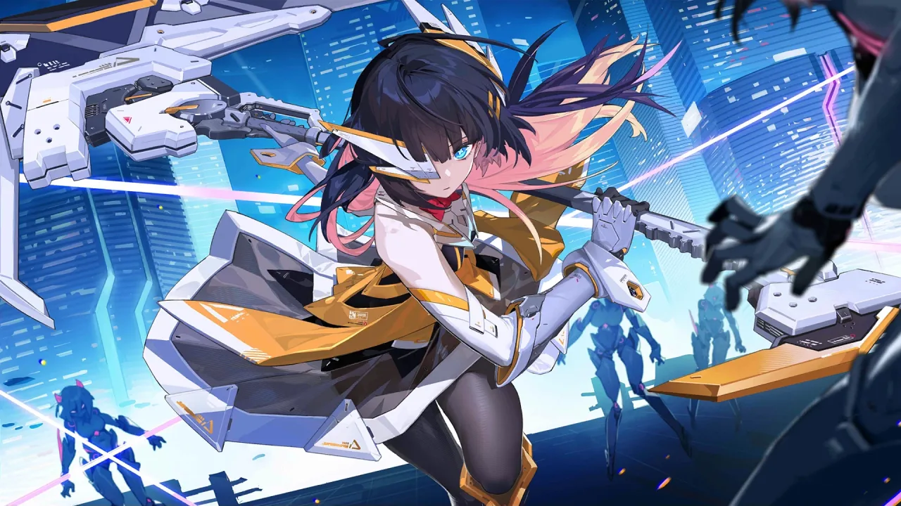

[Ruby skins](https://boostmlbb.ru/en/skins/ruby.html)

[Skins](https://boostmlbb.ru/en/skins/)/[Ruby](https://boostmlbb.ru/en/skins/ruby.html)/Mecha Maiden

[Ruby skin](https://boostmlbb.ru/en/skins/ruby.html)

# Mecha Maiden

GrandThe AspirantsLimited

How to get

Released in the The Aspirants event. Limited skins come back in event draws from time to time.

Released

7 October 2023

## What the skin changes

-   New look
-   New skill effects
-   Skill sounds
-   Voice-over
-   Skill icons
-   Showcase animation
-   Showcase scene
-   Showcase music
-   Spawn animation
-   Special actions
-   Attribute bonus

## All Ruby skins [10](https://boostmlbb.ru/en/skins/ruby.html)

[Neon EdgeExceptional · 2025](https://boostmlbb.ru/en/skins/ruby/neon-edge.html)[Crescent DervishExceptional · 2025](https://boostmlbb.ru/en/skins/ruby/crescent-dervish.html)[Soul ReaperExceptional · 2024](https://boostmlbb.ru/en/skins/ruby/soul-reaper.html)[Mecha MaidenGrand · 2023](https://boostmlbb.ru/en/skins/ruby/mecha-maiden.html)[Prismatic PlumeExquisite · 2023](https://boostmlbb.ru/en/skins/ruby/prismatic-plume.html)[Pirate ParrotExceptional · 2021](https://boostmlbb.ru/en/skins/ruby/pirate-parrot.html)[Lady ZombieExquisite · 2019](https://boostmlbb.ru/en/skins/ruby/lady-zombie.html)[EdelweissCommon · 2018](https://boostmlbb.ru/en/skins/ruby/edelweiss.html)[Cat GirlCommon · 2017](https://boostmlbb.ru/en/skins/ruby/cat-girl.html)[Hidden Orchid ButterflyCommon · 2017](https://boostmlbb.ru/en/skins/ruby/hidden-orchid-butterfly.html)

## The Aspirants series

[Silverbolt RaikoSelena · 2026](https://boostmlbb.ru/en/skins/selena/silverbolt-raiko.html)[Imperatrix ArashiObsidia · 2026](https://boostmlbb.ru/en/skins/obsidia/imperatrix-arashi.html)[Daybreak HaloGuinevere · 2025](https://boostmlbb.ru/en/skins/guinevere/daybreak-halo.html)[Twilight StarVexana · 2025](https://boostmlbb.ru/en/skins/vexana/twilight-star.html)[Tech TensaiChang'e · 2024](https://boostmlbb.ru/en/skins/change/tech-tensai.html)[Deadeye SpectreLesley · 2024](https://boostmlbb.ru/en/skins/lesley/deadeye-spectre.html)[Blade of KibouFanny · 2022](https://boostmlbb.ru/en/skins/fanny/blade-of-kibou.html)[Miss HikariLayla · 2022](https://boostmlbb.ru/en/skins/layla/miss-hikari.html)

**How much is a rank boost on Ruby?**Choose your current and target ranks to see the price here.

[Calculate price](https://boostmlbb.ru/en/order.html?type=hero)

## Frequently asked questions

How to get the Mecha Maiden skin for Ruby?

Released in the The Aspirants event. Limited skins come back in event draws from time to time.

When was Mecha Maiden released?

7 October 2023.

What class is Mecha Maiden?

Grand, The Aspirants series.
