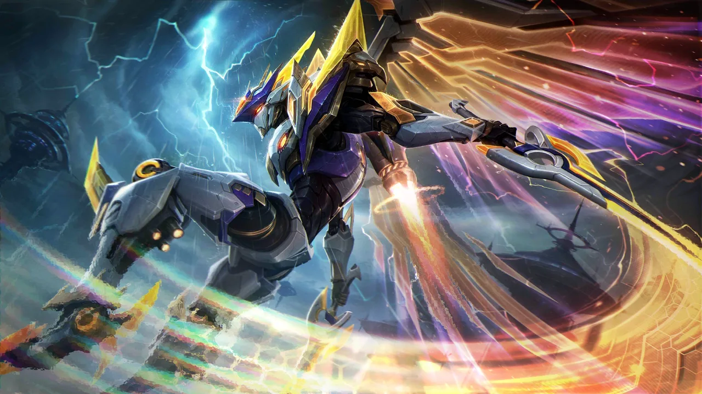

[Tier list](https://boostmlbb.ru/en/heroes/)[Items](https://boostmlbb.ru/en/items/)[Skins](https://boostmlbb.ru/en/skins/)[News & guides](https://boostmlbb.ru/en/news/)

[Skins](https://boostmlbb.ru/en/skins/)/[Saber](https://boostmlbb.ru/en/skins/saber.html)/Codename - Storm

[Saber skin](https://boostmlbb.ru/en/skins/saber.html)

# Codename - Storm

SupremeLegendIn the shop

How to get

Exchanged for 200 Magic Crystals from the Magic Wheel.

Price

200 Magic Crystals

Released

2017

## What the skin changes

-   New look
-   New skill effects
-   Skill animations
-   Skill sounds
-   Voice-over
-   Skill icons
-   Showcase animation
-   Showcase scene
-   Recall effect
-   Special actions
-   Avatar border
-   Achievement
-   Attribute bonus

## All Saber skins [8](https://boostmlbb.ru/en/skins/saber.html)

[Iron HoundExceptional · 2023](https://boostmlbb.ru/en/skins/saber/iron-hound.html)[Silver EdgeCommon · 2021](https://boostmlbb.ru/en/skins/saber/silver-edge.html)[OnimaruExquisite · 2019](https://boostmlbb.ru/en/skins/saber/onimaru.html)[S.A.B.E.R. RegulatorDeluxe · 2018](https://boostmlbb.ru/en/skins/saber/s-a-b-e-r-regulator.html)[Fullmetal RoninCommon · 2018](https://boostmlbb.ru/en/skins/saber/fullmetal-ronin.html)[Codename - StormSupreme · 2017](https://boostmlbb.ru/en/skins/saber/codename-storm.html)[Force WarriorExceptional · 2016](https://boostmlbb.ru/en/skins/saber/force-warrior.html)[Golden FlashCommon · 2016](https://boostmlbb.ru/en/skins/saber/golden-flash.html)

## Legend series

[Revenant of RosesAlpha · 2025](https://boostmlbb.ru/en/skins/alpha/revenant-of-roses.html)[Sovereign of RealmsJohnson · 2025](https://boostmlbb.ru/en/skins/johnson/sovereign-of-realms.html)[Galactic VanquisherFreya · 2024](https://boostmlbb.ru/en/skins/freya/galactic-vanquisher.html)[Divine GoddessLunox · 2023](https://boostmlbb.ru/en/skins/lunox/divine-goddess.html)[King of HellFranco · 2023](https://boostmlbb.ru/en/skins/franco/king-of-hell.html)[Psion of TomorrowGuinevere · 2022](https://boostmlbb.ru/en/skins/guinevere/psion-of-tomorrow.html)[Infernal BlazeValir · 2022](https://boostmlbb.ru/en/skins/valir/infernal-blaze.html)[Cosmic GleamGusion · 2022](https://boostmlbb.ru/en/skins/gusion/cosmic-gleam.html)

**Rank up on Saber**The calculator shows the price

[Calculate price](https://boostmlbb.ru/en/order.html?type=hero)

## Frequently asked questions

How to get the Codename - Storm skin for Saber?

Exchanged for 200 Magic Crystals from the Magic Wheel.

When was Codename - Storm released?

2017.

What class is Codename - Storm?

Supreme, Legend series.
