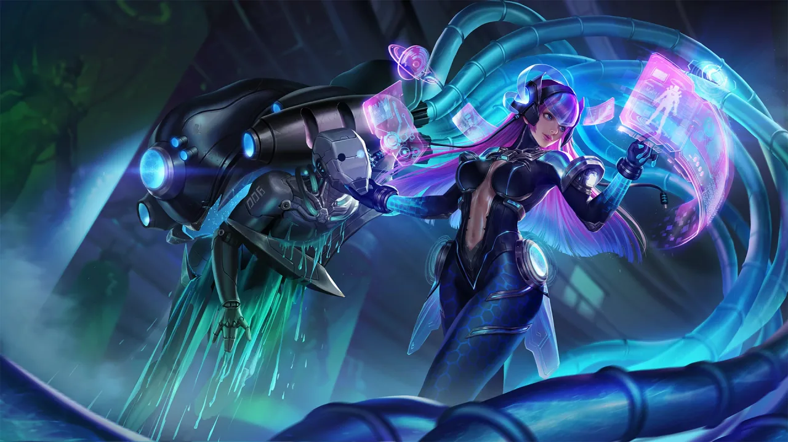

[Selena skins](https://boostmlbb.ru/en/skins/selena.html)

[Skins](https://boostmlbb.ru/en/skins/)/[Selena](https://boostmlbb.ru/en/skins/selena.html)/Virus

[Selena skin](https://boostmlbb.ru/en/skins/selena.html)

# Virus

DeluxeEpicLimited

How to get

Released in the skin shop during an event. Limited skins come back in event draws from time to time.

Released

8 January 2019

## What the skin changes

-   New look
-   New skill effects
-   Skill sounds
-   Voice-over
-   Showcase animation
-   Showcase scene
-   Attribute bonus

## All Selena skins [10](https://boostmlbb.ru/en/skins/selena.html)

[Silverbolt RaikoGrand · 2026](https://boostmlbb.ru/en/skins/selena/silverbolt-raiko.html)[Curse of CinderGrand · 2025](https://boostmlbb.ru/en/skins/selena/curse-of-cinder.html)[Lady VengeanceGrand · 2021](https://boostmlbb.ru/en/skins/selena/lady-vengeance.html)[Gothic CurseCommon · 2021](https://boostmlbb.ru/en/skins/selena/gothic-curse.html)[S.T.U.N. SelenaDeluxe · 2021](https://boostmlbb.ru/en/skins/selena/s-t-u-n-selena.html)[Thunder FlashExquisite · 2020](https://boostmlbb.ru/en/skins/selena/thunder-flash.html)[Double IdentityExceptional · 2019](https://boostmlbb.ru/en/skins/selena/double-identity.html)[Gemini - ShadowDeluxe · 2019](https://boostmlbb.ru/en/skins/selena/gemini-shadow.html)[VirusDeluxe · 2019](https://boostmlbb.ru/en/skins/selena/virus.html)[Wasp QueenCommon · 2018](https://boostmlbb.ru/en/skins/selena/wasp-queen.html)

## Epic series

[Nether OverseerMinotaur · 2026](https://boostmlbb.ru/en/skins/minotaur/nether-overseer.html)[Sunken CurseAtlas · 2026](https://boostmlbb.ru/en/skins/atlas/sunken-curse.html)[Eternal VowVexana · 2026](https://boostmlbb.ru/en/skins/vexana/eternal-vow.html)[Cursed ScrollKhufra · 2025](https://boostmlbb.ru/en/skins/khufra/cursed-scroll.html)[Soul HuntressNatalia · 2025](https://boostmlbb.ru/en/skins/natalia/soul-huntress.html)[Nightmare CountLeomord · 2025](https://boostmlbb.ru/en/skins/leomord/nightmare-count.html)[Arbiter of StarsBelerick · 2025](https://boostmlbb.ru/en/skins/belerick/arbiter-of-stars.html)[Keeper of the WindsVale · 2025](https://boostmlbb.ru/en/skins/vale/keeper-of-the-winds.html)

**How much is a rank boost on Selena?**Choose your current and target ranks to see the price here.

[Calculate price](https://boostmlbb.ru/en/order.html?type=hero)

## Frequently asked questions

How to get the Virus skin for Selena?

Released in the skin shop during an event. Limited skins come back in event draws from time to time.

When was Virus released?

8 January 2019.

What class is Virus?

Deluxe, Epic series.
