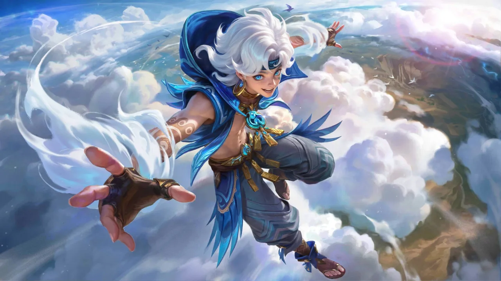
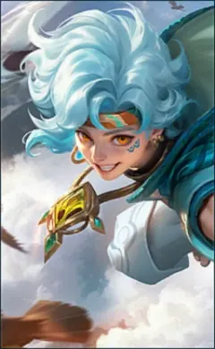

[All skins](https://boostmlbb.ru/en/skins/)

[Skins](https://boostmlbb.ru/en/skins/)/Sora

# Sora skins

Skins

1

In the shop

1

Latest

[Azure Cloud](https://boostmlbb.ru/en/skins/sora/azure-cloud.html)2025

[Hero profile→](https://boostmlbb.ru/en/heroes/sora.html)

## All skins

[Azure CloudCommon · 2025](https://boostmlbb.ru/en/skins/sora/azure-cloud.html)

**How much is a rank boost on Sora?**Choose your current and target ranks to see the price here.

[Calculate price](https://boostmlbb.ru/en/order.html?type=hero)

## Frequently asked questions

How many skins does Sora have?

1 skin, the default look not counted. The newest is Azure Cloud (18 December 2025).

Which Sora skins can you buy now?

Azure Cloud (269 diamonds). The other skins were limited and come back only in events.

What is the rarest Sora skin?

Azure Cloud, Common class. Sold in the skin shop for 269 diamonds.
