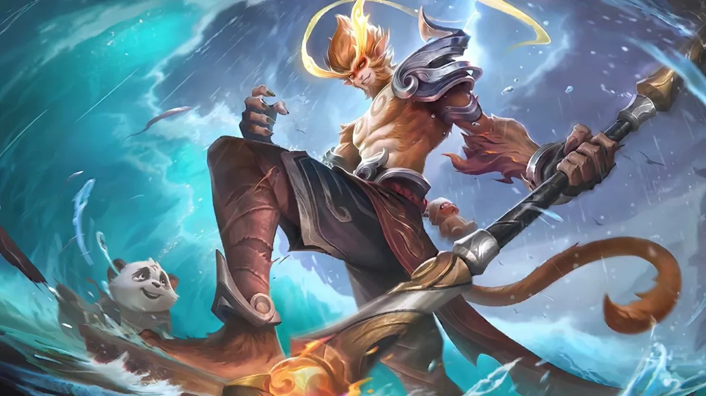
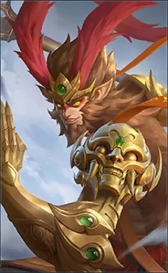

[Tier list](https://boostmlbb.ru/en/heroes/)[Items](https://boostmlbb.ru/en/items/)[Skins](https://boostmlbb.ru/en/skins/)[News & guides](https://boostmlbb.ru/en/news/)

[Skins](https://boostmlbb.ru/en/skins/)/Sun

# Sun skins

Skins

8

In the shop

2

Latest

[Celestial Rebel](https://boostmlbb.ru/en/skins/sun/celestial-rebel.html)2026

[Hero profile→](https://boostmlbb.ru/en/heroes/sun.html)

## All skins

AllExquisiteDeluxeExceptionalCommon

[Celestial RebelExquisite · 2026](https://boostmlbb.ru/en/skins/sun/celestial-rebel.html)[Wicked FlamesExquisite · 2022](https://boostmlbb.ru/en/skins/sun/wicked-flames.html)[Spring BlessingsDeluxe · 2022](https://boostmlbb.ru/en/skins/sun/spring-blessings.html)[Simian CurseExceptional · 2021](https://boostmlbb.ru/en/skins/sun/simian-curse.html)[Celestial OutlawCommon · 2020](https://boostmlbb.ru/en/skins/sun/celestial-outlaw.html)[Street LegendExceptional · 2018](https://boostmlbb.ru/en/skins/sun/street-legend.html)[Battle BuddhaCommon · 2017](https://boostmlbb.ru/en/skins/sun/battle-buddha.html)[Rock StarExceptional · 2017](https://boostmlbb.ru/en/skins/sun/rock-star.html)

**Rank up on Sun**The calculator shows the price

[Calculate price](https://boostmlbb.ru/en/order.html?type=hero)

## Frequently asked questions

How many skins does Sun have?

8 skins, the default look not counted. The newest is Celestial Rebel (1 October 2026).

Which Sun skins can you buy now?

Battle Buddha (599 diamonds), Rock Star (749 diamonds). The other skins were limited and come back only in events.

What is the rarest Sun skin?

Celestial Rebel, Exquisite class, Collector series. The top prize of a Collector event draw, paid with diamonds. Limited skins come back in event draws from time to time.
