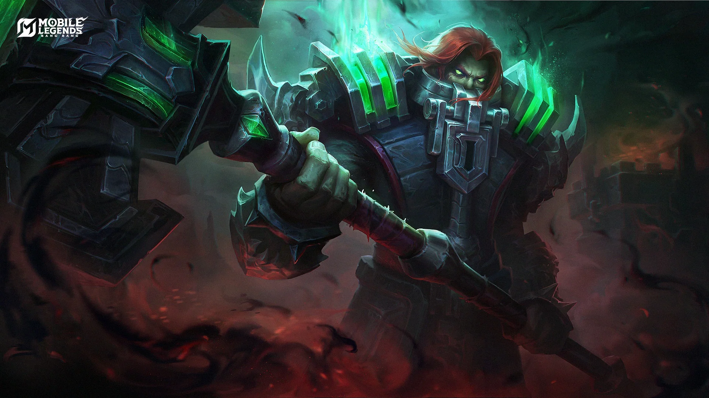

[Tier list](https://boostmlbb.ru/en/heroes/)[Items](https://boostmlbb.ru/en/items/)[Skins](https://boostmlbb.ru/en/skins/)[News & guides](https://boostmlbb.ru/en/news/)

[Skins](https://boostmlbb.ru/en/skins/)/Terizla

# Terizla skins

Skins

6

In the shop

3

Latest

[Soulblight Tyrant](https://boostmlbb.ru/en/skins/terizla/soulblight-tyrant.html)2025

[Hero profile→](https://boostmlbb.ru/en/heroes/terizla.html)

## All skins

[Soulblight TyrantExquisite · 2025](https://boostmlbb.ru/en/skins/terizla/soulblight-tyrant.html)[Flames of JudgementDeluxe · 2024](https://boostmlbb.ru/en/skins/terizla/flames-of-judgement.html)[RustwreckCommon · 2023](https://boostmlbb.ru/en/skins/terizla/rustwreck.html)[FlareCommon · 2023](https://boostmlbb.ru/en/skins/terizla/flare.html)[Hammer GiantExceptional · 2020](https://boostmlbb.ru/en/skins/terizla/hammer-giant.html)[Abyss GuardCommon · 2019](https://boostmlbb.ru/en/skins/terizla/abyss-guard.html)

**Rank up on Terizla**The calculator shows the price

[Calculate price](https://boostmlbb.ru/en/order.html?type=hero)

## Frequently asked questions

How many skins does Terizla have?

6 skins, the default look not counted. The newest is Soulblight Tyrant (3 February 2025).

Which Terizla skins can you buy now?

Flames of Judgement (899 diamonds), Flare (599 diamonds), Abyss Guard (269 diamonds). The other skins were limited and come back only in events.

What is the rarest Terizla skin?

Soulblight Tyrant, Exquisite class, Collector series. The top prize of a Collector event draw, paid with diamonds. Limited skins come back in event draws from time to time.
