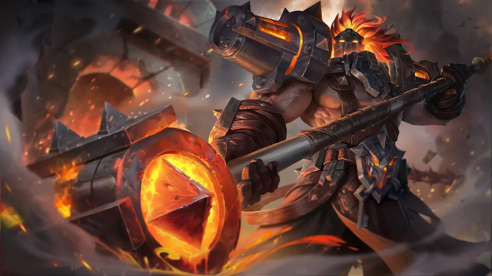

[Tier list](https://boostmlbb.ru/en/heroes/)[Items](https://boostmlbb.ru/en/items/)[Skins](https://boostmlbb.ru/en/skins/)[News & guides](https://boostmlbb.ru/en/news/)

[Skins](https://boostmlbb.ru/en/skins/)/[Terizla](https://boostmlbb.ru/en/skins/terizla.html)/Flare

[Terizla skin](https://boostmlbb.ru/en/skins/terizla.html)

# Flare

CommonEliteIn the shop

How to get

Sold in the skin shop for 599 diamonds.

Price

599 diamonds

Released

18 February 2023

## What the skin changes

-   New look
-   Recoloured effects
-   Showcase animation
-   Attribute bonus

## Painted versions

The same skin in other colours. A painted version needs the skin itself.

-   **Ember Flare**StarLight reward for August 2020.

## All Terizla skins [6](https://boostmlbb.ru/en/skins/terizla.html)

[Soulblight TyrantExquisite · 2025](https://boostmlbb.ru/en/skins/terizla/soulblight-tyrant.html)[Flames of JudgementDeluxe · 2024](https://boostmlbb.ru/en/skins/terizla/flames-of-judgement.html)[RustwreckCommon · 2023](https://boostmlbb.ru/en/skins/terizla/rustwreck.html)[FlareCommon · 2023](https://boostmlbb.ru/en/skins/terizla/flare.html)[Hammer GiantExceptional · 2020](https://boostmlbb.ru/en/skins/terizla/hammer-giant.html)[Abyss GuardCommon · 2019](https://boostmlbb.ru/en/skins/terizla/abyss-guard.html)

## Elite series

[Golden OsmanthusChang'e · 2026](https://boostmlbb.ru/en/skins/change/golden-osmanthus.html)[Warlord KingMartis · 2025](https://boostmlbb.ru/en/skins/martis/warlord-king.html)[High Seas CadetKimmy · 2024](https://boostmlbb.ru/en/skins/kimmy/high-seas-cadet.html)[Verdant LancerSilvanna · 2024](https://boostmlbb.ru/en/skins/silvanna/verdant-lancer.html)[Bloodhoof MarauderHylos · 2024](https://boostmlbb.ru/en/skins/hylos/bloodhoof-marauder.html)[Elegant ButterflyGuinevere · 2024](https://boostmlbb.ru/en/skins/guinevere/elegant-butterfly.html)[Marques of BladesLancelot · 2024](https://boostmlbb.ru/en/skins/lancelot/marques-of-blades.html)[Badlands HiatusChip · 2024](https://boostmlbb.ru/en/skins/chip/badlands-hiatus.html)

**Rank up on Terizla**The calculator shows the price

[Calculate price](https://boostmlbb.ru/en/order.html?type=hero)

## Frequently asked questions

How to get the Flare skin for Terizla?

Sold in the skin shop for 599 diamonds.

When was Flare released?

18 February 2023.

What class is Flare?

Common, Elite series.
