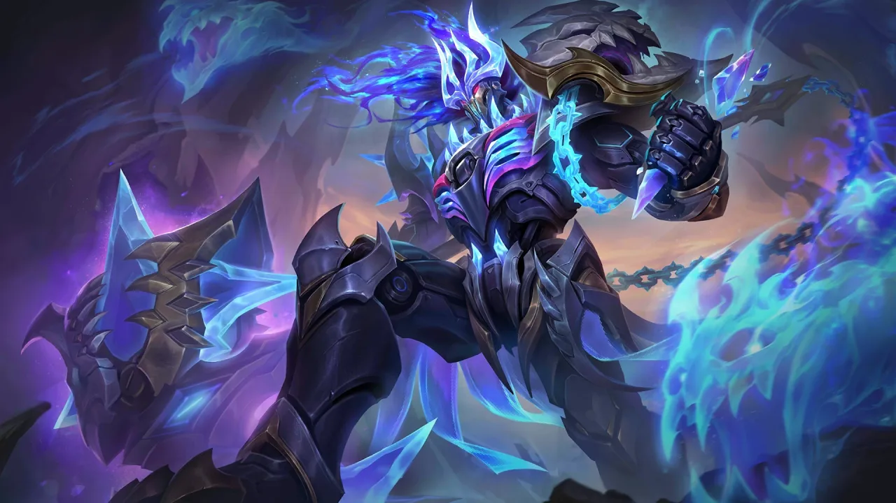
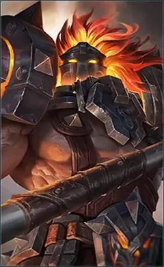

[Tier list](https://boostmlbb.ru/en/heroes/)[Items](https://boostmlbb.ru/en/items/)[Skins](https://boostmlbb.ru/en/skins/)[News & guides](https://boostmlbb.ru/en/news/)

[Skins](https://boostmlbb.ru/en/skins/)/[Terizla](https://boostmlbb.ru/en/skins/terizla.html)/Soulblight Tyrant

[Terizla skin](https://boostmlbb.ru/en/skins/terizla.html)

# Soulblight Tyrant

ExquisiteCollectorLimited

How to get

The top prize of a Collector event draw, paid with diamonds. Limited skins come back in event draws from time to time.

Released

3 February 2025

## What the skin changes

-   New look
-   New skill effects
-   Skill sounds
-   Voice-over
-   Showcase animation
-   Showcase scene
-   Showcase music
-   Special actions
-   Attribute bonus

## All Terizla skins [6](https://boostmlbb.ru/en/skins/terizla.html)

[Soulblight TyrantExquisite · 2025](https://boostmlbb.ru/en/skins/terizla/soulblight-tyrant.html)[Flames of JudgementDeluxe · 2024](https://boostmlbb.ru/en/skins/terizla/flames-of-judgement.html)[RustwreckCommon · 2023](https://boostmlbb.ru/en/skins/terizla/rustwreck.html)[FlareCommon · 2023](https://boostmlbb.ru/en/skins/terizla/flare.html)[Hammer GiantExceptional · 2020](https://boostmlbb.ru/en/skins/terizla/hammer-giant.html)[Abyss GuardCommon · 2019](https://boostmlbb.ru/en/skins/terizla/abyss-guard.html)

## Collector series

[The PurifierBruno · 2026](https://boostmlbb.ru/en/skins/bruno/the-purifier.html)[Celestial RebelSun · 2026](https://boostmlbb.ru/en/skins/sun/celestial-rebel.html)[Kaiju of the DeepHelcurt · 2026](https://boostmlbb.ru/en/skins/helcurt/kaiju-of-the-deep.html)[Starbound SentryKimmy · 2026](https://boostmlbb.ru/en/skins/kimmy/starbound-sentry.html)[Dreaming MonarchAlice · 2026](https://boostmlbb.ru/en/skins/alice/dreaming-monarch.html)[Tremor of the DeepGrock · 2026](https://boostmlbb.ru/en/skins/grock/tremor-of-the-deep.html)[Celestial GeneralTigreal · 2026](https://boostmlbb.ru/en/skins/tigreal/celestial-general.html)[Sunborn MonarchXavier · 2026](https://boostmlbb.ru/en/skins/xavier/sunborn-monarch.html)

**Rank up on Terizla**The calculator shows the price

[Calculate price](https://boostmlbb.ru/en/order.html?type=hero)

## Frequently asked questions

How to get the Soulblight Tyrant skin for Terizla?

The top prize of a Collector event draw, paid with diamonds. Limited skins come back in event draws from time to time.

When was Soulblight Tyrant released?

3 February 2025.

What class is Soulblight Tyrant?

Exquisite, Collector series.
