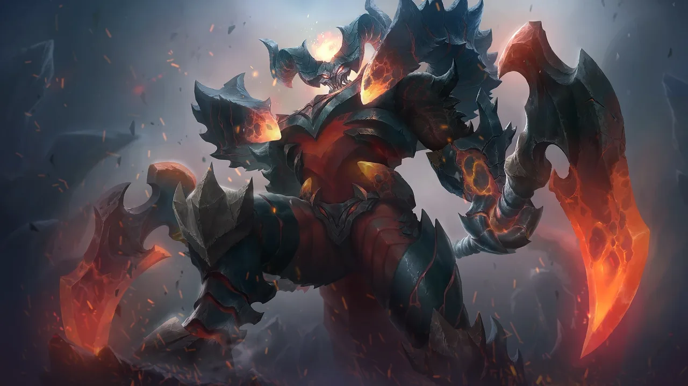

[All skins](https://boostmlbb.ru/en/skins/)

[Skins](https://boostmlbb.ru/en/skins/)/Thamuz

# Thamuz skins

Skins

6

In the shop

2

Latest

[The Annihi­lator](https://boostmlbb.ru/en/skins/thamuz/the-annihilator.html)2025

[Hero profile→](https://boostmlbb.ru/en/heroes/thamuz.html)

## All skins

[The Annihi­latorGrand · 2025](https://boostmlbb.ru/en/skins/thamuz/the-annihilator.html)[Abyssal ReaperExceptional · 2025](https://boostmlbb.ru/en/skins/thamuz/abyssal-reaper.html)[Sanctified FlameExceptional · 2023](https://boostmlbb.ru/en/skins/thamuz/sanctified-flame.html)[General KaiGrand · 2023](https://boostmlbb.ru/en/skins/thamuz/general-kai.html)[Lord of WraithCommon · 2022](https://boostmlbb.ru/en/skins/thamuz/lord-of-wraith.html)[Liquid FireCommon · 2019](https://boostmlbb.ru/en/skins/thamuz/liquid-fire.html)

**How much is a rank boost on Thamuz?**Choose your current and target ranks to see the price here.

[Calculate price](https://boostmlbb.ru/en/order.html?type=hero)

## Frequently asked questions

How many skins does Thamuz have?

6 skins, the default look not counted. The newest is The Annihilator (5 November 2025).

Which Thamuz skins can you buy now?

Lord of Wraith (269 diamonds), Liquid Fire (599 diamonds). The other skins were limited and come back only in events.

What is the rarest Thamuz skin?

The Annihilator, Grand class, Nexus Sea series. Released in the Nexus Sea event. Limited skins come back in event draws from time to time.
