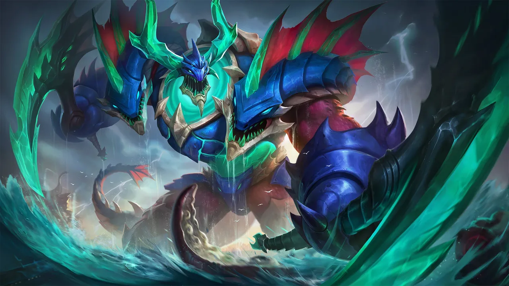

[Tier list](https://boostmlbb.ru/en/heroes/)[Items](https://boostmlbb.ru/en/items/)[Skins](https://boostmlbb.ru/en/skins/)[News & guides](https://boostmlbb.ru/en/news/)

[Skins](https://boostmlbb.ru/en/skins/)/[Thamuz](https://boostmlbb.ru/en/skins/thamuz.html)/Liquid Fire

[Thamuz skin](https://boostmlbb.ru/en/skins/thamuz.html)

# Liquid Fire

CommonEliteIn the shop

How to get

Sold in the skin shop for 599 diamonds.

Price

599 diamonds

Released

7 August 2019

## What the skin changes

-   New look
-   Recoloured effects
-   Showcase animation
-   Attribute bonus

## Painted versions

The same skin in other colours. A painted version needs the skin itself.

-   **Fire Crystal**StarLight reward for August 2021.

## All Thamuz skins [6](https://boostmlbb.ru/en/skins/thamuz.html)

[The Annihi­latorGrand · 2025](https://boostmlbb.ru/en/skins/thamuz/the-annihilator.html)[Abyssal ReaperExceptional · 2025](https://boostmlbb.ru/en/skins/thamuz/abyssal-reaper.html)[Sanctified FlameExceptional · 2023](https://boostmlbb.ru/en/skins/thamuz/sanctified-flame.html)[General KaiGrand · 2023](https://boostmlbb.ru/en/skins/thamuz/general-kai.html)[Lord of WraithCommon · 2022](https://boostmlbb.ru/en/skins/thamuz/lord-of-wraith.html)[Liquid FireCommon · 2019](https://boostmlbb.ru/en/skins/thamuz/liquid-fire.html)

## Elite series

[Golden OsmanthusChang'e · 2026](https://boostmlbb.ru/en/skins/change/golden-osmanthus.html)[Warlord KingMartis · 2025](https://boostmlbb.ru/en/skins/martis/warlord-king.html)[High Seas CadetKimmy · 2024](https://boostmlbb.ru/en/skins/kimmy/high-seas-cadet.html)[Verdant LancerSilvanna · 2024](https://boostmlbb.ru/en/skins/silvanna/verdant-lancer.html)[Bloodhoof MarauderHylos · 2024](https://boostmlbb.ru/en/skins/hylos/bloodhoof-marauder.html)[Elegant ButterflyGuinevere · 2024](https://boostmlbb.ru/en/skins/guinevere/elegant-butterfly.html)[Marques of BladesLancelot · 2024](https://boostmlbb.ru/en/skins/lancelot/marques-of-blades.html)[Badlands HiatusChip · 2024](https://boostmlbb.ru/en/skins/chip/badlands-hiatus.html)

**Rank up on Thamuz**The calculator shows the price

[Calculate price](https://boostmlbb.ru/en/order.html?type=hero)

## Frequently asked questions

How to get the Liquid Fire skin for Thamuz?

Sold in the skin shop for 599 diamonds.

When was Liquid Fire released?

7 August 2019.

What class is Liquid Fire?

Common, Elite series.
