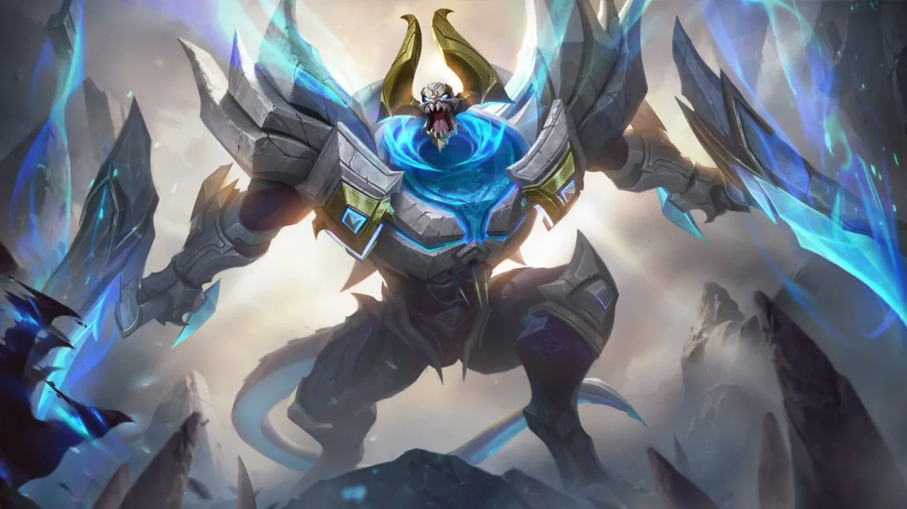
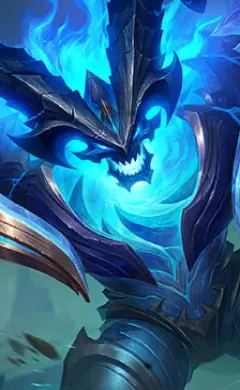

[Thamuz skins](https://boostmlbb.ru/en/skins/thamuz.html)

[Skins](https://boostmlbb.ru/en/skins/)/[Thamuz](https://boostmlbb.ru/en/skins/thamuz.html)/Sanctified Flame

[Thamuz skin](https://boostmlbb.ru/en/skins/thamuz.html)

# Sanctified Flame

ExceptionalStarLightLimited

How to get

StarLight reward for June 2023.

Released

1 June 2023

## What the skin changes

-   New look
-   New skill effects
-   Showcase animation
-   Showcase scene
-   Attribute bonus

## All Thamuz skins [6](https://boostmlbb.ru/en/skins/thamuz.html)

[The Annihi­latorGrand · 2025](https://boostmlbb.ru/en/skins/thamuz/the-annihilator.html)[Abyssal ReaperExceptional · 2025](https://boostmlbb.ru/en/skins/thamuz/abyssal-reaper.html)[Sanctified FlameExceptional · 2023](https://boostmlbb.ru/en/skins/thamuz/sanctified-flame.html)[General KaiGrand · 2023](https://boostmlbb.ru/en/skins/thamuz/general-kai.html)[Lord of WraithCommon · 2022](https://boostmlbb.ru/en/skins/thamuz/lord-of-wraith.html)[Liquid FireCommon · 2019](https://boostmlbb.ru/en/skins/thamuz/liquid-fire.html)

## StarLight series

[Tideborn SailorKalea · 2026](https://boostmlbb.ru/en/skins/kalea/tideborn-sailor.html)[Kitsune's ShadowHayabusa · 2026](https://boostmlbb.ru/en/skins/hayabusa/kitsune-s-shadow.html)[Fangs of SlaughterHanzo · 2026](https://boostmlbb.ru/en/skins/hanzo/fangs-of-slaughter.html)[Smoul­dering FortressBelerick · 2026](https://boostmlbb.ru/en/skins/belerick/smouldering-fortress.html)[Magitech WraithObsidia · 2026](https://boostmlbb.ru/en/skins/obsidia/magitech-wraith.html)[Elysian LuminanceZetian · 2026](https://boostmlbb.ru/en/skins/zetian/elysian-luminance.html)[Guardian BattalionHilda · 2026](https://boostmlbb.ru/en/skins/hilda/guardian-battalion.html)[Dreaming KoiHarley · 2026](https://boostmlbb.ru/en/skins/harley/dreaming-koi.html)

**How much is a rank boost on Thamuz?**Choose your current and target ranks to see the price here.

[Calculate price](https://boostmlbb.ru/en/order.html?type=hero)

## Frequently asked questions

How to get the Sanctified Flame skin for Thamuz?

StarLight reward for June 2023.

When was Sanctified Flame released?

1 June 2023.

What class is Sanctified Flame?

Exceptional, StarLight series.
