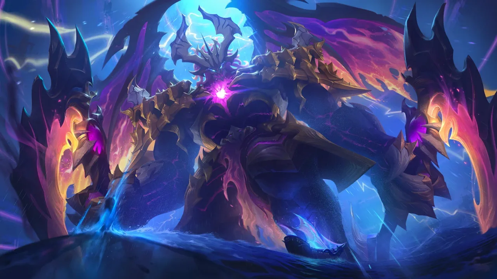

[Thamuz skins](https://boostmlbb.ru/en/skins/thamuz.html)

[Skins](https://boostmlbb.ru/en/skins/)/[Thamuz](https://boostmlbb.ru/en/skins/thamuz.html)/The Annihilator

[Thamuz skin](https://boostmlbb.ru/en/skins/thamuz.html)

# The Annihilator

GrandNexus SeaLimited

How to get

Released in the Nexus Sea event. Limited skins come back in event draws from time to time.

Released

5 November 2025

## What the skin changes

-   New look
-   New skill effects
-   Skill sounds
-   Voice-over
-   Skill icons
-   Showcase animation
-   Showcase scene
-   Showcase music
-   Spawn animation
-   Special actions
-   Special interactions
-   Stunning effects
-   Attribute bonus

## All Thamuz skins [6](https://boostmlbb.ru/en/skins/thamuz.html)

[The Annihi­latorGrand · 2025](https://boostmlbb.ru/en/skins/thamuz/the-annihilator.html)[Abyssal ReaperExceptional · 2025](https://boostmlbb.ru/en/skins/thamuz/abyssal-reaper.html)[Sanctified FlameExceptional · 2023](https://boostmlbb.ru/en/skins/thamuz/sanctified-flame.html)[General KaiGrand · 2023](https://boostmlbb.ru/en/skins/thamuz/general-kai.html)[Lord of WraithCommon · 2022](https://boostmlbb.ru/en/skins/thamuz/lord-of-wraith.html)[Liquid FireCommon · 2019](https://boostmlbb.ru/en/skins/thamuz/liquid-fire.html)

**How much is a rank boost on Thamuz?**Choose your current and target ranks to see the price here.

[Calculate price](https://boostmlbb.ru/en/order.html?type=hero)

## Frequently asked questions

How to get the The Annihilator skin for Thamuz?

Released in the Nexus Sea event. Limited skins come back in event draws from time to time.

When was The Annihilator released?

5 November 2025.

What class is The Annihilator?

Grand, Nexus Sea series.
