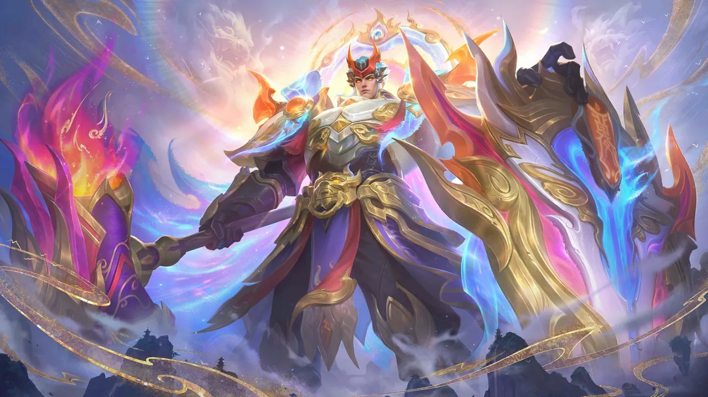

[Tier list](https://boostmlbb.ru/en/heroes/)[Items](https://boostmlbb.ru/en/items/)[Skins](https://boostmlbb.ru/en/skins/)[News & guides](https://boostmlbb.ru/en/news/)

[Skins](https://boostmlbb.ru/en/skins/)/[Tigreal](https://boostmlbb.ru/en/skins/tigreal.html)/Celestial General

[Tigreal skin](https://boostmlbb.ru/en/skins/tigreal.html)

# Celestial General

Collector

How to get

The top prize of a Collector event draw, paid with diamonds. Limited skins come back in event draws from time to time.

Released

March 2026

## All Tigreal skins [9](https://boostmlbb.ru/en/skins/tigreal.html)

[Celestial General2026](https://boostmlbb.ru/en/skins/tigreal/celestial-general.html)[Steel GuardianCommon · 2025](https://boostmlbb.ru/en/skins/tigreal/steel-guardian.html)[Pasha of JusticeExceptional · 2024](https://boostmlbb.ru/en/skins/tigreal/pasha-of-justice.html)[Galactic MarshalExceptional · 2022](https://boostmlbb.ru/en/skins/tigreal/galactic-marshal.html)[Gold BaronExceptional · 2021](https://boostmlbb.ru/en/skins/tigreal/gold-baron.html)[Lightborn - DefenderDeluxe · 2019](https://boostmlbb.ru/en/skins/tigreal/lightborn-defender.html)[WyrmslayerCommon · 2018](https://boostmlbb.ru/en/skins/tigreal/wyrmslayer.html)[Fallen GuardCommon · 2017](https://boostmlbb.ru/en/skins/tigreal/fallen-guard.html)[Dark GuardianCommon · 2016](https://boostmlbb.ru/en/skins/tigreal/dark-guardian.html)

## Collector series

[The PurifierBruno · 2026](https://boostmlbb.ru/en/skins/bruno/the-purifier.html)[Celestial RebelSun · 2026](https://boostmlbb.ru/en/skins/sun/celestial-rebel.html)[Kaiju of the DeepHelcurt · 2026](https://boostmlbb.ru/en/skins/helcurt/kaiju-of-the-deep.html)[Starbound SentryKimmy · 2026](https://boostmlbb.ru/en/skins/kimmy/starbound-sentry.html)[Dreaming MonarchAlice · 2026](https://boostmlbb.ru/en/skins/alice/dreaming-monarch.html)[Tremor of the DeepGrock · 2026](https://boostmlbb.ru/en/skins/grock/tremor-of-the-deep.html)[Sunborn MonarchXavier · 2026](https://boostmlbb.ru/en/skins/xavier/sunborn-monarch.html)[Soul ReaverAamon · 2025](https://boostmlbb.ru/en/skins/aamon/soul-reaver.html)

**Rank up on Tigreal**The calculator shows the price

[Calculate price](https://boostmlbb.ru/en/order.html?type=hero)

## Frequently asked questions

How to get the Celestial General skin for Tigreal?

The top prize of a Collector event draw, paid with diamonds. Limited skins come back in event draws from time to time.

When was Celestial General released?

March 2026.
