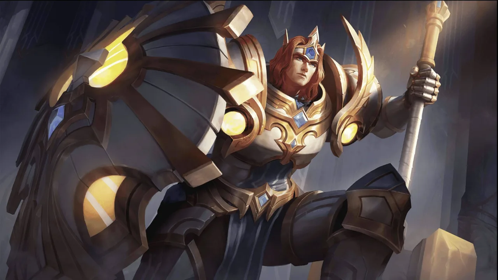

[Tier list](https://boostmlbb.ru/en/heroes/)[Items](https://boostmlbb.ru/en/items/)[Skins](https://boostmlbb.ru/en/skins/)[News & guides](https://boostmlbb.ru/en/news/)

[Skins](https://boostmlbb.ru/en/skins/)/[Tigreal](https://boostmlbb.ru/en/skins/tigreal.html)/Lightborn - Defender

[Tigreal skin](https://boostmlbb.ru/en/skins/tigreal.html)

# Lightborn - Defender

DeluxeLightbornIn the shop

How to get

Sold in the skin shop for 1,089 diamonds.

Price

1,089 diamonds

Released

2019

## What the skin changes

-   New look
-   New skill effects
-   Showcase animation
-   Showcase scene
-   Attribute bonus

## All Tigreal skins [9](https://boostmlbb.ru/en/skins/tigreal.html)

[Celestial General2026](https://boostmlbb.ru/en/skins/tigreal/celestial-general.html)[Steel GuardianCommon · 2025](https://boostmlbb.ru/en/skins/tigreal/steel-guardian.html)[Pasha of JusticeExceptional · 2024](https://boostmlbb.ru/en/skins/tigreal/pasha-of-justice.html)[Galactic MarshalExceptional · 2022](https://boostmlbb.ru/en/skins/tigreal/galactic-marshal.html)[Gold BaronExceptional · 2021](https://boostmlbb.ru/en/skins/tigreal/gold-baron.html)[Lightborn - DefenderDeluxe · 2019](https://boostmlbb.ru/en/skins/tigreal/lightborn-defender.html)[WyrmslayerCommon · 2018](https://boostmlbb.ru/en/skins/tigreal/wyrmslayer.html)[Fallen GuardCommon · 2017](https://boostmlbb.ru/en/skins/tigreal/fallen-guard.html)[Dark GuardianCommon · 2016](https://boostmlbb.ru/en/skins/tigreal/dark-guardian.html)

## Lightborn series

[Lightborn - OverriderGranger · 2024](https://boostmlbb.ru/en/skins/granger/lightborn-overrider.html)[Lightborn - RangerFanny · 2019](https://boostmlbb.ru/en/skins/fanny/lightborn-ranger.html)[Lightborn - StrikerAlucard · 2019](https://boostmlbb.ru/en/skins/alucard/lightborn-striker.html)[Lightborn - InspirerHarith · 2018](https://boostmlbb.ru/en/skins/harith/lightborn-inspirer.html)

**Rank up on Tigreal**The calculator shows the price

[Calculate price](https://boostmlbb.ru/en/order.html?type=hero)

## Frequently asked questions

How to get the Lightborn - Defender skin for Tigreal?

Sold in the skin shop for 1,089 diamonds.

When was Lightborn - Defender released?

2019.

What class is Lightborn - Defender?

Deluxe, Lightborn series.
