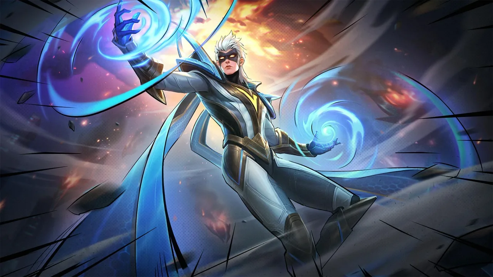

[Vale skins](https://boostmlbb.ru/en/skins/vale.html)

[Skins](https://boostmlbb.ru/en/skins/)/[Vale](https://boostmlbb.ru/en/skins/vale.html)/Blizzard Storm

[Vale skin](https://boostmlbb.ru/en/skins/vale.html)

# Blizzard Storm

GrandDawning StarsLimited

How to get

Released in the Dawning Stars event. Limited skins come back in event draws from time to time.

Released

18 February 2023

## What the skin changes

-   New look
-   New skill effects
-   Skill sounds
-   Voice-over
-   Showcase animation
-   Showcase scene
-   Attribute bonus

## All Vale skins [9](https://boostmlbb.ru/en/skins/vale.html)

[Windborne WaltzExceptional · 2026](https://boostmlbb.ru/en/skins/vale/windborne-waltz.html)[GaaraDeluxe · 2025](https://boostmlbb.ru/en/skins/vale/gaara.html)[Keeper of the WindsDeluxe · 2025](https://boostmlbb.ru/en/skins/vale/keeper-of-the-winds.html)[Concerto of LightExquisite · 2024](https://boostmlbb.ru/en/skins/vale/concerto-of-light.html)[KannagiCommon · 2023](https://boostmlbb.ru/en/skins/vale/kannagi.html)[Blizzard StormGrand · 2023](https://boostmlbb.ru/en/skins/vale/blizzard-storm.html)[Supernal TempestExquisite · 2022](https://boostmlbb.ru/en/skins/vale/supernal-tempest.html)[Soaring DevataExceptional · 2021](https://boostmlbb.ru/en/skins/vale/soaring-devata.html)[Cerulean WindsCommon · 2019](https://boostmlbb.ru/en/skins/vale/cerulean-winds.html)

## Dawning Stars series

[SwordmasterLancelot · 2024](https://boostmlbb.ru/en/skins/lancelot/swordmaster.html)[The ForeseerEsmeralda · 2023](https://boostmlbb.ru/en/skins/esmeralda/the-foreseer.html)[Thun­derfistChou · 2021](https://boostmlbb.ru/en/skins/chou/thunderfist.html)[FireboltBruno · 2020](https://boostmlbb.ru/en/skins/bruno/firebolt.html)

**How much is a rank boost on Vale?**Choose your current and target ranks to see the price here.

[Calculate price](https://boostmlbb.ru/en/order.html?type=hero)

## Frequently asked questions

How to get the Blizzard Storm skin for Vale?

Released in the Dawning Stars event. Limited skins come back in event draws from time to time.

When was Blizzard Storm released?

18 February 2023.

What class is Blizzard Storm?

Grand, Dawning Stars series.
