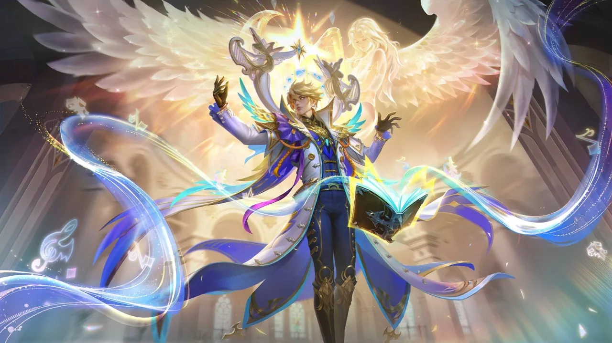

[Vale skins](https://boostmlbb.ru/en/skins/vale.html)

[Skins](https://boostmlbb.ru/en/skins/)/[Vale](https://boostmlbb.ru/en/skins/vale.html)/Concerto of Light

[Vale skin](https://boostmlbb.ru/en/skins/vale.html)

# Concerto of Light

ExquisiteAnnual StarLightLimited

How to get

StarLight Fest 2024 event.

Released

3 April 2024

## What the skin changes

-   New look
-   New skill effects
-   Skill sounds
-   Voice-over
-   Showcase animation
-   Showcase scene
-   Showcase music
-   Special actions
-   Attribute bonus

## All Vale skins [9](https://boostmlbb.ru/en/skins/vale.html)

[Windborne WaltzExceptional · 2026](https://boostmlbb.ru/en/skins/vale/windborne-waltz.html)[GaaraDeluxe · 2025](https://boostmlbb.ru/en/skins/vale/gaara.html)[Keeper of the WindsDeluxe · 2025](https://boostmlbb.ru/en/skins/vale/keeper-of-the-winds.html)[Concerto of LightExquisite · 2024](https://boostmlbb.ru/en/skins/vale/concerto-of-light.html)[KannagiCommon · 2023](https://boostmlbb.ru/en/skins/vale/kannagi.html)[Blizzard StormGrand · 2023](https://boostmlbb.ru/en/skins/vale/blizzard-storm.html)[Supernal TempestExquisite · 2022](https://boostmlbb.ru/en/skins/vale/supernal-tempest.html)[Soaring DevataExceptional · 2021](https://boostmlbb.ru/en/skins/vale/soaring-devata.html)[Cerulean WindsCommon · 2019](https://boostmlbb.ru/en/skins/vale/cerulean-winds.html)

## Annual StarLight series

[Avatar of TimeAngela · 2023](https://boostmlbb.ru/en/skins/angela/avatar-of-time.html)[Hawk-eyed SniperLesley · 2021](https://boostmlbb.ru/en/skins/lesley/hawk-eyed-sniper.html)[Water LilyKagura · 2021](https://boostmlbb.ru/en/skins/kagura/water-lily.html)[Neon LightwheelKarrie · 2020](https://boostmlbb.ru/en/skins/karrie/neon-lightwheel.html)[No.1 ControllerGord · 2019](https://boostmlbb.ru/en/skins/gord/no-1-controller.html)[Experiment 21Hayabusa · 2018](https://boostmlbb.ru/en/skins/hayabusa/experiment-21.html)

**How much is a rank boost on Vale?**Choose your current and target ranks to see the price here.

[Calculate price](https://boostmlbb.ru/en/order.html?type=hero)

## Frequently asked questions

How to get the Concerto of Light skin for Vale?

StarLight Fest 2024 event.

When was Concerto of Light released?

3 April 2024.

What class is Concerto of Light?

Exquisite, Annual StarLight series.
