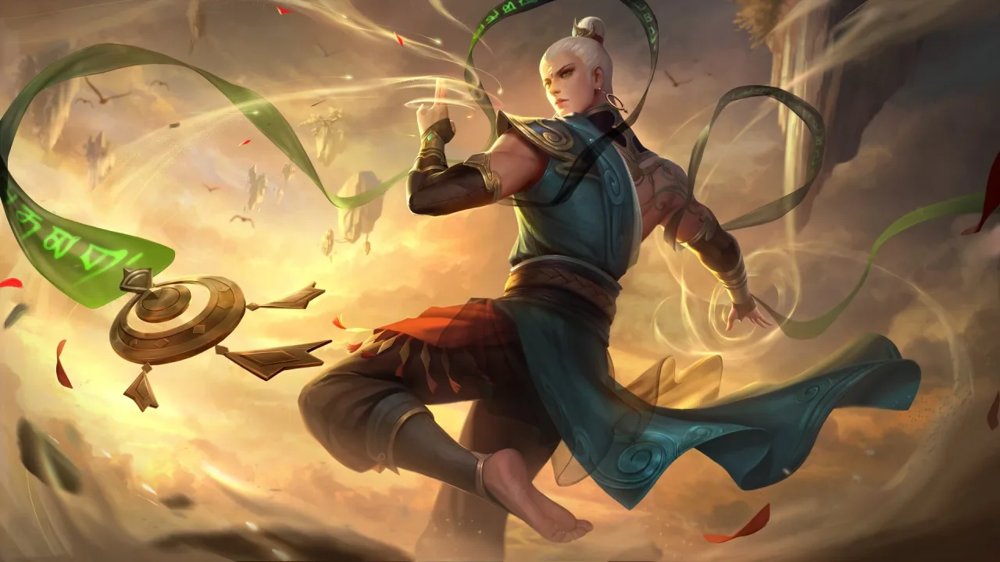

[Tier list](https://boostmlbb.ru/en/heroes/)[Items](https://boostmlbb.ru/en/items/)[Skins](https://boostmlbb.ru/en/skins/)[News & guides](https://boostmlbb.ru/en/news/)

[Skins](https://boostmlbb.ru/en/skins/)/[Vale](https://boostmlbb.ru/en/skins/vale.html)/Soaring Devata

[Vale skin](https://boostmlbb.ru/en/skins/vale.html)

# Soaring Devata

ExceptionalStarLightLimited

How to get

StarLight reward for November 2021.

Released

1 November 2021

## What the skin changes

-   New look
-   New skill effects
-   Showcase animation
-   Showcase scene
-   Attribute bonus

## All Vale skins [9](https://boostmlbb.ru/en/skins/vale.html)

[Windborne WaltzExceptional · 2026](https://boostmlbb.ru/en/skins/vale/windborne-waltz.html)[GaaraDeluxe · 2025](https://boostmlbb.ru/en/skins/vale/gaara.html)[Keeper of the WindsDeluxe · 2025](https://boostmlbb.ru/en/skins/vale/keeper-of-the-winds.html)[Concerto of LightExquisite · 2024](https://boostmlbb.ru/en/skins/vale/concerto-of-light.html)[KannagiCommon · 2023](https://boostmlbb.ru/en/skins/vale/kannagi.html)[Blizzard StormGrand · 2023](https://boostmlbb.ru/en/skins/vale/blizzard-storm.html)[Supernal TempestExquisite · 2022](https://boostmlbb.ru/en/skins/vale/supernal-tempest.html)[Soaring DevataExceptional · 2021](https://boostmlbb.ru/en/skins/vale/soaring-devata.html)[Cerulean WindsCommon · 2019](https://boostmlbb.ru/en/skins/vale/cerulean-winds.html)

## StarLight series

[Tideborn SailorKalea · 2026](https://boostmlbb.ru/en/skins/kalea/tideborn-sailor.html)[Kitsune's ShadowHayabusa · 2026](https://boostmlbb.ru/en/skins/hayabusa/kitsune-s-shadow.html)[Fangs of SlaughterHanzo · 2026](https://boostmlbb.ru/en/skins/hanzo/fangs-of-slaughter.html)[Smoul­dering FortressBelerick · 2026](https://boostmlbb.ru/en/skins/belerick/smouldering-fortress.html)[Magitech WraithObsidia · 2026](https://boostmlbb.ru/en/skins/obsidia/magitech-wraith.html)[Elysian LuminanceZetian · 2026](https://boostmlbb.ru/en/skins/zetian/elysian-luminance.html)[Guardian BattalionHilda · 2026](https://boostmlbb.ru/en/skins/hilda/guardian-battalion.html)[Dreaming KoiHarley · 2026](https://boostmlbb.ru/en/skins/harley/dreaming-koi.html)

**Rank up on Vale**The calculator shows the price

[Calculate price](https://boostmlbb.ru/en/order.html?type=hero)

## Frequently asked questions

How to get the Soaring Devata skin for Vale?

StarLight reward for November 2021.

When was Soaring Devata released?

1 November 2021.

What class is Soaring Devata?

Exceptional, StarLight series.
