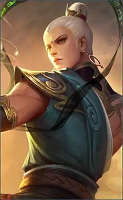

[Vale skins](https://boostmlbb.ru/en/skins/vale.html)

[Skins](https://boostmlbb.ru/en/skins/)/[Vale](https://boostmlbb.ru/en/skins/vale.html)/Supernal Tempest

[Vale skin](https://boostmlbb.ru/en/skins/vale.html)

# Supernal Tempest

ExquisiteCollectorLimited

How to get

The top prize of a Collector event draw, paid with diamonds. Limited skins come back in event draws from time to time.

Released

7 May 2022

## What the skin changes

-   New look
-   New skill effects
-   Skill sounds
-   Voice-over
-   Showcase animation
-   Showcase scene
-   Attribute bonus

## All Vale skins [9](https://boostmlbb.ru/en/skins/vale.html)

[Windborne WaltzExceptional · 2026](https://boostmlbb.ru/en/skins/vale/windborne-waltz.html)[GaaraDeluxe · 2025](https://boostmlbb.ru/en/skins/vale/gaara.html)[Keeper of the WindsDeluxe · 2025](https://boostmlbb.ru/en/skins/vale/keeper-of-the-winds.html)[Concerto of LightExquisite · 2024](https://boostmlbb.ru/en/skins/vale/concerto-of-light.html)[KannagiCommon · 2023](https://boostmlbb.ru/en/skins/vale/kannagi.html)[Blizzard StormGrand · 2023](https://boostmlbb.ru/en/skins/vale/blizzard-storm.html)[Supernal TempestExquisite · 2022](https://boostmlbb.ru/en/skins/vale/supernal-tempest.html)[Soaring DevataExceptional · 2021](https://boostmlbb.ru/en/skins/vale/soaring-devata.html)[Cerulean WindsCommon · 2019](https://boostmlbb.ru/en/skins/vale/cerulean-winds.html)

## Collector series

[The PurifierBruno · 2026](https://boostmlbb.ru/en/skins/bruno/the-purifier.html)[Celestial RebelSun · 2026](https://boostmlbb.ru/en/skins/sun/celestial-rebel.html)[Kaiju of the DeepHelcurt · 2026](https://boostmlbb.ru/en/skins/helcurt/kaiju-of-the-deep.html)[Starbound SentryKimmy · 2026](https://boostmlbb.ru/en/skins/kimmy/starbound-sentry.html)[Dreaming MonarchAlice · 2026](https://boostmlbb.ru/en/skins/alice/dreaming-monarch.html)[Tremor of the DeepGrock · 2026](https://boostmlbb.ru/en/skins/grock/tremor-of-the-deep.html)[Celestial GeneralTigreal · 2026](https://boostmlbb.ru/en/skins/tigreal/celestial-general.html)[Sunborn MonarchXavier · 2026](https://boostmlbb.ru/en/skins/xavier/sunborn-monarch.html)

**How much is a rank boost on Vale?**Choose your current and target ranks to see the price here.

[Calculate price](https://boostmlbb.ru/en/order.html?type=hero)

## Frequently asked questions

How to get the Supernal Tempest skin for Vale?

The top prize of a Collector event draw, paid with diamonds. Limited skins come back in event draws from time to time.

When was Supernal Tempest released?

7 May 2022.

What class is Supernal Tempest?

Exquisite, Collector series.
