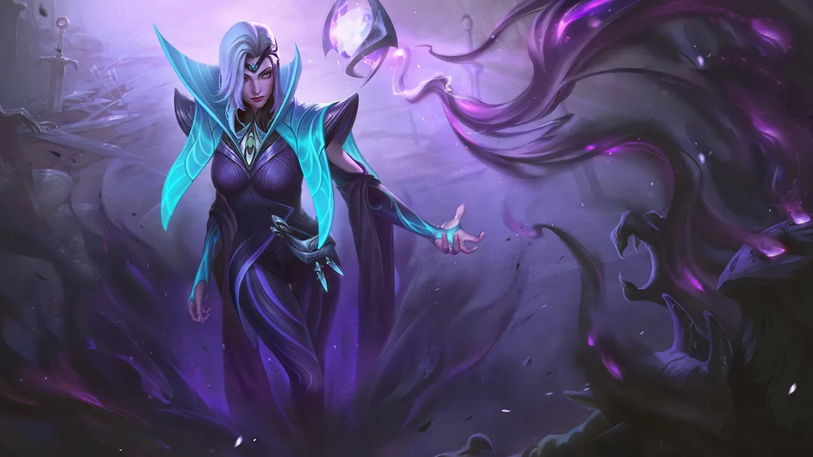

[All skins](https://boostmlbb.ru/en/skins/)

[Skins](https://boostmlbb.ru/en/skins/)/Valentina

# Valentina skins

Skins

6

In the shop

2

Latest

[Grand Gala](https://boostmlbb.ru/en/skins/valentina/grand-gala.html)2025

[Hero profile→](https://boostmlbb.ru/en/heroes/valentina.html)

## All skins

[Grand GalaCommon · 2025](https://boostmlbb.ru/en/skins/valentina/grand-gala.html)[Dark NexusDeluxe · 2024](https://boostmlbb.ru/en/skins/valentina/dark-nexus.html)[Celestial JudicatorExquisite · 2023](https://boostmlbb.ru/en/skins/valentina/celestial-judicator.html)[Cyber AgentExceptional · 2023](https://boostmlbb.ru/en/skins/valentina/cyber-agent.html)[Archma­gisterCommon · 2022](https://boostmlbb.ru/en/skins/valentina/archmagister.html)[Twilight CharmerCommon · 2021](https://boostmlbb.ru/en/skins/valentina/twilight-charmer.html)

**How much is a rank boost on Valentina?**Choose your current and target ranks to see the price here.

[Calculate price](https://boostmlbb.ru/en/order.html?type=hero)

## Frequently asked questions

How many skins does Valentina have?

6 skins, the default look not counted. The newest is Grand Gala (17 September 2025).

Which Valentina skins can you buy now?

Archmagister (599 diamonds), Twilight Charmer (269 diamonds). The other skins were limited and come back only in events.

What is the rarest Valentina skin?

Celestial Judicator, Exquisite class, Collector series. The top prize of a Collector event draw, paid with diamonds. Limited skins come back in event draws from time to time.
