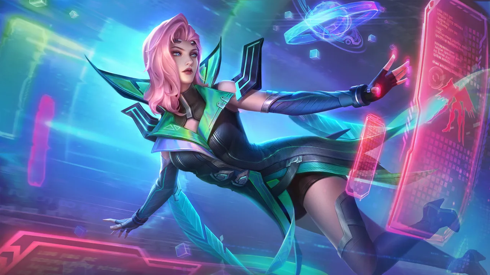

[Valentina skins](https://boostmlbb.ru/en/skins/valentina.html)

[Skins](https://boostmlbb.ru/en/skins/)/[Valentina](https://boostmlbb.ru/en/skins/valentina.html)/Cyber Agent

[Valentina skin](https://boostmlbb.ru/en/skins/valentina.html)

# Cyber Agent

ExceptionalStarLightLimited

How to get

StarLight reward for March 2023.

Released

1 March 2023

## What the skin changes

-   New look
-   New skill effects
-   Showcase animation
-   Showcase scene
-   Attribute bonus

## All Valentina skins [6](https://boostmlbb.ru/en/skins/valentina.html)

[Grand GalaCommon · 2025](https://boostmlbb.ru/en/skins/valentina/grand-gala.html)[Dark NexusDeluxe · 2024](https://boostmlbb.ru/en/skins/valentina/dark-nexus.html)[Celestial JudicatorExquisite · 2023](https://boostmlbb.ru/en/skins/valentina/celestial-judicator.html)[Cyber AgentExceptional · 2023](https://boostmlbb.ru/en/skins/valentina/cyber-agent.html)[Archma­gisterCommon · 2022](https://boostmlbb.ru/en/skins/valentina/archmagister.html)[Twilight CharmerCommon · 2021](https://boostmlbb.ru/en/skins/valentina/twilight-charmer.html)

## StarLight series

[Tideborn SailorKalea · 2026](https://boostmlbb.ru/en/skins/kalea/tideborn-sailor.html)[Kitsune's ShadowHayabusa · 2026](https://boostmlbb.ru/en/skins/hayabusa/kitsune-s-shadow.html)[Fangs of SlaughterHanzo · 2026](https://boostmlbb.ru/en/skins/hanzo/fangs-of-slaughter.html)[Smoul­dering FortressBelerick · 2026](https://boostmlbb.ru/en/skins/belerick/smouldering-fortress.html)[Magitech WraithObsidia · 2026](https://boostmlbb.ru/en/skins/obsidia/magitech-wraith.html)[Elysian LuminanceZetian · 2026](https://boostmlbb.ru/en/skins/zetian/elysian-luminance.html)[Guardian BattalionHilda · 2026](https://boostmlbb.ru/en/skins/hilda/guardian-battalion.html)[Dreaming KoiHarley · 2026](https://boostmlbb.ru/en/skins/harley/dreaming-koi.html)

**How much is a rank boost on Valentina?**Choose your current and target ranks to see the price here.

[Calculate price](https://boostmlbb.ru/en/order.html?type=hero)

## Frequently asked questions

How to get the Cyber Agent skin for Valentina?

StarLight reward for March 2023.

When was Cyber Agent released?

1 March 2023.

What class is Cyber Agent?

Exceptional, StarLight series.
