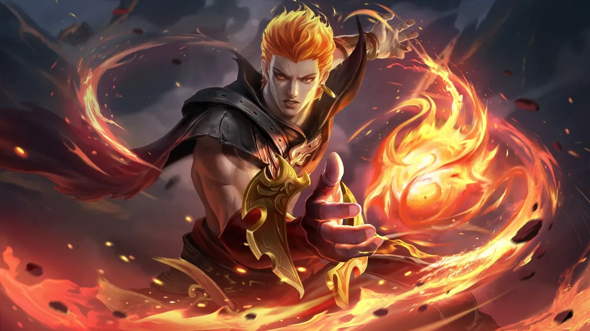

[Tier list](https://boostmlbb.ru/en/heroes/)[Items](https://boostmlbb.ru/en/items/)[Skins](https://boostmlbb.ru/en/skins/)[News & guides](https://boostmlbb.ru/en/news/)

[Skins](https://boostmlbb.ru/en/skins/)/Valir

# Valir skins

Skins

10

In the shop

4

Latest

[Kyo Kusanagi](https://boostmlbb.ru/en/skins/valir/kyo-kusanagi.html)2024

[Hero profile→](https://boostmlbb.ru/en/heroes/valir.html)

## All skins

AllSupremeGrandExquisiteDeluxeExceptionalCommon

[Kyo KusanagiGrand · 2024](https://boostmlbb.ru/en/skins/valir/kyo-kusanagi.html)[Phoenix IkkiDeluxe · 2022](https://boostmlbb.ru/en/skins/valir/phoenix-ikki.html)[Leo IkkiGrand · 2022](https://boostmlbb.ru/en/skins/valir/leo-ikki.html)[Shikigami SumonnerExceptional · 2022](https://boostmlbb.ru/en/skins/valir/shikigami-sumonner.html)[Infernal BlazeSupreme · 2022](https://boostmlbb.ru/en/skins/valir/infernal-blaze.html)[DemonlordExquisite · 2021](https://boostmlbb.ru/en/skins/valir/demonlord.html)[DictatorExceptional · 2020](https://boostmlbb.ru/en/skins/valir/dictator.html)[Draconic FlameDeluxe · 2019](https://boostmlbb.ru/en/skins/valir/draconic-flame.html)[Arcane SeekerCommon · 2018](https://boostmlbb.ru/en/skins/valir/arcane-seeker.html)[Pale FlameCommon · 2018](https://boostmlbb.ru/en/skins/valir/pale-flame.html)

**Rank up on Valir**The calculator shows the price

[Calculate price](https://boostmlbb.ru/en/order.html?type=hero)

## Frequently asked questions

How many skins does Valir have?

10 skins, the default look not counted. The newest is Kyo Kusanagi (24 April 2024).

Which Valir skins can you buy now?

Shikigami Sumonner (749 diamonds), Draconic Flame (899 diamonds), Pale Flame (269 diamonds). The other skins were limited and come back only in events.

What is the rarest Valir skin?

Infernal Blaze, Supreme class, Legend series. Exchanged for 200 Magic Crystals from the Magic Wheel.
