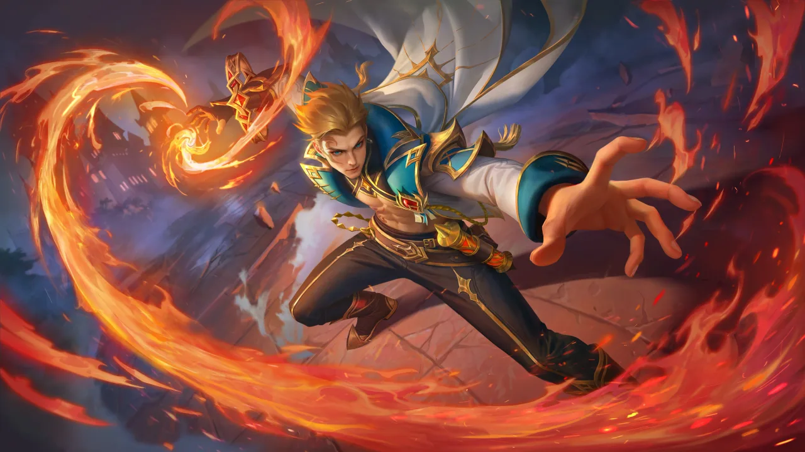

[Valir skins](https://boostmlbb.ru/en/skins/valir.html)

[Skins](https://boostmlbb.ru/en/skins/)/[Valir](https://boostmlbb.ru/en/skins/valir.html)/Arcane Seeker

[Valir skin](https://boostmlbb.ru/en/skins/valir.html)

# Arcane Seeker

CommonEliteLimited

How to get

Released in the skin shop during an event. Limited skins come back in event draws from time to time.

Released

August 2018

## What the skin changes

-   New look
-   Recoloured effects
-   Showcase animation
-   Attribute bonus

## All Valir skins [10](https://boostmlbb.ru/en/skins/valir.html)

[Kyo KusanagiGrand · 2024](https://boostmlbb.ru/en/skins/valir/kyo-kusanagi.html)[Phoenix IkkiDeluxe · 2022](https://boostmlbb.ru/en/skins/valir/phoenix-ikki.html)[Leo IkkiGrand · 2022](https://boostmlbb.ru/en/skins/valir/leo-ikki.html)[Shikigami SumonnerExceptional · 2022](https://boostmlbb.ru/en/skins/valir/shikigami-sumonner.html)[Infernal BlazeSupreme · 2022](https://boostmlbb.ru/en/skins/valir/infernal-blaze.html)[DemonlordExquisite · 2021](https://boostmlbb.ru/en/skins/valir/demonlord.html)[DictatorExceptional · 2020](https://boostmlbb.ru/en/skins/valir/dictator.html)[Draconic FlameDeluxe · 2019](https://boostmlbb.ru/en/skins/valir/draconic-flame.html)[Arcane SeekerCommon · 2018](https://boostmlbb.ru/en/skins/valir/arcane-seeker.html)[Pale FlameCommon · 2018](https://boostmlbb.ru/en/skins/valir/pale-flame.html)

## Elite series

[Golden OsmanthusChang'e · 2026](https://boostmlbb.ru/en/skins/change/golden-osmanthus.html)[Warlord KingMartis · 2025](https://boostmlbb.ru/en/skins/martis/warlord-king.html)[High Seas CadetKimmy · 2024](https://boostmlbb.ru/en/skins/kimmy/high-seas-cadet.html)[Verdant LancerSilvanna · 2024](https://boostmlbb.ru/en/skins/silvanna/verdant-lancer.html)[Bloodhoof MarauderHylos · 2024](https://boostmlbb.ru/en/skins/hylos/bloodhoof-marauder.html)[Elegant ButterflyGuinevere · 2024](https://boostmlbb.ru/en/skins/guinevere/elegant-butterfly.html)[Marques of BladesLancelot · 2024](https://boostmlbb.ru/en/skins/lancelot/marques-of-blades.html)[Badlands HiatusChip · 2024](https://boostmlbb.ru/en/skins/chip/badlands-hiatus.html)

**How much is a rank boost on Valir?**Choose your current and target ranks to see the price here.

[Calculate price](https://boostmlbb.ru/en/order.html?type=hero)

## Frequently asked questions

How to get the Arcane Seeker skin for Valir?

Released in the skin shop during an event. Limited skins come back in event draws from time to time.

When was Arcane Seeker released?

August 2018.

What class is Arcane Seeker?

Common, Elite series.
