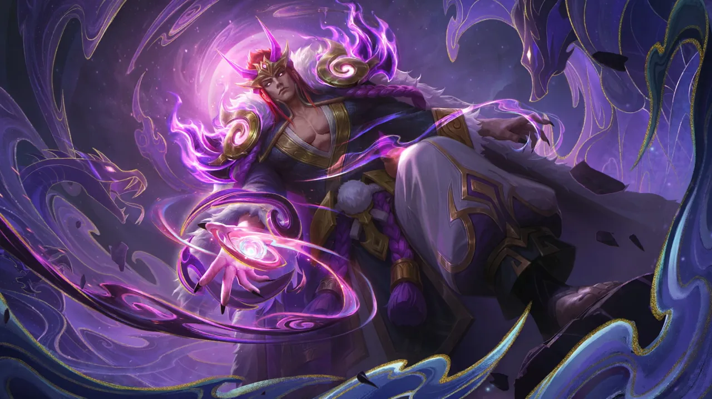
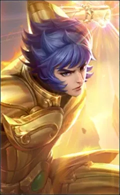

[Valir skins](https://boostmlbb.ru/en/skins/valir.html)

[Skins](https://boostmlbb.ru/en/skins/)/[Valir](https://boostmlbb.ru/en/skins/valir.html)/Demonlord

[Valir skin](https://boostmlbb.ru/en/skins/valir.html)

# Demonlord

ExquisiteCollectorLimited

How to get

The top prize of a Collector event draw, paid with diamonds. Limited skins come back in event draws from time to time.

Released

January 2021

## What the skin changes

-   New look
-   New skill effects
-   Skill sounds
-   Voice-over
-   Showcase animation
-   Showcase scene
-   Attribute bonus

## All Valir skins [10](https://boostmlbb.ru/en/skins/valir.html)

[Kyo KusanagiGrand · 2024](https://boostmlbb.ru/en/skins/valir/kyo-kusanagi.html)[Phoenix IkkiDeluxe · 2022](https://boostmlbb.ru/en/skins/valir/phoenix-ikki.html)[Leo IkkiGrand · 2022](https://boostmlbb.ru/en/skins/valir/leo-ikki.html)[Shikigami SumonnerExceptional · 2022](https://boostmlbb.ru/en/skins/valir/shikigami-sumonner.html)[Infernal BlazeSupreme · 2022](https://boostmlbb.ru/en/skins/valir/infernal-blaze.html)[DemonlordExquisite · 2021](https://boostmlbb.ru/en/skins/valir/demonlord.html)[DictatorExceptional · 2020](https://boostmlbb.ru/en/skins/valir/dictator.html)[Draconic FlameDeluxe · 2019](https://boostmlbb.ru/en/skins/valir/draconic-flame.html)[Arcane SeekerCommon · 2018](https://boostmlbb.ru/en/skins/valir/arcane-seeker.html)[Pale FlameCommon · 2018](https://boostmlbb.ru/en/skins/valir/pale-flame.html)

## Collector series

[The PurifierBruno · 2026](https://boostmlbb.ru/en/skins/bruno/the-purifier.html)[Celestial RebelSun · 2026](https://boostmlbb.ru/en/skins/sun/celestial-rebel.html)[Kaiju of the DeepHelcurt · 2026](https://boostmlbb.ru/en/skins/helcurt/kaiju-of-the-deep.html)[Starbound SentryKimmy · 2026](https://boostmlbb.ru/en/skins/kimmy/starbound-sentry.html)[Dreaming MonarchAlice · 2026](https://boostmlbb.ru/en/skins/alice/dreaming-monarch.html)[Tremor of the DeepGrock · 2026](https://boostmlbb.ru/en/skins/grock/tremor-of-the-deep.html)[Celestial GeneralTigreal · 2026](https://boostmlbb.ru/en/skins/tigreal/celestial-general.html)[Sunborn MonarchXavier · 2026](https://boostmlbb.ru/en/skins/xavier/sunborn-monarch.html)

**How much is a rank boost on Valir?**Choose your current and target ranks to see the price here.

[Calculate price](https://boostmlbb.ru/en/order.html?type=hero)

## Frequently asked questions

How to get the Demonlord skin for Valir?

The top prize of a Collector event draw, paid with diamonds. Limited skins come back in event draws from time to time.

When was Demonlord released?

January 2021.

What class is Demonlord?

Exquisite, Collector series.
