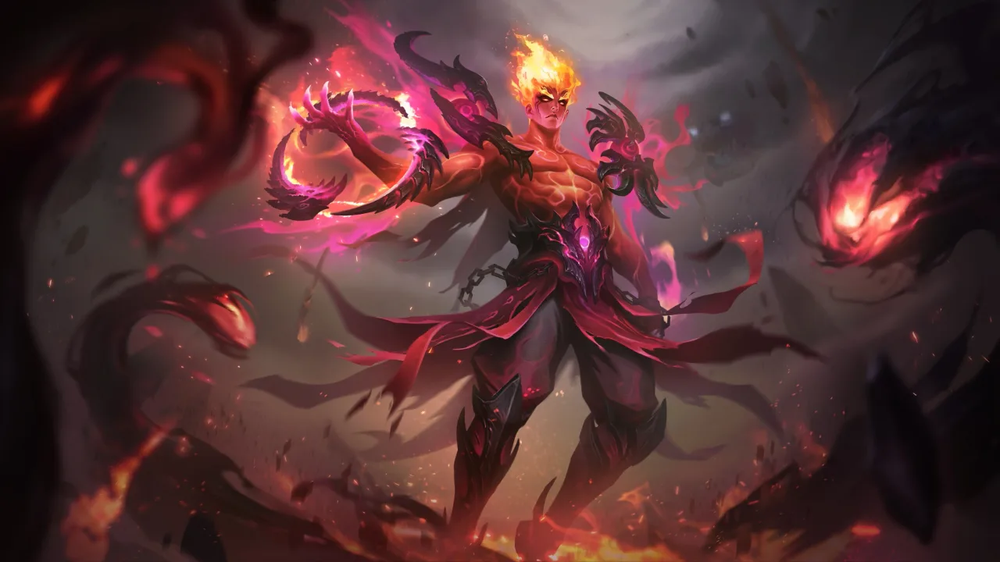

[Tier list](https://boostmlbb.ru/en/heroes/)[Items](https://boostmlbb.ru/en/items/)[Skins](https://boostmlbb.ru/en/skins/)[News & guides](https://boostmlbb.ru/en/news/)

[Skins](https://boostmlbb.ru/en/skins/)/[Valir](https://boostmlbb.ru/en/skins/valir.html)/Infernal Blaze

[Valir skin](https://boostmlbb.ru/en/skins/valir.html)

# Infernal Blaze

SupremeLegendIn the shop

How to get

Exchanged for 200 Magic Crystals from the Magic Wheel.

Price

200 Magic Crystals

Released

6 January 2022

## What the skin changes

-   New look
-   New skill effects
-   Skill animations
-   Skill sounds
-   Voice-over
-   Skill icons
-   Showcase animation
-   Showcase scene
-   Recall effect
-   Avatar border
-   Achievement
-   Attribute bonus

## All Valir skins [10](https://boostmlbb.ru/en/skins/valir.html)

[Kyo KusanagiGrand · 2024](https://boostmlbb.ru/en/skins/valir/kyo-kusanagi.html)[Phoenix IkkiDeluxe · 2022](https://boostmlbb.ru/en/skins/valir/phoenix-ikki.html)[Leo IkkiGrand · 2022](https://boostmlbb.ru/en/skins/valir/leo-ikki.html)[Shikigami SumonnerExceptional · 2022](https://boostmlbb.ru/en/skins/valir/shikigami-sumonner.html)[Infernal BlazeSupreme · 2022](https://boostmlbb.ru/en/skins/valir/infernal-blaze.html)[DemonlordExquisite · 2021](https://boostmlbb.ru/en/skins/valir/demonlord.html)[DictatorExceptional · 2020](https://boostmlbb.ru/en/skins/valir/dictator.html)[Draconic FlameDeluxe · 2019](https://boostmlbb.ru/en/skins/valir/draconic-flame.html)[Arcane SeekerCommon · 2018](https://boostmlbb.ru/en/skins/valir/arcane-seeker.html)[Pale FlameCommon · 2018](https://boostmlbb.ru/en/skins/valir/pale-flame.html)

## Legend series

[Revenant of RosesAlpha · 2025](https://boostmlbb.ru/en/skins/alpha/revenant-of-roses.html)[Sovereign of RealmsJohnson · 2025](https://boostmlbb.ru/en/skins/johnson/sovereign-of-realms.html)[Galactic VanquisherFreya · 2024](https://boostmlbb.ru/en/skins/freya/galactic-vanquisher.html)[Divine GoddessLunox · 2023](https://boostmlbb.ru/en/skins/lunox/divine-goddess.html)[King of HellFranco · 2023](https://boostmlbb.ru/en/skins/franco/king-of-hell.html)[Psion of TomorrowGuinevere · 2022](https://boostmlbb.ru/en/skins/guinevere/psion-of-tomorrow.html)[Cosmic GleamGusion · 2022](https://boostmlbb.ru/en/skins/gusion/cosmic-gleam.html)[Starfall KnightGranger · 2021](https://boostmlbb.ru/en/skins/granger/starfall-knight.html)

**Rank up on Valir**The calculator shows the price

[Calculate price](https://boostmlbb.ru/en/order.html?type=hero)

## Frequently asked questions

How to get the Infernal Blaze skin for Valir?

Exchanged for 200 Magic Crystals from the Magic Wheel.

When was Infernal Blaze released?

6 January 2022.

What class is Infernal Blaze?

Supreme, Legend series.
