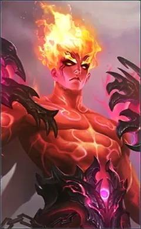
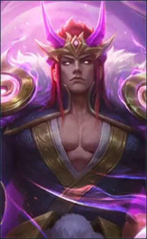

[Tier list](https://boostmlbb.ru/en/heroes/)[Items](https://boostmlbb.ru/en/items/)[Skins](https://boostmlbb.ru/en/skins/)[News & guides](https://boostmlbb.ru/en/news/)

[Skins](https://boostmlbb.ru/en/skins/)/[Valir](https://boostmlbb.ru/en/skins/valir.html)/Kyo Kusanagi

[Valir skin](https://boostmlbb.ru/en/skins/valir.html)

# Kyo Kusanagi

GrandKOFLimited

How to get

Released in the MLBB × KOF collaboration event. Limited skins come back in event draws from time to time.

Released

24 April 2024

## What the skin changes

-   New look
-   New skill effects
-   Skill sounds
-   Voice-over
-   Skill icons
-   Showcase animation
-   Showcase scene
-   Showcase music
-   Spawn animation
-   Special actions
-   Attribute bonus

## All Valir skins [10](https://boostmlbb.ru/en/skins/valir.html)

[Kyo KusanagiGrand · 2024](https://boostmlbb.ru/en/skins/valir/kyo-kusanagi.html)[Phoenix IkkiDeluxe · 2022](https://boostmlbb.ru/en/skins/valir/phoenix-ikki.html)[Leo IkkiGrand · 2022](https://boostmlbb.ru/en/skins/valir/leo-ikki.html)[Shikigami SumonnerExceptional · 2022](https://boostmlbb.ru/en/skins/valir/shikigami-sumonner.html)[Infernal BlazeSupreme · 2022](https://boostmlbb.ru/en/skins/valir/infernal-blaze.html)[DemonlordExquisite · 2021](https://boostmlbb.ru/en/skins/valir/demonlord.html)[DictatorExceptional · 2020](https://boostmlbb.ru/en/skins/valir/dictator.html)[Draconic FlameDeluxe · 2019](https://boostmlbb.ru/en/skins/valir/draconic-flame.html)[Arcane SeekerCommon · 2018](https://boostmlbb.ru/en/skins/valir/arcane-seeker.html)[Pale FlameCommon · 2018](https://boostmlbb.ru/en/skins/valir/pale-flame.html)

## KOF series

[Terry BogardPaquito · 2024](https://boostmlbb.ru/en/skins/paquito/terry-bogard.html)[Mai ShiranuiMasha · 2024](https://boostmlbb.ru/en/skins/masha/mai-shiranui.html)[K'Gusion · 2024](https://boostmlbb.ru/en/skins/gusion/k.html)[Orochi ChrisDyrroth · 2020](https://boostmlbb.ru/en/skins/dyrroth/orochi-chris.html)[Kula DiamondAurora · 2019](https://boostmlbb.ru/en/skins/aurora/kula-diamond.html)[Athena AsamiyaGuinevere · 2019](https://boostmlbb.ru/en/skins/guinevere/athena-asamiya.html)[Iori YagamiChou · 2019](https://boostmlbb.ru/en/skins/chou/iori-yagami.html)[LeonaKarina · 2019](https://boostmlbb.ru/en/skins/karina/leona.html)

**Rank up on Valir**The calculator shows the price

[Calculate price](https://boostmlbb.ru/en/order.html?type=hero)

## Frequently asked questions

How to get the Kyo Kusanagi skin for Valir?

Released in the MLBB × KOF collaboration event. Limited skins come back in event draws from time to time.

When was Kyo Kusanagi released?

24 April 2024.

What class is Kyo Kusanagi?

Grand, KOF series.
