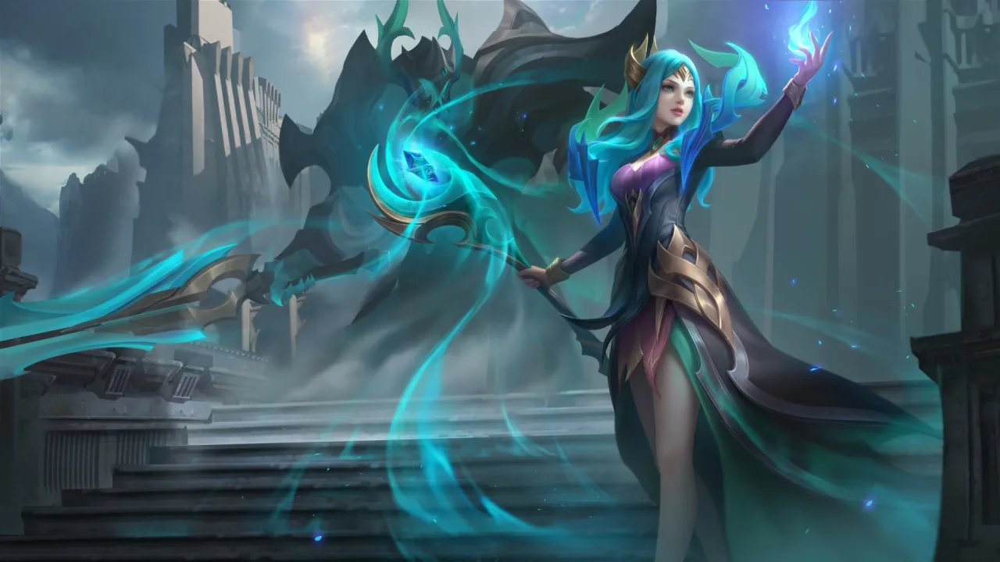

[All skins](https://boostmlbb.ru/en/skins/)

[Skins](https://boostmlbb.ru/en/skins/)/Vexana

# Vexana skins

Skins

8

In the shop

2

Latest

[Eternal Vow](https://boostmlbb.ru/en/skins/vexana/eternal-vow.html)2026

[Hero profile→](https://boostmlbb.ru/en/heroes/vexana.html)

## All skins

AllGrandExquisiteDeluxeExceptionalCommon

[Eternal VowDeluxe · 2026](https://boostmlbb.ru/en/skins/vexana/eternal-vow.html)[Twilight StarGrand · 2025](https://boostmlbb.ru/en/skins/vexana/twilight-star.html)[Twisted FairytaleGrand · 2024](https://boostmlbb.ru/en/skins/vexana/twisted-fairytale.html)[The Sun EmpressExquisite · 2023](https://boostmlbb.ru/en/skins/vexana/the-sun-empress.html)[Circus MagicianExceptional · 2022](https://boostmlbb.ru/en/skins/vexana/circus-magician.html)[Cursed ShackleCommon · 2019](https://boostmlbb.ru/en/skins/vexana/cursed-shackle.html)[Sanguine RoseDeluxe · 2018](https://boostmlbb.ru/en/skins/vexana/sanguine-rose.html)[Lucent BeaconCommon · 2017](https://boostmlbb.ru/en/skins/vexana/lucent-beacon.html)

**How much is a rank boost on Vexana?**Choose your current and target ranks to see the price here.

[Calculate price](https://boostmlbb.ru/en/order.html?type=hero)

## Frequently asked questions

How many skins does Vexana have?

8 skins, the default look not counted. The newest is Eternal Vow (6 February 2026).

Which Vexana skins can you buy now?

Eternal Vow (899 diamonds), Lucent Beacon (269 diamonds). The other skins were limited and come back only in events.

What is the rarest Vexana skin?

Twilight Star, Grand class, The Aspirants series. Released in the The Aspirants event. Limited skins come back in event draws from time to time.
