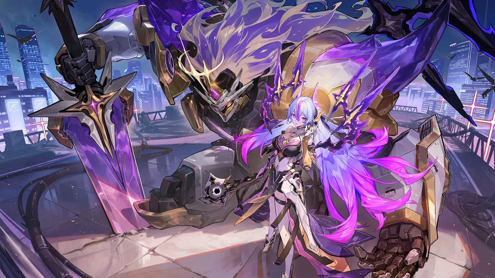
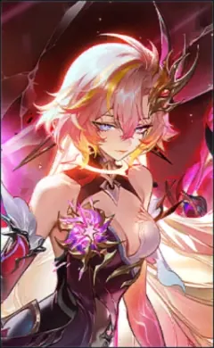

[Tier list](https://boostmlbb.ru/en/heroes/)[Items](https://boostmlbb.ru/en/items/)[Skins](https://boostmlbb.ru/en/skins/)[News & guides](https://boostmlbb.ru/en/news/)

[Skins](https://boostmlbb.ru/en/skins/)/[Vexana](https://boostmlbb.ru/en/skins/vexana.html)/Twilight Star

[Vexana skin](https://boostmlbb.ru/en/skins/vexana.html)

# Twilight Star

GrandThe AspirantsLimited

How to get

Released in the The Aspirants event. Limited skins come back in event draws from time to time.

Released

3 October 2025

## What the skin changes

-   New look
-   New skill effects
-   Skill sounds
-   Voice-over
-   Skill icons
-   Showcase animation
-   Showcase scene
-   Showcase music
-   Spawn animation
-   Special actions
-   Attribute bonus

## All Vexana skins [8](https://boostmlbb.ru/en/skins/vexana.html)

[Eternal VowDeluxe · 2026](https://boostmlbb.ru/en/skins/vexana/eternal-vow.html)[Twilight StarGrand · 2025](https://boostmlbb.ru/en/skins/vexana/twilight-star.html)[Twisted FairytaleGrand · 2024](https://boostmlbb.ru/en/skins/vexana/twisted-fairytale.html)[The Sun EmpressExquisite · 2023](https://boostmlbb.ru/en/skins/vexana/the-sun-empress.html)[Circus MagicianExceptional · 2022](https://boostmlbb.ru/en/skins/vexana/circus-magician.html)[Cursed ShackleCommon · 2019](https://boostmlbb.ru/en/skins/vexana/cursed-shackle.html)[Sanguine RoseDeluxe · 2018](https://boostmlbb.ru/en/skins/vexana/sanguine-rose.html)[Lucent BeaconCommon · 2017](https://boostmlbb.ru/en/skins/vexana/lucent-beacon.html)

## The Aspirants series

[Silverbolt RaikoSelena · 2026](https://boostmlbb.ru/en/skins/selena/silverbolt-raiko.html)[Imperatrix ArashiObsidia · 2026](https://boostmlbb.ru/en/skins/obsidia/imperatrix-arashi.html)[Daybreak HaloGuinevere · 2025](https://boostmlbb.ru/en/skins/guinevere/daybreak-halo.html)[Tech TensaiChang'e · 2024](https://boostmlbb.ru/en/skins/change/tech-tensai.html)[Deadeye SpectreLesley · 2024](https://boostmlbb.ru/en/skins/lesley/deadeye-spectre.html)[Mecha MaidenRuby · 2023](https://boostmlbb.ru/en/skins/ruby/mecha-maiden.html)[Blade of KibouFanny · 2022](https://boostmlbb.ru/en/skins/fanny/blade-of-kibou.html)[Miss HikariLayla · 2022](https://boostmlbb.ru/en/skins/layla/miss-hikari.html)

**Rank up on Vexana**The calculator shows the price

[Calculate price](https://boostmlbb.ru/en/order.html?type=hero)

## Frequently asked questions

How to get the Twilight Star skin for Vexana?

Released in the The Aspirants event. Limited skins come back in event draws from time to time.

When was Twilight Star released?

3 October 2025.

What class is Twilight Star?

Grand, The Aspirants series.
