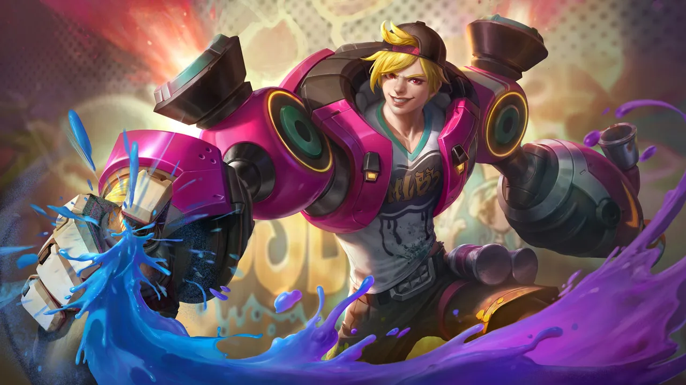

[Tier list](https://boostmlbb.ru/en/heroes/)[Items](https://boostmlbb.ru/en/items/)[Skins](https://boostmlbb.ru/en/skins/)[News & guides](https://boostmlbb.ru/en/news/)

[Skins](https://boostmlbb.ru/en/skins/)/[X.Borg](https://boostmlbb.ru/en/skins/x-borg.html)/Graffiti Fashion

[X.Borg skin](https://boostmlbb.ru/en/skins/x-borg.html)

# Graffiti Fashion

ExceptionalStarLightLimited

How to get

StarLight reward for June 2020.

Released

1 June 2020

## What the skin changes

-   New look
-   New skill effects
-   Showcase animation
-   Attribute bonus

## All X.Borg skins [6](https://boostmlbb.ru/en/skins/x-borg.html)

[BumblebeeGrand · 2025](https://boostmlbb.ru/en/skins/x-borg/bumblebee.html)[Pecados RioterCommon · 2025](https://boostmlbb.ru/en/skins/x-borg/pecados-rioter.html)[Moto DrifterCommon · 2023](https://boostmlbb.ru/en/skins/x-borg/moto-drifter.html)[Tesla ManiacGrand · 2020](https://boostmlbb.ru/en/skins/x-borg/tesla-maniac.html)[Graffiti FashionExceptional · 2020](https://boostmlbb.ru/en/skins/x-borg/graffiti-fashion.html)[Blue StormCommon · 2019](https://boostmlbb.ru/en/skins/x-borg/blue-storm.html)

## StarLight series

[Tideborn SailorKalea · 2026](https://boostmlbb.ru/en/skins/kalea/tideborn-sailor.html)[Kitsune's ShadowHayabusa · 2026](https://boostmlbb.ru/en/skins/hayabusa/kitsune-s-shadow.html)[Fangs of SlaughterHanzo · 2026](https://boostmlbb.ru/en/skins/hanzo/fangs-of-slaughter.html)[Smoul­dering FortressBelerick · 2026](https://boostmlbb.ru/en/skins/belerick/smouldering-fortress.html)[Magitech WraithObsidia · 2026](https://boostmlbb.ru/en/skins/obsidia/magitech-wraith.html)[Elysian LuminanceZetian · 2026](https://boostmlbb.ru/en/skins/zetian/elysian-luminance.html)[Guardian BattalionHilda · 2026](https://boostmlbb.ru/en/skins/hilda/guardian-battalion.html)[Dreaming KoiHarley · 2026](https://boostmlbb.ru/en/skins/harley/dreaming-koi.html)

**Rank up on X.Borg**The calculator shows the price

[Calculate price](https://boostmlbb.ru/en/order.html?type=hero)

## Frequently asked questions

How to get the Graffiti Fashion skin for X.Borg?

StarLight reward for June 2020.

When was Graffiti Fashion released?

1 June 2020.

What class is Graffiti Fashion?

Exceptional, StarLight series.
