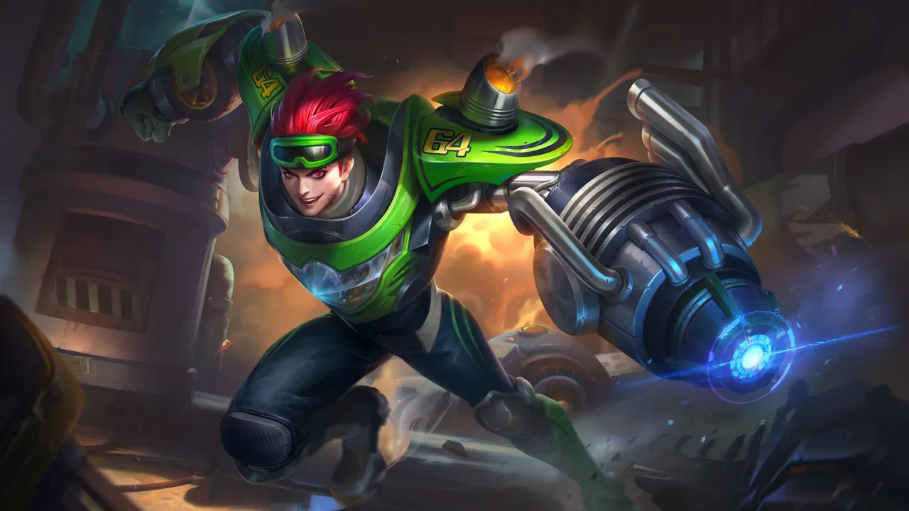

[X.Borg skins](https://boostmlbb.ru/en/skins/x-borg.html)

[Skins](https://boostmlbb.ru/en/skins/)/[X.Borg](https://boostmlbb.ru/en/skins/x-borg.html)/Moto Drifter

[X.Borg skin](https://boostmlbb.ru/en/skins/x-borg.html)

# Moto Drifter

CommonEliteIn the shop

How to get

Sold in the skin shop for 599 diamonds.

Price

599 diamonds

Released

18 February 2023

## What the skin changes

-   New look
-   Recoloured effects
-   Showcase animation
-   Attribute bonus

## All X.Borg skins [6](https://boostmlbb.ru/en/skins/x-borg.html)

[BumblebeeGrand · 2025](https://boostmlbb.ru/en/skins/x-borg/bumblebee.html)[Pecados RioterCommon · 2025](https://boostmlbb.ru/en/skins/x-borg/pecados-rioter.html)[Moto DrifterCommon · 2023](https://boostmlbb.ru/en/skins/x-borg/moto-drifter.html)[Tesla ManiacGrand · 2020](https://boostmlbb.ru/en/skins/x-borg/tesla-maniac.html)[Graffiti FashionExceptional · 2020](https://boostmlbb.ru/en/skins/x-borg/graffiti-fashion.html)[Blue StormCommon · 2019](https://boostmlbb.ru/en/skins/x-borg/blue-storm.html)

## Elite series

[Golden OsmanthusChang'e · 2026](https://boostmlbb.ru/en/skins/change/golden-osmanthus.html)[Warlord KingMartis · 2025](https://boostmlbb.ru/en/skins/martis/warlord-king.html)[High Seas CadetKimmy · 2024](https://boostmlbb.ru/en/skins/kimmy/high-seas-cadet.html)[Verdant LancerSilvanna · 2024](https://boostmlbb.ru/en/skins/silvanna/verdant-lancer.html)[Bloodhoof MarauderHylos · 2024](https://boostmlbb.ru/en/skins/hylos/bloodhoof-marauder.html)[Elegant ButterflyGuinevere · 2024](https://boostmlbb.ru/en/skins/guinevere/elegant-butterfly.html)[Marques of BladesLancelot · 2024](https://boostmlbb.ru/en/skins/lancelot/marques-of-blades.html)[Badlands HiatusChip · 2024](https://boostmlbb.ru/en/skins/chip/badlands-hiatus.html)

**How much is a rank boost on X.Borg?**Choose your current and target ranks to see the price here.

[Calculate price](https://boostmlbb.ru/en/order.html?type=hero)

## Frequently asked questions

How to get the Moto Drifter skin for X.Borg?

Sold in the skin shop for 599 diamonds.

When was Moto Drifter released?

18 February 2023.

What class is Moto Drifter?

Common, Elite series.
