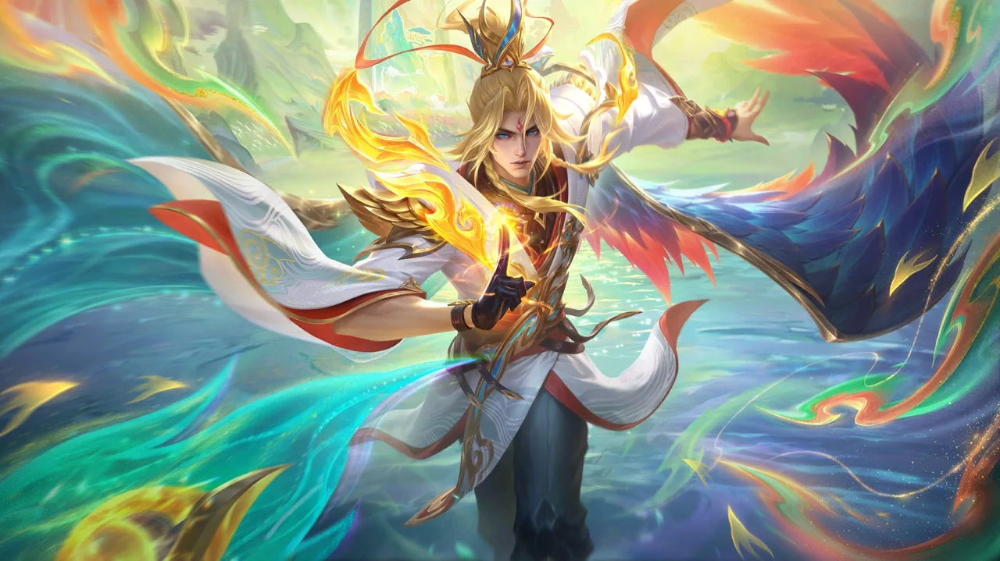

[Tier list](https://boostmlbb.ru/en/heroes/)[Items](https://boostmlbb.ru/en/items/)[Skins](https://boostmlbb.ru/en/skins/)[News & guides](https://boostmlbb.ru/en/news/)

[Skins](https://boostmlbb.ru/en/skins/)/[Xavier](https://boostmlbb.ru/en/skins/xavier.html)/Sunborn Monarch

[Xavier skin](https://boostmlbb.ru/en/skins/xavier.html)

# Sunborn Monarch

Collector

How to get

The top prize of a Collector event draw, paid with diamonds. Limited skins come back in event draws from time to time.

Released

January 2026

## All Xavier skins [5](https://boostmlbb.ru/en/skins/xavier.html)

[Sunborn Monarch2026](https://boostmlbb.ru/en/skins/xavier/sunborn-monarch.html)[Beyond the Clouds XavierExquisite · 2024](https://boostmlbb.ru/en/skins/xavier/beyond-the-clouds-xavier.html)[Hardlight ArtificerExceptional · 2024](https://boostmlbb.ru/en/skins/xavier/hardlight-artificer.html)[Satoru GojoGrand · 2023](https://boostmlbb.ru/en/skins/xavier/satoru-gojo.html)[Verdict of LightCommon · 2022](https://boostmlbb.ru/en/skins/xavier/verdict-of-light.html)

## Collector series

[The PurifierBruno · 2026](https://boostmlbb.ru/en/skins/bruno/the-purifier.html)[Celestial RebelSun · 2026](https://boostmlbb.ru/en/skins/sun/celestial-rebel.html)[Kaiju of the DeepHelcurt · 2026](https://boostmlbb.ru/en/skins/helcurt/kaiju-of-the-deep.html)[Starbound SentryKimmy · 2026](https://boostmlbb.ru/en/skins/kimmy/starbound-sentry.html)[Dreaming MonarchAlice · 2026](https://boostmlbb.ru/en/skins/alice/dreaming-monarch.html)[Tremor of the DeepGrock · 2026](https://boostmlbb.ru/en/skins/grock/tremor-of-the-deep.html)[Celestial GeneralTigreal · 2026](https://boostmlbb.ru/en/skins/tigreal/celestial-general.html)[Soul ReaverAamon · 2025](https://boostmlbb.ru/en/skins/aamon/soul-reaver.html)

**Rank up on Xavier**The calculator shows the price

[Calculate price](https://boostmlbb.ru/en/order.html?type=hero)

## Frequently asked questions

How to get the Sunborn Monarch skin for Xavier?

The top prize of a Collector event draw, paid with diamonds. Limited skins come back in event draws from time to time.

When was Sunborn Monarch released?

January 2026.
