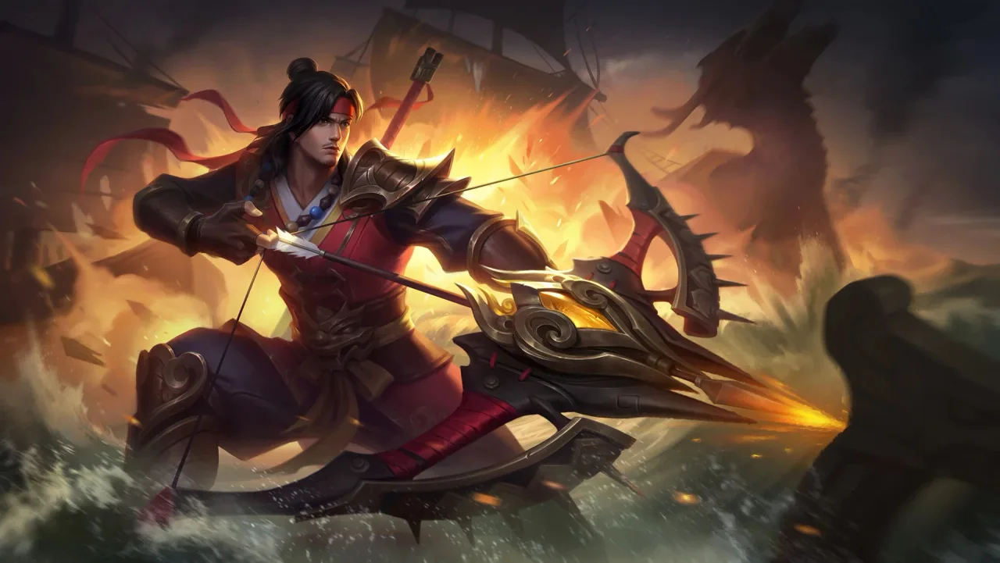

[Tier list](https://boostmlbb.ru/en/heroes/)[Items](https://boostmlbb.ru/en/items/)[Skins](https://boostmlbb.ru/en/skins/)[News & guides](https://boostmlbb.ru/en/news/)

[Skins](https://boostmlbb.ru/en/skins/)/Yi Sun-shin

# Yi Sun-shin skins

Skins

8

In the shop

4

Latest

[Waveb­reaker](https://boostmlbb.ru/en/skins/yi-sun-shin/wavebreaker.html)2025

[Hero profile→](https://boostmlbb.ru/en/heroes/yi-sun-shin.html)

## All skins

AllExquisiteDeluxeExceptionalCommon

[Waveb­reakerExceptional · 2025](https://boostmlbb.ru/en/skins/yi-sun-shin/wavebreaker.html)[Surging TorrentCommon · 2023](https://boostmlbb.ru/en/skins/yi-sun-shin/surging-torrent.html)[Azure SentryExceptional · 2021](https://boostmlbb.ru/en/skins/yi-sun-shin/azure-sentry.html)[Astral WandererExquisite · 2019](https://boostmlbb.ru/en/skins/yi-sun-shin/astral-wanderer.html)[Fleet WardenDeluxe · 2017](https://boostmlbb.ru/en/skins/yi-sun-shin/fleet-warden.html)[Roguish RangerCommon · 2017](https://boostmlbb.ru/en/skins/yi-sun-shin/roguish-ranger.html)[Apocalypse AgentCommon · 2017](https://boostmlbb.ru/en/skins/yi-sun-shin/apocalypse-agent.html)[Major GeneralCommon · 2017](https://boostmlbb.ru/en/skins/yi-sun-shin/major-general.html)

**Rank up on Yi Sun-shin**The calculator shows the price

[Calculate price](https://boostmlbb.ru/en/order.html?type=hero)

## Frequently asked questions

How many skins does Yi Sun-shin have?

8 skins, the default look not counted. The newest is Wavebreaker (18 December 2025).

Which Yi Sun-shin skins can you buy now?

Fleet Warden (899 diamonds), Roguish Ranger (599 diamonds), Apocalypse Agent (599 diamonds), Major General (269 diamonds). The other skins were limited and come back only in events.

What is the rarest Yi Sun-shin skin?

Astral Wanderer, Exquisite class, Collector series. The top prize of a Collector event draw, paid with diamonds. Limited skins come back in event draws from time to time.
