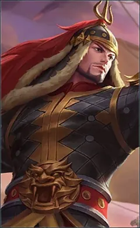

[Yi Sun-shin skins](https://boostmlbb.ru/en/skins/yi-sun-shin.html)

[Skins](https://boostmlbb.ru/en/skins/)/[Yi Sun-shin](https://boostmlbb.ru/en/skins/yi-sun-shin.html)/Astral Wanderer

[Yi Sun-shin skin](https://boostmlbb.ru/en/skins/yi-sun-shin.html)

# Astral Wanderer

ExquisiteCollectorLimited

How to get

The top prize of a Collector event draw, paid with diamonds. Limited skins come back in event draws from time to time.

Released

5 November 2019

## What the skin changes

-   New look
-   New skill effects
-   Voice-over
-   Showcase animation
-   Showcase scene
-   Attribute bonus

## All Yi Sun-shin skins [8](https://boostmlbb.ru/en/skins/yi-sun-shin.html)

[Waveb­reakerExceptional · 2025](https://boostmlbb.ru/en/skins/yi-sun-shin/wavebreaker.html)[Surging TorrentCommon · 2023](https://boostmlbb.ru/en/skins/yi-sun-shin/surging-torrent.html)[Azure SentryExceptional · 2021](https://boostmlbb.ru/en/skins/yi-sun-shin/azure-sentry.html)[Astral WandererExquisite · 2019](https://boostmlbb.ru/en/skins/yi-sun-shin/astral-wanderer.html)[Fleet WardenDeluxe · 2017](https://boostmlbb.ru/en/skins/yi-sun-shin/fleet-warden.html)[Roguish RangerCommon · 2017](https://boostmlbb.ru/en/skins/yi-sun-shin/roguish-ranger.html)[Apocalypse AgentCommon · 2017](https://boostmlbb.ru/en/skins/yi-sun-shin/apocalypse-agent.html)[Major GeneralCommon · 2017](https://boostmlbb.ru/en/skins/yi-sun-shin/major-general.html)

## Collector series

[The PurifierBruno · 2026](https://boostmlbb.ru/en/skins/bruno/the-purifier.html)[Celestial RebelSun · 2026](https://boostmlbb.ru/en/skins/sun/celestial-rebel.html)[Kaiju of the DeepHelcurt · 2026](https://boostmlbb.ru/en/skins/helcurt/kaiju-of-the-deep.html)[Starbound SentryKimmy · 2026](https://boostmlbb.ru/en/skins/kimmy/starbound-sentry.html)[Dreaming MonarchAlice · 2026](https://boostmlbb.ru/en/skins/alice/dreaming-monarch.html)[Tremor of the DeepGrock · 2026](https://boostmlbb.ru/en/skins/grock/tremor-of-the-deep.html)[Celestial GeneralTigreal · 2026](https://boostmlbb.ru/en/skins/tigreal/celestial-general.html)[Sunborn MonarchXavier · 2026](https://boostmlbb.ru/en/skins/xavier/sunborn-monarch.html)

**How much is a rank boost on Yi Sun-shin?**Choose your current and target ranks to see the price here.

[Calculate price](https://boostmlbb.ru/en/order.html?type=hero)

## Frequently asked questions

How to get the Astral Wanderer skin for Yi Sun-shin?

The top prize of a Collector event draw, paid with diamonds. Limited skins come back in event draws from time to time.

When was Astral Wanderer released?

5 November 2019.

What class is Astral Wanderer?

Exquisite, Collector series.
