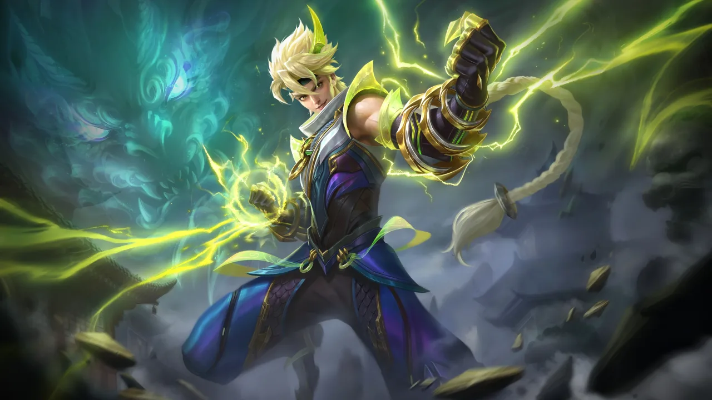
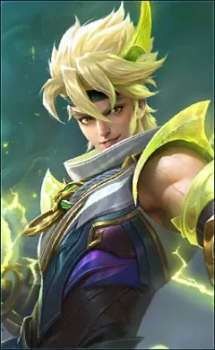

[Tier list](https://boostmlbb.ru/en/heroes/)[Items](https://boostmlbb.ru/en/items/)[Skins](https://boostmlbb.ru/en/skins/)[News & guides](https://boostmlbb.ru/en/news/)

[Skins](https://boostmlbb.ru/en/skins/)/[Yin](https://boostmlbb.ru/en/skins/yin.html)/Eternal Guardian

[Yin skin](https://boostmlbb.ru/en/skins/yin.html)

# Eternal Guardian

ExceptionalStarLightLimited

How to get

StarLight reward for August 2023.

Released

1 August 2023

## What the skin changes

-   New look
-   New skill effects
-   Showcase animation
-   Showcase scene
-   Attribute bonus

## All Yin skins [5](https://boostmlbb.ru/en/skins/yin.html)

[Eternal GuardianExceptional · 2023](https://boostmlbb.ru/en/skins/yin/eternal-guardian.html)[ErenGrand · 2023](https://boostmlbb.ru/en/skins/yin/eren.html)[Yuji ItadoriGrand · 2023](https://boostmlbb.ru/en/skins/yin/yuji-itadori.html)[M-World YinDeluxe · 2022](https://boostmlbb.ru/en/skins/yin/m-world-yin.html)[Fists of ValorCommon · 2022](https://boostmlbb.ru/en/skins/yin/fists-of-valor.html)

## StarLight series

[Tideborn SailorKalea · 2026](https://boostmlbb.ru/en/skins/kalea/tideborn-sailor.html)[Kitsune's ShadowHayabusa · 2026](https://boostmlbb.ru/en/skins/hayabusa/kitsune-s-shadow.html)[Fangs of SlaughterHanzo · 2026](https://boostmlbb.ru/en/skins/hanzo/fangs-of-slaughter.html)[Smoul­dering FortressBelerick · 2026](https://boostmlbb.ru/en/skins/belerick/smouldering-fortress.html)[Magitech WraithObsidia · 2026](https://boostmlbb.ru/en/skins/obsidia/magitech-wraith.html)[Elysian LuminanceZetian · 2026](https://boostmlbb.ru/en/skins/zetian/elysian-luminance.html)[Guardian BattalionHilda · 2026](https://boostmlbb.ru/en/skins/hilda/guardian-battalion.html)[Dreaming KoiHarley · 2026](https://boostmlbb.ru/en/skins/harley/dreaming-koi.html)

**Rank up on Yin**The calculator shows the price

[Calculate price](https://boostmlbb.ru/en/order.html?type=hero)

## Frequently asked questions

How to get the Eternal Guardian skin for Yin?

StarLight reward for August 2023.

When was Eternal Guardian released?

1 August 2023.

What class is Eternal Guardian?

Exceptional, StarLight series.
