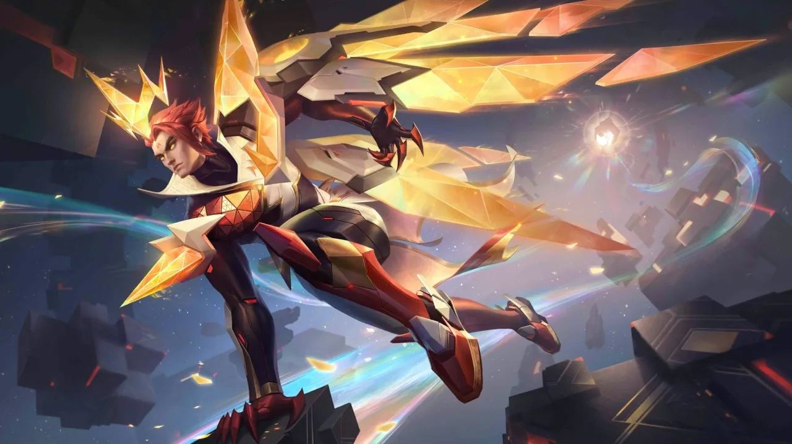

[Yu Zhong skins](https://boostmlbb.ru/en/skins/yu-zhong.html)

[Skins](https://boostmlbb.ru/en/skins/)/[Yu Zhong](https://boostmlbb.ru/en/skins/yu-zhong.html)/Cosmic Dragon

[Yu Zhong skin](https://boostmlbb.ru/en/skins/yu-zhong.html)

# Cosmic Dragon

GrandPRIMELimited

How to get

M5 Pass reward.

Released

20 November 2023

## What the skin changes

-   New look
-   New skill effects
-   Skill sounds
-   Voice-over
-   Showcase animation
-   Showcase scene
-   Showcase music
-   Spawn animation
-   Special actions
-   Attribute bonus

## All Yu Zhong skins [6](https://boostmlbb.ru/en/skins/yu-zhong.html)

[Cosmic DragonGrand · 2023](https://boostmlbb.ru/en/skins/yu-zhong/cosmic-dragon.html)[Dragon's ShadeDeluxe · 2023](https://boostmlbb.ru/en/skins/yu-zhong/dragon-s-shade.html)[Exorcist Yu ZhongGrand · 2022](https://boostmlbb.ru/en/skins/yu-zhong/exorcist-yu-zhong.html)[Blood SerpentExquisite · 2021](https://boostmlbb.ru/en/skins/yu-zhong/blood-serpent.html)[BiohazardExceptional · 2020](https://boostmlbb.ru/en/skins/yu-zhong/biohazard.html)[Emerald DragonCommon · 2020](https://boostmlbb.ru/en/skins/yu-zhong/emerald-dragon.html)

## PRIME series

[Cosmic BlazeClaude · 2024](https://boostmlbb.ru/en/skins/claude/cosmic-blaze.html)[Stellar BrilianceBeatrix · 2022](https://boostmlbb.ru/en/skins/beatrix/stellar-briliance.html)[Fiend HunterRoger · 2021](https://boostmlbb.ru/en/skins/roger/fiend-hunter.html)[Cosmic FinalityGranger](https://boostmlbb.ru/en/skins/granger/cosmic-finality.html)

**How much is a rank boost on Yu Zhong?**Choose your current and target ranks to see the price here.

[Calculate price](https://boostmlbb.ru/en/order.html?type=hero)

## Frequently asked questions

How to get the Cosmic Dragon skin for Yu Zhong?

M5 Pass reward.

When was Cosmic Dragon released?

20 November 2023.

What class is Cosmic Dragon?

Grand, PRIME series.
