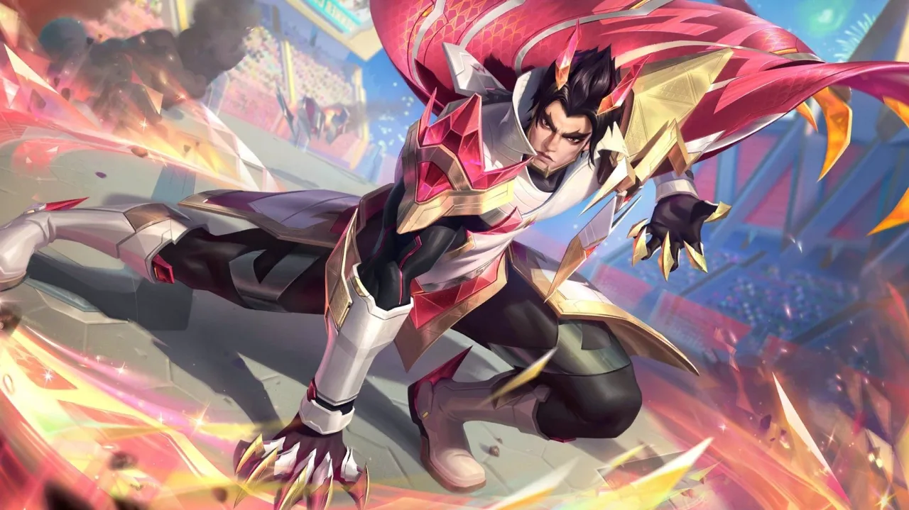

[Tier list](https://boostmlbb.ru/en/heroes/)[Items](https://boostmlbb.ru/en/items/)[Skins](https://boostmlbb.ru/en/skins/)[News & guides](https://boostmlbb.ru/en/news/)

[Skins](https://boostmlbb.ru/en/skins/)/[Yu Zhong](https://boostmlbb.ru/en/skins/yu-zhong.html)/Dragon's Shade

[Yu Zhong skin](https://boostmlbb.ru/en/skins/yu-zhong.html)

# Dragon's Shade

DeluxeM5 World ChampionshipLimited

How to get

M5 Pass reward.

Released

20 November 2023

## What the skin changes

-   New look
-   New skill effects
-   Skill sounds
-   Voice-over
-   Showcase animation
-   Showcase scene
-   Showcase music
-   Attribute bonus

## All Yu Zhong skins [6](https://boostmlbb.ru/en/skins/yu-zhong.html)

[Cosmic DragonGrand · 2023](https://boostmlbb.ru/en/skins/yu-zhong/cosmic-dragon.html)[Dragon's ShadeDeluxe · 2023](https://boostmlbb.ru/en/skins/yu-zhong/dragon-s-shade.html)[Exorcist Yu ZhongGrand · 2022](https://boostmlbb.ru/en/skins/yu-zhong/exorcist-yu-zhong.html)[Blood SerpentExquisite · 2021](https://boostmlbb.ru/en/skins/yu-zhong/blood-serpent.html)[BiohazardExceptional · 2020](https://boostmlbb.ru/en/skins/yu-zhong/biohazard.html)[Emerald DragonCommon · 2020](https://boostmlbb.ru/en/skins/yu-zhong/emerald-dragon.html)

**Rank up on Yu Zhong**The calculator shows the price

[Calculate price](https://boostmlbb.ru/en/order.html?type=hero)

## Frequently asked questions

How to get the Dragon's Shade skin for Yu Zhong?

M5 Pass reward.

When was Dragon's Shade released?

20 November 2023.

What class is Dragon's Shade?

Deluxe, M5 World Championship series.
