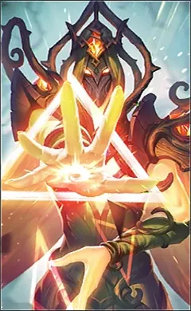

[Tier list](https://boostmlbb.ru/en/heroes/)[Items](https://boostmlbb.ru/en/items/)[Skins](https://boostmlbb.ru/en/skins/)[News & guides](https://boostmlbb.ru/en/news/)

[Skins](https://boostmlbb.ru/en/skins/)/Yve

# Yve skins

Skins

3

In the shop

2

Latest

[Flame Lotus](https://boostmlbb.ru/en/skins/yve/flame-lotus.html)2025

[Hero profile→](https://boostmlbb.ru/en/heroes/yve.html)

## All skins

[Flame LotusExceptional · 2025](https://boostmlbb.ru/en/skins/yve/flame-lotus.html)[Ruin Pro­tectressCommon · 2022](https://boostmlbb.ru/en/skins/yve/ruin-protectress.html)[Forest HymnCommon · 2021](https://boostmlbb.ru/en/skins/yve/forest-hymn.html)

**Rank up on Yve**The calculator shows the price

[Calculate price](https://boostmlbb.ru/en/order.html?type=hero)

## Frequently asked questions

How many skins does Yve have?

3 skins, the default look not counted. The newest is Flame Lotus (1 October 2025).

Which Yve skins can you buy now?

Ruin Protectress (599 diamonds), Forest Hymn (269 diamonds). The other skins were limited and come back only in events.

What is the rarest Yve skin?

Flame Lotus, Exceptional class, StarLight series. StarLight reward for October 2025.
