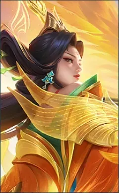

[All skins](https://boostmlbb.ru/en/skins/)

[Skins](https://boostmlbb.ru/en/skins/)/Zetian

# Zetian skins

Skins

2

In the shop

1

Latest

[Elysian Luminance](https://boostmlbb.ru/en/skins/zetian/elysian-luminance.html)2026

[Hero profile→](https://boostmlbb.ru/en/heroes/zetian.html)

## All skins

[Elysian Luminance2026](https://boostmlbb.ru/en/skins/zetian/elysian-luminance.html)[Heavenly SplendorCommon · 2025](https://boostmlbb.ru/en/skins/zetian/heavenly-splendor.html)

**How much is a rank boost on Zetian?**Choose your current and target ranks to see the price here.

[Calculate price](https://boostmlbb.ru/en/order.html?type=hero)

## Frequently asked questions

How many skins does Zetian have?

2 skins, the default look not counted. The newest is Elysian Luminance (April 2026).

Which Zetian skins can you buy now?

Heavenly Splendor (269 diamonds). The other skins were limited and come back only in events.

What is the rarest Zetian skin?

Heavenly Splendor, Common class. Sold in the skin shop for 269 diamonds.
