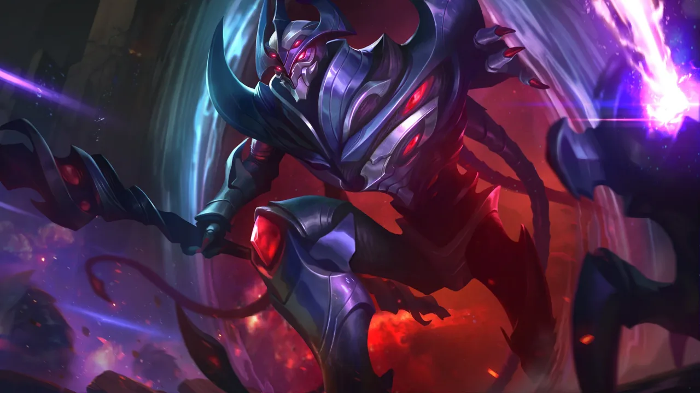
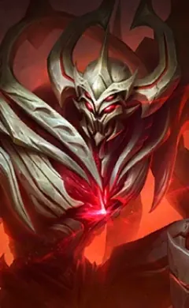

[All skins](https://boostmlbb.ru/en/skins/)

[Skins](https://boostmlbb.ru/en/skins/)/Zhask

# Zhask skins

Skins

5

In the shop

2

Latest

[Death's Shadow](https://boostmlbb.ru/en/skins/zhask/death-s-shadow.html)2024

[Hero profile→](https://boostmlbb.ru/en/heroes/zhask.html)

## All skins

[Death's ShadowExceptional · 2024](https://boostmlbb.ru/en/skins/zhask/death-s-shadow.html)[Extrater­restrialExceptional · 2020](https://boostmlbb.ru/en/skins/zhask/extraterrestrial.html)[CancerDeluxe · 2019](https://boostmlbb.ru/en/skins/zhask/cancer.html)[Bone FlamenExquisite · 2018](https://boostmlbb.ru/en/skins/zhask/bone-flamen.html)[Crystal­lized PredatorCommon · 2017](https://boostmlbb.ru/en/skins/zhask/crystallized-predator.html)

**How much is a rank boost on Zhask?**Choose your current and target ranks to see the price here.

[Calculate price](https://boostmlbb.ru/en/order.html?type=hero)

## Frequently asked questions

How many skins does Zhask have?

5 skins, the default look not counted. The newest is Death's Shadow (1 October 2024).

Which Zhask skins can you buy now?

Extraterrestrial (749 diamonds), Crystallized Predator (269 diamonds). The other skins were limited and come back only in events.

What is the rarest Zhask skin?

Bone Flamen, Exquisite class, Luckybox series. Came out of Lucky Boxes in events. Limited skins come back in event draws from time to time.
