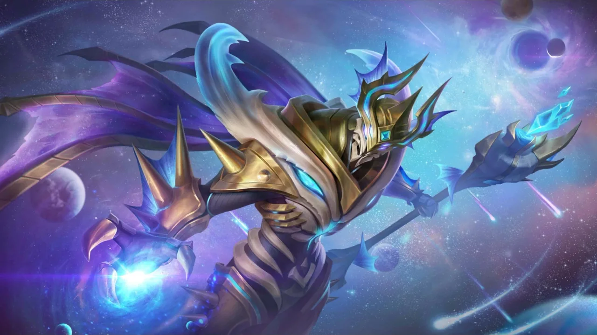

[Tier list](https://boostmlbb.ru/en/heroes/)[Items](https://boostmlbb.ru/en/items/)[Skins](https://boostmlbb.ru/en/skins/)[News & guides](https://boostmlbb.ru/en/news/)

[Skins](https://boostmlbb.ru/en/skins/)/[Zhask](https://boostmlbb.ru/en/skins/zhask.html)/Cancer

[Zhask skin](https://boostmlbb.ru/en/skins/zhask.html)

# Cancer

DeluxeZodiacLimited

How to get

Drawn in the Zodiac Summon.

Released

22 June 2019

## What the skin changes

-   New look
-   New skill effects
-   Skill sounds
-   Voice-over
-   Showcase animation
-   Showcase scene
-   Attribute bonus

## All Zhask skins [5](https://boostmlbb.ru/en/skins/zhask.html)

[Death's ShadowExceptional · 2024](https://boostmlbb.ru/en/skins/zhask/death-s-shadow.html)[Extrater­restrialExceptional · 2020](https://boostmlbb.ru/en/skins/zhask/extraterrestrial.html)[CancerDeluxe · 2019](https://boostmlbb.ru/en/skins/zhask/cancer.html)[Bone FlamenExquisite · 2018](https://boostmlbb.ru/en/skins/zhask/bone-flamen.html)[Crystal­lized PredatorCommon · 2017](https://boostmlbb.ru/en/skins/zhask/crystallized-predator.html)

## Zodiac series

[CapricornMartis · 2022](https://boostmlbb.ru/en/skins/martis/capricorn.html)[ScorpioHelcurt · 2019](https://boostmlbb.ru/en/skins/helcurt/scorpio.html)[LibraLunox · 2019](https://boostmlbb.ru/en/skins/lunox/libra.html)[LeoBadang · 2019](https://boostmlbb.ru/en/skins/badang/leo.html)[Gemini - ShadowSelena · 2019](https://boostmlbb.ru/en/skins/selena/gemini-shadow.html)[Gemini - HaloKarina · 2019](https://boostmlbb.ru/en/skins/karina/gemini-halo.html)[TaurusMinotaur · 2019](https://boostmlbb.ru/en/skins/minotaur/taurus.html)[AriesHilda · 2019](https://boostmlbb.ru/en/skins/hilda/aries.html)

**Rank up on Zhask**The calculator shows the price

[Calculate price](https://boostmlbb.ru/en/order.html?type=hero)

## Frequently asked questions

How to get the Cancer skin for Zhask?

Drawn in the Zodiac Summon.

When was Cancer released?

22 June 2019.

What class is Cancer?

Deluxe, Zodiac series.
