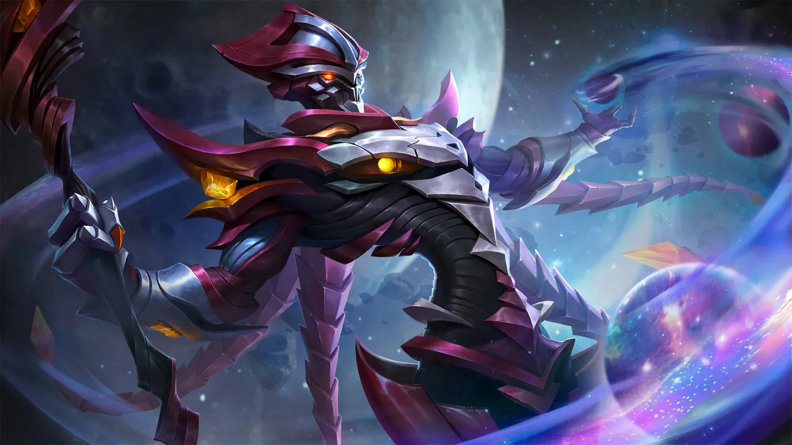

[Tier list](https://boostmlbb.ru/en/heroes/)[Items](https://boostmlbb.ru/en/items/)[Skins](https://boostmlbb.ru/en/skins/)[News & guides](https://boostmlbb.ru/en/news/)

[Skins](https://boostmlbb.ru/en/skins/)/[Zhask](https://boostmlbb.ru/en/skins/zhask.html)/Crystallized Predator

[Zhask skin](https://boostmlbb.ru/en/skins/zhask.html)

# Crystallized Predator

CommonIn the shop

How to get

Sold in the skin shop for 269 diamonds.

Price

269 diamonds

Released

29 November 2017

## What the skin changes

-   Attribute bonus

## All Zhask skins [5](https://boostmlbb.ru/en/skins/zhask.html)

[Death's ShadowExceptional · 2024](https://boostmlbb.ru/en/skins/zhask/death-s-shadow.html)[Extrater­restrialExceptional · 2020](https://boostmlbb.ru/en/skins/zhask/extraterrestrial.html)[CancerDeluxe · 2019](https://boostmlbb.ru/en/skins/zhask/cancer.html)[Bone FlamenExquisite · 2018](https://boostmlbb.ru/en/skins/zhask/bone-flamen.html)[Crystal­lized PredatorCommon · 2017](https://boostmlbb.ru/en/skins/zhask/crystallized-predator.html)

**Rank up on Zhask**The calculator shows the price

[Calculate price](https://boostmlbb.ru/en/order.html?type=hero)

## Frequently asked questions

How to get the Crystallized Predator skin for Zhask?

Sold in the skin shop for 269 diamonds.

When was Crystallized Predator released?

29 November 2017.

What class is Crystallized Predator?

Common.
