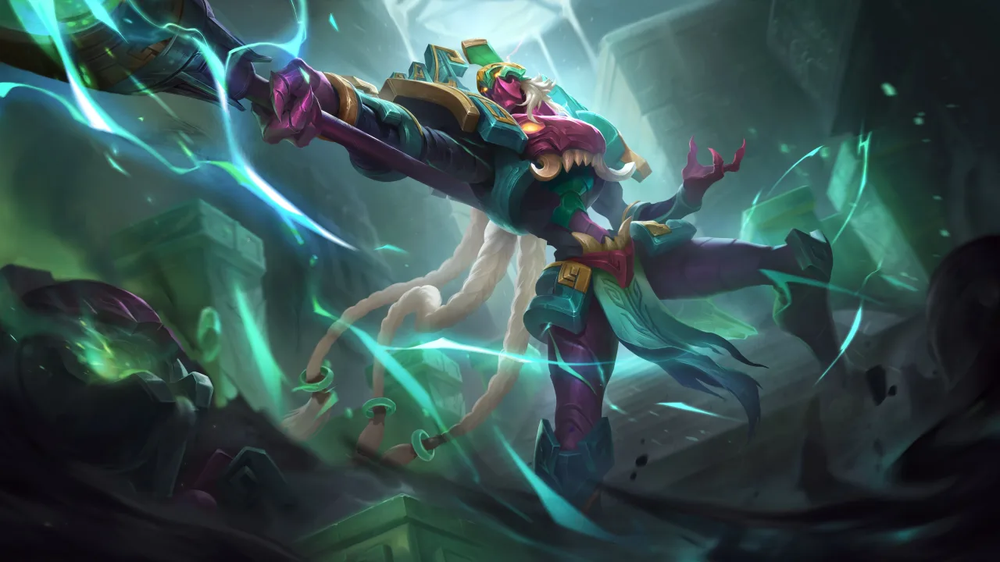
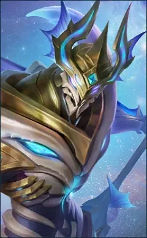

[Zhask skins](https://boostmlbb.ru/en/skins/zhask.html)

[Skins](https://boostmlbb.ru/en/skins/)/[Zhask](https://boostmlbb.ru/en/skins/zhask.html)/Death's Shadow

[Zhask skin](https://boostmlbb.ru/en/skins/zhask.html)

# Death's Shadow

ExceptionalStarLightLimited

How to get

StarLight reward for October 2024.

Released

1 October 2024

## What the skin changes

-   New look
-   New skill effects
-   Showcase animation
-   Showcase scene
-   Attribute bonus

## All Zhask skins [5](https://boostmlbb.ru/en/skins/zhask.html)

[Death's ShadowExceptional · 2024](https://boostmlbb.ru/en/skins/zhask/death-s-shadow.html)[Extrater­restrialExceptional · 2020](https://boostmlbb.ru/en/skins/zhask/extraterrestrial.html)[CancerDeluxe · 2019](https://boostmlbb.ru/en/skins/zhask/cancer.html)[Bone FlamenExquisite · 2018](https://boostmlbb.ru/en/skins/zhask/bone-flamen.html)[Crystal­lized PredatorCommon · 2017](https://boostmlbb.ru/en/skins/zhask/crystallized-predator.html)

## StarLight series

[Tideborn SailorKalea · 2026](https://boostmlbb.ru/en/skins/kalea/tideborn-sailor.html)[Kitsune's ShadowHayabusa · 2026](https://boostmlbb.ru/en/skins/hayabusa/kitsune-s-shadow.html)[Fangs of SlaughterHanzo · 2026](https://boostmlbb.ru/en/skins/hanzo/fangs-of-slaughter.html)[Smoul­dering FortressBelerick · 2026](https://boostmlbb.ru/en/skins/belerick/smouldering-fortress.html)[Magitech WraithObsidia · 2026](https://boostmlbb.ru/en/skins/obsidia/magitech-wraith.html)[Elysian LuminanceZetian · 2026](https://boostmlbb.ru/en/skins/zetian/elysian-luminance.html)[Guardian BattalionHilda · 2026](https://boostmlbb.ru/en/skins/hilda/guardian-battalion.html)[Dreaming KoiHarley · 2026](https://boostmlbb.ru/en/skins/harley/dreaming-koi.html)

**How much is a rank boost on Zhask?**Choose your current and target ranks to see the price here.

[Calculate price](https://boostmlbb.ru/en/order.html?type=hero)

## Frequently asked questions

How to get the Death's Shadow skin for Zhask?

StarLight reward for October 2024.

When was Death's Shadow released?

1 October 2024.

What class is Death's Shadow?

Exceptional, StarLight series.
