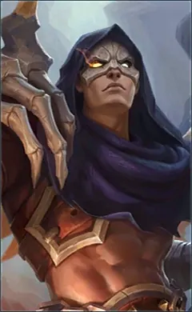

[Тир-лист](https://boostmlbb.ru/heroes/)[Предметы](https://boostmlbb.ru/items/)[Скины](https://boostmlbb.ru/skins/)[Новости и гайды](https://boostmlbb.ru/news/)

[Тир-лист](https://boostmlbb.ru/heroes/)

# Алдос

C

БоецЛиния опыта

Победы

53,3%

Выбор

0,4%

Баны

0,3%

[Обзор](https://boostmlbb.ru/#overview)[Сборка](https://boostmlbb.ru/#build)[Как играть](https://boostmlbb.ru/#howto)[Навыки](https://boostmlbb.ru/#skills)[Контрпики](https://boostmlbb.ru/#draft)[Скины](https://boostmlbb.ru/#skins)[История](https://boostmlbb.ru/#lore)

## Обзор

### Характеристики

-   Живучесть**70**
-   Атака**30**
-   Эффекты**50**
-   Сложность**70**

-   Разрушительный урон
-   Поддержка

### Победы по рангам, 30 дней

1.  **52,3%**Эпик
2.  **52,4%**Легенда
3.  **53,1%**Мифик
4.  **52,1%**Честь
5.  **52,1%**Слава

Пунктир: 50% побед

### Другие бойцы этой линии

[Фрейя](https://boostmlbb.ru/heroes/freya.html)[Аулус](https://boostmlbb.ru/heroes/aulus.html)[Пакито](https://boostmlbb.ru/heroes/paquito.html)[Сан](https://boostmlbb.ru/heroes/sun.html)[Лукас](https://boostmlbb.ru/heroes/lukas.html)[Чичи](https://boostmlbb.ru/heroes/cici.html)[Сора](https://boostmlbb.ru/heroes/sora.html)[Чонг](https://boostmlbb.ru/heroes/yu-zhong.html)

### Места в рейтингах

-   [Лучшие бойцы MLBB**24 из 44**](https://boostmlbb.ru/heroes/best-fighter.html)

## Сборка

Сборка 1Сборка 2Сборка 3

Победы

59,2%

Выбор

15,9%

#### Основные предметы

-   [

    

    Клинок семи морей

    ](https://boostmlbb.ru/items/blade-of-the-heptaseas.html)
-   [

    

    Бесконечная битва

    ](https://boostmlbb.ru/items/endless-battle.html)
-   [

    

    Злобный рык

    ](https://boostmlbb.ru/items/malefic-roar.html)

#### Заклинание

Вспышка

#### Эмблема и таланты

Эмблема убийцы

-   

    Ловкость

-   

    Благословение природы

-   

    Квантовый заряд

Победы

62,2%

Выбор

3,3%

#### Основные предметы

-   [

    

    Штормовой пояс

    ](https://boostmlbb.ru/items/thunder-belt.html)
-   [

    

    Господство льда

    ](https://boostmlbb.ru/items/dominance-ice.html)
-   [

    

    Бесконечная битва

    ](https://boostmlbb.ru/items/endless-battle.html)

#### Заклинание

Вспышка

#### Эмблема и таланты

Эмблема убийцы

-   

    Ловкость

-   

    Благословение природы

-   

    Квантовый заряд

Победы

62,4%

Выбор

2,6%

#### Основные предметы

-   [

    

    Господство льда

    ](https://boostmlbb.ru/items/dominance-ice.html)
-   [

    

    Бесконечная битва

    ](https://boostmlbb.ru/items/endless-battle.html)
-   [

    

    Золотой метеор

    ](https://boostmlbb.ru/items/rose-gold-meteor.html)

#### Заклинание

Вспышка

#### Эмблема и таланты

Эмблема убийцы

-   

    Ловкость

-   

    Благословение природы

-   

    Квантовый заряд

## Как играть за Алдоса

### Комбо Алдоса

#### В драке

1.  Ульт
2.  Ульт
3.  1
4.  2
5.  Атака

В драке ультом откройте обзор на врагов и повторным нажатием прыгните на самую уязвимую цель. Затем связкой первого и второго навыка ударьте усиленной атакой.

#### На линии

1.  1
2.  2
3.  Атака
4.  1
5.  Атака

На линии первым навыком усильте следующую атаку, вторым подойдите и ударьте. Ещё раз первый и снова усиленный удар.

### Когда сильнее всего

Сильнее в долгой игре: на 18–20 минутах выигрывает 59,7%. Не рискуйте в начале, фармите и ввязывайтесь в драки вместе с командой.

1.  **44,7**10–12
2.  **50,7**12–14
3.  **54,3**14–16
4.  **58,2**16–18
5.  **59,7**18–20
6.  **59,5**20+

Проценты побед по длине матча в минутах, все ранги. Пунктир: 50%

### Приоритет прокачки

1.  Контракт: погоня за судьбой
2.  Контракт: кража души
3.  Контракт: взрыв

## Навыки

Пассивный**Контракт: трансформация**1-й навык**Контракт: кража души** 2-й навык**Контракт: взрыв**Ультимейт**Контракт: погоня за судьбой**

Пассивный

### Контракт: трансформация

Кажд. 8 сек. Алдос получает щит, равный 350 (+3 за каждый заряд "Кражи души"), на 3 сек. для следующей базовой атаки. Он также получает 60% скорости передвижения на 1 сек.

1-й навык

### Контракт: кража души

Перезарядка **4 Mana Cost: 45 с**

Алдос усиливает свою следующую базовую атаку, которая наносит 200 (+100% общей физической атаки) (+ 3 за каждый заряд "Кражи души") единиц физического урона.

Убийство осадного миньона этой атакой дает 12 зар. "Кражи души"; убийство любого другого юнита, не являющегося героем, дает 5 зар. Попадание по вражескому герою дает дополнительно 5 зар., а его убийство дает 12 зар. (до 1000 зарядов).

Эта атака наносит на 300% больше базового урона миньонам и монстрам. Алдос также получает 6 зар., когда союзники убивают ближайшего вражеского осадного миньона, и 2 зар., когда они убивают любого другого ближайшего юнита, не являющегося героем.

Алдос получает 20% скорости передвижения при движении к вражеским героям во время действия этого навыка.

2-й навык

### Контракт: взрыв

Перезарядка **9.5 Mana Cost: 80 с**

Алдос занимает оборонительную позицию, получая 30% снижения урона на 2 сек. или до отмены.

После этого он нанесет 200 (+20% общей физической атаки)-400 (+40% общей физической атаки) единиц физического урона ближайшим врагам и оглушит их на 0.5-1 сек. (зависит от длительности оборонительной позиции).

Ультимейт

### Контракт: погоня за судьбой

Перезарядка **60 Mana Cost: 150 с**

Алдос получает обзор всех вражеских героев на 5 сек.

**Повторное использование:** в течение этого времени он совершает рывок к вражескому герою, нанося 250 (+8% от цели) единиц физического урона и отбрасывая цель на 1 сек.

Во время рывка Алдос может прервать "Возвращение" цели.

## Контрпики Алдоса

### Кто контрит Алдоса

[Уранус](https://boostmlbb.ru/heroes/uranus.html)[Ксавьер](https://boostmlbb.ru/heroes/xavier.html)[Хелкарт](https://boostmlbb.ru/heroes/helcurt.html)[Икс.Борг](https://boostmlbb.ru/heroes/x-borg.html)[Ханзо](https://boostmlbb.ru/heroes/hanzo.html)

### Кого контрит Алдос

[Обсидия](https://boostmlbb.ru/heroes/obsidia.html)[Эсмеральда](https://boostmlbb.ru/heroes/esmeralda.html)

## Скины Алдоса

[Ужас пучиныИсключительный · 2025](https://boostmlbb.ru/skins/aldous/fathom-terror.html)[Алдос, закли­натель туманаГрандиозный · 2023](https://boostmlbb.ru/skins/aldous/mistbender-aldous.html)[СтарскримГрандиозный · 2022](https://boostmlbb.ru/skins/aldous/starscream.html)[Страж мировИзысканный · 2021](https://boostmlbb.ru/skins/aldous/realm-watcher.html)[Пылающая силаДелюкс · 2020](https://boostmlbb.ru/skins/aldous/blazing-force.html)[Король превос­ходстваДелюкс · 2019](https://boostmlbb.ru/skins/aldous/king-of-supremacy.html)[Бесчувствен­ныйИсключительный · 2019](https://boostmlbb.ru/skins/aldous/the-insentient.html)[СмертьОбычный · 2019](https://boostmlbb.ru/skins/aldous/death.html)[Красная мантияОбычный · 2018](https://boostmlbb.ru/skins/aldous/red-mantle.html)[Наёмник2018](https://boostmlbb.ru/skins/aldous/contractor.html)

[Все 10 скинов Алдоса: цены и как получить](https://boostmlbb.ru/skins/aldous.html)

## История

> Хранитель Минойского лабиринта.

[Читать полную историю ↗](https://kazukiofficial.com/stories/aldous)Kazuki Official, английский [Характеристики на сайте игры ↗](https://www.mobilelegends.com/hero/detail?heroid=64)

**Поднимем ранг на герое «Алдос»**Цена считается в калькуляторе

[Рассчитать цену](https://boostmlbb.ru/order.html?type=hero)

## Частые вопросы

Кто контрит Алдоса в MLBB?

За последние 30 дней Алдоса чаще всего обыгрывают Уранус, Ксавьер, Хелкарт, Икс.Борг и Ханзо.

Как играть за Алдоса?

В первую очередь качайте «Контракт: кража души », ульт берите, как только доступен. Сильнее в долгой игре: на 18–20 минутах выигрывает 59,7%. Не рискуйте в начале, фармите и ввязывайтесь в драки вместе с командой. Комбо для драки: В драке ультом откройте обзор на врагов и повторным нажатием прыгните на самую уязвимую цель. Затем связкой первого и второго навыка ударьте усиленной атакой.

Какой процент побед у Алдоса сейчас?

53,30% в Мифической славе за последние 7 дней и 52,38% на всех рангах за 30 дней, данные на 27 ноября 2026 года.

Какая роль и линия у Алдоса?

Боец, играет на линии опыта.

Стоит ли брать Алдоса в текущей мете?

Тир C, 82-е место из 133 героев и 24-е среди бойцов. Тир учитывает, как часто героя берут и банят и как он выигрывает в Мифической славе за 7 дней: бан в 0,3% матчей, 53,3% побед. В профессиональных матчах за месяц героя драфтуют в 0,0% катков.

Какая сборка на Алдоса лучшая?

Самая популярная сборка в рейтинге: ключевые предметы «Клинок семи морей», «Бесконечная битва» и «Злобный рык», эмблема убийцы с талантами «Ловкость», «Благословение природы» и «Квантовый заряд» и заклинание «Вспышка». С ней выигрывают 59,24% матчей.
