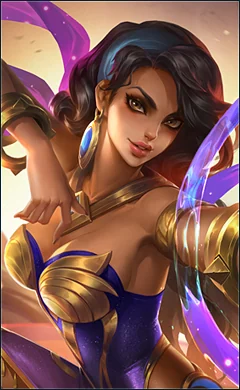

[Тир-лист](https://boostmlbb.ru/heroes/)

# Алиса

A

ТанкМагЛиния опытаЛес

Победы

50,3%

Выбор

1,0%

Баны

8,3%

[Обзор](https://boostmlbb.ru/#overview)[Сборка](https://boostmlbb.ru/#build)[Как играть](https://boostmlbb.ru/#howto)[Навыки](https://boostmlbb.ru/#skills)[Контрпики](https://boostmlbb.ru/#draft)[Скины](https://boostmlbb.ru/#skins)[История](https://boostmlbb.ru/#lore)

## Обзор

### Характеристики

-   Живучесть**50**
-   Атака**50**
-   Эффекты**70**
-   Сложность**40**

-   Рывок
-   Регенерация

### Другие танки этой линии

[Маша](https://boostmlbb.ru/heroes/masha.html)[Эсмеральда](https://boostmlbb.ru/heroes/esmeralda.html)[Глу](https://boostmlbb.ru/heroes/gloo.html)[Бартс](https://boostmlbb.ru/heroes/barats.html)[Уранус](https://boostmlbb.ru/heroes/uranus.html)[Фредрин](https://boostmlbb.ru/heroes/fredrinn.html)[Хильда](https://boostmlbb.ru/heroes/hilda.html)[Гатоткача](https://boostmlbb.ru/heroes/gatotkaca.html)

### Места в рейтингах

-   [Лучшие лесники MLBB**6 из 37**](https://boostmlbb.ru/heroes/best-jungle.html)
-   [Лучшие маги MLBB**1 из 32**](https://boostmlbb.ru/heroes/best-mage.html)
-   [Лучшие танки MLBB**5 из 25**](https://boostmlbb.ru/heroes/best-tank.html)

## Сборка

Сборка 1Сборка 2Сборка 3

Победы

54,9%

Выбор

2,6%

#### Основные предметы

-   [

    

    Кираса грубой силы

    ](https://boostmlbb.ru/items/brute-force-breastplate.html)
-   [

    

    Оракул

    ](https://boostmlbb.ru/items/oracle.html)
-   [

    

    Концентрированная энергия

    ](https://boostmlbb.ru/items/concentrated-energy.html)

#### Заклинание

Восстановление

#### Эмблема и таланты

Эмблема танка

-   

    Живучесть

-   

    Опытный охотник

-   

    Нечестивая ярость

Победы

57,5%

Выбор

2,1%

#### Основные предметы

-   [

    

    Кираса грубой силы

    ](https://boostmlbb.ru/items/brute-force-breastplate.html)
-   [

    

    Оракул

    ](https://boostmlbb.ru/items/oracle.html)
-   [

    

    Концентрированная энергия

    ](https://boostmlbb.ru/items/concentrated-energy.html)

#### Заклинание

Восстановление

#### Эмблема и таланты

Эмблема танка

-   

    Живучесть

-   

    Стойкость

-   

    Нечестивая ярость

Победы

57,8%

Выбор

1,5%

#### Основные предметы

-   [

    

    Часы судьбы

    ](https://boostmlbb.ru/items/clock-of-destiny.html)
-   [

    

    Оракул

    ](https://boostmlbb.ru/items/oracle.html)
-   [

    

    Концентрированная энергия

    ](https://boostmlbb.ru/items/concentrated-energy.html)

#### Заклинание

Месть

#### Эмблема и таланты

Эмблема танка

-   

    Живучесть

-   

    Кровавое пиршество

-   

    Нечестивая ярость

## Как играть за Алису

### Комбо Алисы

#### В драке

1.  1
2.  1
3.  2
4.  Ульт

Первым навыком тревожьте и повторным нажатием прыгните на врага, вторым дайте контроль и продолжайте атаку ультом.

#### На линии

1.  1
2.  1
3.  2
4.  Ульт

Первым навыком тревожьте и повторным нажатием прыгните на врага, вторым дайте контроль и продолжайте атаку ультом.

### Когда сильнее всего

Сильнее в долгой игре: после 20-й минуты выигрывает 50,1%. Не рискуйте в начале, фармите и ввязывайтесь в драки вместе с командой.

1.  **48,1**10–12
2.  **48,7**12–14
3.  **49,7**14–16
4.  **49,5**16–18
5.  **50,0**18–20
6.  **50,1**20+

Проценты побед по длине матча в минутах, все ранги. Пунктир: 50%

### Приоритет прокачки

1.  Гибельная власть
2.  Роковой вальс
3.  Багровое сияние

## Навыки

Пассивный**Багряный кровавый банкет**1-й навык**Багровое сияние**2-й навык**Роковой вальс**Ультимейт**Гибельная власть**

Пассивный

### Багряный кровавый банкет

Каждый раз, когда навык Алисы поражает врага, она получает 1 зар. "Багрянца" на 4 сек. (до 2 зарядов). "Кровавый банкет" активируется при максимальном количестве зарядов.

**Кровавый банкет:** кажд. 0.5 сек. Алиса наносит 25 (+30% общей магической силы) (+0.5% - 2.5% от цели, увеличивается с уровнем) единиц магического урона ближайшим врагам. Она также восстанавливает 10 (+3% доп. макс. ОЗ) ОЗ и получает 8% скорости передвижения. Его длительность обновляется, когда ее навыки поражают вражеского героя.

Урон по монстрам ограничен 70 (+10 × ур. героя) ед. магического урона.

1-й навык

### Багровое сияние

Перезарядка **12 с**

Алиса выпускает кровавую энергию вперед, нанося 100 (+50% общей магической силы) единиц магического урона врагам.

**Повторное использование:** до того, как кровавая энергия рассеется, Алиса может снова применить этот навык как "Алую тень", чтобы переместиться к ее местоположению.

2-й навык

### Роковой вальс

Перезарядка **4 с**

Алиса исполняет смертельный танец, нанося 350 (+130% общей магической силы) единиц магического урона ближайшим врагам и замедляя их на 70% на 1 сек.

Если "Кровавый банкет" активен, навык также обжигает врагов, нанося 300% от урона "Кровавого банкета" и восстанавливая такое же количество ОЗ.

Ультимейт

### Гибельная власть

Перезарядка **60 с**

Алиса окружает себя кровью, получая иммунитет к контролю и 50% снижения урона, замедляясь при этом на 50%.

Через 1.5 сек. она обрушивается сверху, нанося 500 (+200% общей магической силы) (+20% доп. макс. ОЗ) единиц магического урона всем врагам в области и обездвиживая их на 1 сек.

Во время подготовки ультимейта Алиса не может использовать никакие навыки героя, кроме "Алой тени".

## Контрпики Алисы

### Кто контрит Алису

[Чип](https://boostmlbb.ru/heroes/chip.html)[Глу](https://boostmlbb.ru/heroes/gloo.html)[Тигрил](https://boostmlbb.ru/heroes/tigreal.html)[Атлас](https://boostmlbb.ru/heroes/atlas.html)[Бартс](https://boostmlbb.ru/heroes/barats.html)

### Кого контрит Алиса

[Ангела](https://boostmlbb.ru/heroes/angela.html)[Дариус](https://boostmlbb.ru/heroes/dyrroth.html)[Валир](https://boostmlbb.ru/heroes/valir.html)[Флорин](https://boostmlbb.ru/heroes/floryn.html)[Тамуз](https://boostmlbb.ru/heroes/thamuz.html)[Харли](https://boostmlbb.ru/heroes/harley.html)[Чичи](https://boostmlbb.ru/heroes/cici.html)[Джулиан](https://boostmlbb.ru/heroes/julian.html)[Эстес](https://boostmlbb.ru/heroes/estes.html)[Горд](https://boostmlbb.ru/heroes/gord.html)

## Скины Алисы

[Монархиня грёз2026](https://boostmlbb.ru/skins/alice/dreaming-monarch.html)[Соблазни­тельница даркнетаДелюкс · 2024](https://boostmlbb.ru/skins/alice/darknet-temptress.html)[Нефритовая импе­ратрицаОбычный · 2023](https://boostmlbb.ru/skins/alice/jade-empress.html)[Паровой планерИсключительный · 2019](https://boostmlbb.ru/skins/alice/steam-glider.html)[Божествен­ная соваИсключительный · 2018](https://boostmlbb.ru/skins/alice/divine-owl.html)[Учи­тельница магииИзысканный · 2017](https://boostmlbb.ru/skins/alice/wizardry-teacher.html)[Дух-покрови­тельницаОбычный · 2016](https://boostmlbb.ru/skins/alice/spirit-woman.html)

[Все 7 скинов Алисы: цены и как получить](https://boostmlbb.ru/skins/alice.html)

## История

> Королева демонов крови и одна из двух доминирующих сил в Бездне.

[Читать полную историю ↗](https://play.mobilelegends.com/lore/hero/Alice)Официальный сайт Mobile Legends [Характеристики на сайте игры ↗](https://www.mobilelegends.com/hero/detail?heroid=4)

**Поднимем ранг на герое «Алиса»**Цена считается в калькуляторе

[Рассчитать цену](https://boostmlbb.ru/order.html?type=hero)

## Частые вопросы

Кто контрит Алису в MLBB?

За последние 30 дней Алису чаще всего обыгрывают Чип, Глу, Тигрил, Атлас и Бартс.

Как играть за Алису?

В первую очередь качайте «Роковой вальс», ульт берите, как только доступен. Сильнее в долгой игре: после 20-й минуты выигрывает 50,1%. Не рискуйте в начале, фармите и ввязывайтесь в драки вместе с командой. Комбо для драки: Первым навыком тревожьте и повторным нажатием прыгните на врага, вторым дайте контроль и продолжайте атаку ультом.

Какой процент побед у Алисы сейчас?

50,31% в Мифической славе за последние 7 дней и 50,58% на всех рангах за 30 дней, данные на 27 ноября 2026 года.

Какая роль и линия у Алисы?

Танк и маг, играет на линии опыта или в лесу.

Стоит ли брать Алису в текущей мете?

Тир A, 13-е место из 133 героев и 5-е среди танков. Тир учитывает, как часто героя берут и банят и как он выигрывает в Мифической славе за 7 дней: бан в 8,3% матчей, 50,3% побед. В профессиональных матчах за месяц героя драфтуют в 57,7% катков.

Какая сборка на Алису лучшая?

Самая популярная сборка в рейтинге: ключевые предметы «Кираса грубой силы», «Оракул» и «Концентрированная энергия», эмблема танка с талантами «Живучесть», «Опытный охотник» и «Нечестивая ярость» и заклинание «Восстановление». С ней выигрывают 54,85% матчей.
