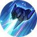

[Главная](https://boostmlbb.ru/) / [Герои](https://boostmlbb.ru/heroes/)

Тир C

# Альфа в Mobile Legends: сборка, контрпики и статистика

Боец, линия опыта или лес. Выигрывает 48,85% матчей за последние 30 дней — 96-е место из 133 героев.

[Буст на этом герое](https://boostmlbb.ru/order.html?type=hero)[Все герои](https://boostmlbb.ru/heroes/)

Статистика герояТир C

**Альфа**Бан 0,68% · Выбор 1,32%

Контрпики

Победы за 30 дней**48,85%**

**48,85%**побед за 30 дней

**1,32%**выбирают в матчах

**0,68%**банят в матчах

**48,05%**побед в Мифической славе

## Сборка на героя «Альфа»

Самая популярная сборка для героя «Альфа» на роли линии опыта в рейтинговых матчах на всех рангах — по данным «Академии» в игре. Процент побед — в матчах именно с этой сборкой.

Ключевые предметы

Топор войныКлинок отчаянияКрылья королевы

Эмблема и таланты

Эмблема бойцаТрепетКровавое пиршествоНечестивая ярость

Боевое заклинание

Месть

Побед с этой сборкой **60,20%**Выбирают в **1,23%** матчей

### Другие популярные варианты

-   МестьЭмблема бойцаТрепет · Кровавое пиршество · Убийственный пир**58,32%**
-   МестьЭмблема бойцаТрепет · Опытный охотник · Нечестивая ярость**54,96%**

## Навыки героя «Альфа»

Официальные описания навыков от MOONTON с перезарядкой и типом навыка.

Порядок прокачки: **Копье Альфы** → **Поворотный импульс** → **Поворотный удар**

-   

    **Бета, вперед!**Пассивный

    Когда Альфа использует навык, для атаки будет призван Бета. Враги, которых Бета поразит 2 р., войдут в состояние захвата цели.
    Захват цели: после того, как Альфа нанесет урон цели, Бета выстрелит в нее лазером, нанося 60 (+50% общей физической атаки) (+8\*Hero Level) единиц чистого урона и ненадолго применяя мощный эффект замедления.
    Этот навык наносит только 75% урона монстрам.

-   

    **Поворотный удар**1-й навыкПерезарядка 4 Mana Cost: 50 с

    Альфа выпускает волну энергии в указанном направлении, нанося 100 (+90% дополнительной физической атаки) единиц физического урона врагам на пути и замедляя их на 40% на 1 сек.
    Затем Бета обстреливает врагов по тому же пути, нанося 60 (+30% дополнительной физической атаки) единиц чистого урона.

-   

    **Поворотный импульс**2-й навыкПерезарядка 6 Mana Cost: 45 с

    После короткой подготовки Альфа взмахивает оружием в указанном направлении, нанося 180 (+100% общей физической атаки) единиц физического урона врагам в веерообразной области и восстанавливая 80 (+40% дополнительной физической атаки) ОЗ за первого пораженного врага (лечение снижается на 40% за каждого последующего пораженного врага).
    Затем Бета обстреливает эту же область, нанося 60 (+30% общей физической атаки) единиц чистого урона.

-   

    **Копье Альфы**Ультимейт

    Бета бросается в указанное место, нанося 100 (+20% дополнительной физической атаки) единиц физического урона пораженным врагам и оглушая их на 1 сек. Затем Альфа прыгает в то же место, подбрасывая врагов на своем пути и перенося их к месту приземления. После этого Альфа приземляется, нанося 250 (+100% дополнительной физической атаки) единиц физического урона и замедляя врагов на 40% на 1.5 сек.
    Потом Бета атакует ту же область 5 р., каждый раз нанося 15 (+30% дополнительной физической атаки) единиц чистого урона.

## Роль и линия

Место считается по проценту побед за 30 дней среди героев той же роли или линии.

-   Роль**Боец**
-   Линия**Линия опыта или лес**
-   Среди бойцов**33-е из 44**
-   На линии опыта**32-е из 42**
-   В лесу**25-е из 37**
-   Специализация**Рывок, Урон**
-   Сложность**Низкая (10/100)**

## Кто контрит этого героя

Против этих героев «Альфа» проигрывает чаще всего. Под иконкой — их собственный процент побед. 3 из 5 контрпиков — бойцы.

[Фовиус48,21%](https://boostmlbb.ru/heroes/phoveus.html)[Одетта49,69%](https://boostmlbb.ru/heroes/odette.html)[Бартс51,67%](https://boostmlbb.ru/heroes/barats.html)[Сабер51,21%](https://boostmlbb.ru/heroes/saber.html)[Фредрин51,25%](https://boostmlbb.ru/heroes/fredrinn.html)

## Против кого силён

Для этих героев «Альфа» — один из самых неудобных соперников.

[Чан'Э48,20%](https://boostmlbb.ru/heroes/change.html)[Ланселот43,13%](https://boostmlbb.ru/heroes/lancelot.html)[Лилия49,34%](https://boostmlbb.ru/heroes/lylia.html)[Бенедетта52,10%](https://boostmlbb.ru/heroes/benedetta.html)[Ханзо49,90%](https://boostmlbb.ru/heroes/hanzo.html)

## С кем играть в команде

С этими героями в одной команде «Альфа» выигрывает чаще. Число — прибавка к проценту побед в процентных пунктах.

[Гатоткача+1,70 п. п.](https://boostmlbb.ru/heroes/gatotkaca.html)[Халид+1,64 п. п.](https://boostmlbb.ru/heroes/khaleed.html)[Уранус+1,58 п. п.](https://boostmlbb.ru/heroes/uranus.html)[Тэризла+1,54 п. п.](https://boostmlbb.ru/heroes/terizla.html)

## Процент побед по рангам

Лучший результат — на ранге «Эпик» (50,15%), слабее всего — «Мифическая слава» (48,05%). Данные за последние 30 дней.

-   Эпик**50,15%**
-   Легенда**48,98%**
-   Мифический**48,47%**
-   Мифическая честь**48,96%**
-   Мифическая слава**48,05%**

## Место в мете

«Альфа» — тир C в нашем тир-листе по проценту побед, 96-е место из 133 героев. В Мифической славе процент побед ниже: 48,05% против 48,85% на всех рангах, разница 0,80 п. п. В патче 2.2.16 герой усилен. Полный [тир-лист ноября](https://boostmlbb.ru/news/mlbb-meta-tier-list/) и [разбор патча](https://boostmlbb.ru/news/mlbb-current-patch/).

## Другие герои линии опыта

Самые сильные по проценту побед за последние 30 дней.

[Маша60,40%](https://boostmlbb.ru/heroes/masha.html)[Аргус56,78%](https://boostmlbb.ru/heroes/argus.html)[Сан53,72%](https://boostmlbb.ru/heroes/sun.html)[Аулус53,46%](https://boostmlbb.ru/heroes/aulus.html)[Глу53,45%](https://boostmlbb.ru/heroes/gloo.html)[Эдит52,67%](https://boostmlbb.ru/heroes/edith.html)

## История героя

«Настоящий киборг, созданный Лабораторией 1718.»

Полная история героя «Альфа» — на официальном сайте лора MOONTON. Карточка героя с навыками и советами разработчиков — на mobilelegends.com, реплики, облики и история изменений — в MLBB Wiki.

[Читать историю](https://play.mobilelegends.com/lore/hero/alpha)[Карточка героя](https://www.mobilelegends.com/hero/detail?heroid=28)[MLBB Wiki](https://mobile-legends.fandom.com/wiki/Alpha)

## Буст на герое «Альфа»

Бустер играет только этим героем: вместе с рангом растёт и рейтинг героя.

[Рассчитать стоимость](https://boostmlbb.ru/order.html?type=hero)

Статистика — официальный рейтинг героев MOONTON (mobilelegends.com/rank) за последние 30 дней, обновление 23 ноября 2026 года, страница обновляется каждый день. Роли и линии — с официальной страницы героев. Сборки, навыки и союзники — данные «Академии» MOONTON через Rone Arena API (ridwaanhall / RoneAI).

## Частые вопросы

Кто контрпик для героя «Альфа» в MLBB?

За последние 30 дней чаще всего героя обыгрывают Фовиус, Одетта, Бартс, Сабер и Фредрин.

Какой процент побед у героя «Альфа» сейчас?

48,85% за последние 30 дней на всех рангах и 48,05% в Мифической славе, данные на 23 ноября 2026 года.

Какая роль и линия у героя «Альфа»?

Боец, играет на линии опыта или в лесу.

Силён ли герой «Альфа» в текущей мете?

Тир C: 96-е место из 133 героев по проценту побед за 30 дней и 33-е среди бойцов.

Какая сборка на героя «Альфа» лучшая?

Самая популярная сборка в рейтинге: ключевые предметы «Топор войны», «Клинок отчаяния» и «Крылья королевы», эмблема бойца с талантами «Трепет», «Кровавое пиршество» и «Нечестивая ярость» и заклинание «Месть». С ней выигрывают 60,20% матчей.

Редакция MLBB Boost · Обновлено 23 ноября 2026
