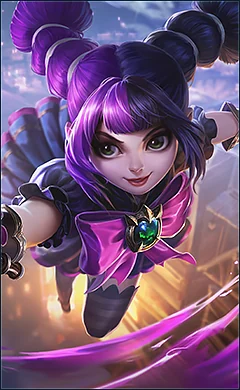

[Тир-лист](https://boostmlbb.ru/heroes/)[Новости и гайды](https://boostmlbb.ru/news/)

# Альфа

C

БоецЛиния опытаЛес

Победы

48,2%

Выбор

0,8%

Баны

0,2%

[Обзор](https://boostmlbb.ru/#overview)[Сборка](https://boostmlbb.ru/#build)[Навыки](https://boostmlbb.ru/#skills)[Контрпики](https://boostmlbb.ru/#draft)[История](https://boostmlbb.ru/#lore)

## Обзор

### Характеристики

-   Живучесть**60**
-   Атака**40**
-   Эффекты**70**
-   Сложность**10**

-   Рывок
-   Урон

### Победы по рангам, 30 дней

1.  **50,1%**Эпик
2.  **49,0%**Легенда
3.  **48,5%**Мифик
4.  **49,0%**Честь
5.  **48,0%**Слава

Пунктир: 50% побед

### Другие бойцы этой линии

[Фрейя](https://boostmlbb.ru/heroes/freya.html)[Аулус](https://boostmlbb.ru/heroes/aulus.html)[Пакито](https://boostmlbb.ru/heroes/paquito.html)[Сан](https://boostmlbb.ru/heroes/sun.html)[Лукас](https://boostmlbb.ru/heroes/lukas.html)[Чичи](https://boostmlbb.ru/heroes/cici.html)[Су Ё](https://boostmlbb.ru/heroes/suyou.html)[Сора](https://boostmlbb.ru/heroes/sora.html)

### Места в рейтингах

-   [Лучшие лесники MLBB**20 из 37**](https://boostmlbb.ru/heroes/best-jungle.html)
-   [Лучшие бойцы MLBB**25 из 44**](https://boostmlbb.ru/heroes/best-fighter.html)

## Сборка

Сборка 1Сборка 2Сборка 3

Победы

55,0%

Выбор

2,4%

#### Основные предметы

-   

    Топор войны

-   

    Пронзающий небеса

-   

    Крылья королевы

#### Заклинание

Месть

#### Эмблема и таланты

Эмблема бойца

-   

    Трепет

-   

    Опытный охотник

-   

    Нечестивая ярость

Победы

58,3%

Выбор

1,8%

#### Основные предметы

-   

    Топор войны

-   

    Пронзающий небеса

-   

    Крылья королевы

#### Заклинание

Месть

#### Эмблема и таланты

Эмблема бойца

-   

    Трепет

-   

    Кровавое пиршество

-   

    Убийственный пир

Победы

60,2%

Выбор

1,2%

#### Основные предметы

-   

    Топор войны

-   

    Клинок отчаяния

-   

    Крылья королевы

#### Заклинание

Месть

#### Эмблема и таланты

Эмблема бойца

-   

    Трепет

-   

    Кровавое пиршество

-   

    Нечестивая ярость

## Навыки

Прокачка**Копье Альфы**_›_**Поворотный импульс**_›_**Поворотный удар**

Пассивный**Бета, вперед!**1-й навык**Поворотный удар**2-й навык**Поворотный импульс**Ультимейт**Копье Альфы**

Пассивный

### Бета, вперед!

Когда Альфа использует навык, для атаки будет призван Бета. Враги, которых Бета поразит 2 р., войдут в состояние захвата цели.

**Захват цели:** после того, как Альфа нанесет урон цели, Бета выстрелит в нее лазером, нанося 60 (+50% общей физической атаки) (+8 × ур. героя) единиц чистого урона и ненадолго применяя мощный эффект замедления.

Этот навык наносит только 75% урона монстрам.

1-й навык

### Поворотный удар

Перезарядка **4 Mana Cost: 50 с**

Альфа выпускает волну энергии в указанном направлении, нанося 100 (+90% дополнительной физической атаки) единиц физического урона врагам на пути и замедляя их на 40% на 1 сек.

Затем Бета обстреливает врагов по тому же пути, нанося 60 (+30% дополнительной физической атаки) единиц чистого урона.

2-й навык

### Поворотный импульс

Перезарядка **6 Mana Cost: 45 с**

После короткой подготовки Альфа взмахивает оружием в указанном направлении, нанося 180 (+100% общей физической атаки) единиц физического урона врагам в веерообразной области и восстанавливая 80 (+40% дополнительной физической атаки) ОЗ за первого пораженного врага (лечение снижается на 40% за каждого последующего пораженного врага).

Затем Бета обстреливает эту же область, нанося 60 (+30% общей физической атаки) единиц чистого урона.

Ультимейт

### Копье Альфы

Бета бросается в указанное место, нанося 100 (+20% дополнительной физической атаки) единиц физического урона пораженным врагам и оглушая их на 1 сек. Затем Альфа прыгает в то же место, подбрасывая врагов на своем пути и перенося их к месту приземления. После этого Альфа приземляется, нанося 250 (+100% дополнительной физической атаки) единиц физического урона и замедляя врагов на 40% на 1.5 сек.

Потом Бета атакует ту же область 5 р., каждый раз нанося 15 (+30% дополнительной физической атаки) единиц чистого урона.

## Контрпики

### Контрпики

Побеждают этого героя

[Фовиус](https://boostmlbb.ru/heroes/phoveus.html)[Одетта](https://boostmlbb.ru/heroes/odette.html)[Бартс](https://boostmlbb.ru/heroes/barats.html)[Сабер](https://boostmlbb.ru/heroes/saber.html)[Фредрин](https://boostmlbb.ru/heroes/fredrinn.html)

### Слабые цели

Этот герой побеждает их

[Чан'Э](https://boostmlbb.ru/heroes/change.html)[Ланселот](https://boostmlbb.ru/heroes/lancelot.html)[Лилия](https://boostmlbb.ru/heroes/lylia.html)[Бенедетта](https://boostmlbb.ru/heroes/benedetta.html)[Ханзо](https://boostmlbb.ru/heroes/hanzo.html)

## История

> Настоящий киборг, созданный Лабораторией 1718.

[Читать полную историю ↗](https://play.mobilelegends.com/lore/hero/alpha)Официальный сайт Mobile Legends [Характеристики на сайте игры ↗](https://www.mobilelegends.com/hero/detail?heroid=28)

**Поднимем ранг на герое «Альфа»**Цена считается в калькуляторе

[Рассчитать цену](https://boostmlbb.ru/order.html?type=hero)

## Частые вопросы

Кто контрпик для героя «Альфа» в MLBB?

За последние 30 дней чаще всего героя обыгрывают Фовиус, Одетта, Бартс, Сабер и Фредрин.

Какой процент побед у героя «Альфа» сейчас?

48,24% в Мифической славе за последние 7 дней и 48,85% на всех рангах за 30 дней, данные на 24 ноября 2026 года.

Какая роль и линия у героя «Альфа»?

Боец, играет на линии опыта или в лесу.

Силён ли герой «Альфа» в текущей мете?

Тир C, 84-е место из 133 героев и 25-е среди бойцов. Тир учитывает, как часто героя берут и банят и как он выигрывает в Мифической славе за 7 дней: бан в 0,2% матчей, 48,2% побед. В профессиональных матчах за месяц героя драфтуют в 1,3% катков.

Какая сборка на героя «Альфа» лучшая?

Самая популярная сборка в рейтинге: ключевые предметы «Топор войны», «Пронзающий небеса» и «Крылья королевы», эмблема бойца с талантами «Трепет», «Опытный охотник» и «Нечестивая ярость» и заклинание «Месть». С ней выигрывают 54,96% матчей.
