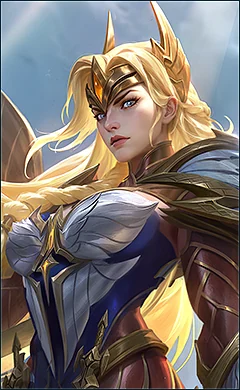
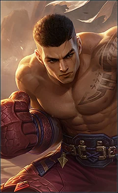

[Тир-лист](https://boostmlbb.ru/heroes/)[Новости и гайды](https://boostmlbb.ru/news/)

# Алукард

C

БоецУбийцаЛес

Победы

49,4%

Выбор

0,4%

Баны

0,1%

[Обзор](https://boostmlbb.ru/#overview)[Сборка](https://boostmlbb.ru/#build)[Навыки](https://boostmlbb.ru/#skills)[Контрпики](https://boostmlbb.ru/#draft)[История](https://boostmlbb.ru/#lore)

## Обзор

### Характеристики

-   Живучесть**50**
-   Атака**50**
-   Эффекты**10**
-   Сложность**30**

-   Преследование
-   Урон

### Победы по рангам, 30 дней

1.  **48,8%**Эпик
2.  **48,9%**Легенда
3.  **49,1%**Мифик
4.  **48,6%**Честь
5.  **49,1%**Слава

Пунктир: 50% побед

### Другие бойцы этой линии

[Фрейя](https://boostmlbb.ru/heroes/freya.html)[Аулус](https://boostmlbb.ru/heroes/aulus.html)[Пакито](https://boostmlbb.ru/heroes/paquito.html)[Сан](https://boostmlbb.ru/heroes/sun.html)[Лукас](https://boostmlbb.ru/heroes/lukas.html)[Су Ё](https://boostmlbb.ru/heroes/suyou.html)[Дариус](https://boostmlbb.ru/heroes/dyrroth.html)[Альфа](https://boostmlbb.ru/heroes/alpha.html)

### Места в рейтингах

-   [Лучшие лесники MLBB**31 из 37**](https://boostmlbb.ru/heroes/best-jungle.html)
-   [Лучшие бойцы MLBB**36 из 44**](https://boostmlbb.ru/heroes/best-fighter.html)
-   [Лучшие убийцы MLBB**25 из 29**](https://boostmlbb.ru/heroes/best-assassin.html)

## Сборка

Сборка 1Сборка 2

Победы

59,7%

Выбор

12,8%

#### Основные предметы

-   

    Топор войны

-   

    Бесконечная битва

-   

    Клинок отчаяния

#### Заклинание

Возмездие

#### Эмблема и таланты

Эмблема убийцы

-   

    Трепет

-   

    Опытный охотник

-   

    Временное правление

Победы

59,2%

Выбор

5,7%

#### Основные предметы

-   

    Удар охотника

-   

    Топор войны

-   

    Бесконечная битва

#### Заклинание

Возмездие

#### Эмблема и таланты

Эмблема убийцы

-   

    Трепет

-   

    Мастер оружий

-   

    Временное правление

## Навыки

Прокачка**Расщепляющая волна**_›_**Круговой удар**_›_**Разрушающий землю**

Пассивный**Преследование**1-й навык**Разрушающий землю**2-й навык**Круговой удар**Ультимейт**Расщепляющая волна**

Пассивный

### Преследование

После каждого применения навыка следующая базовая атака Алукарда позволяет ему совершить рывок к цели и нанести (+125% общей физической атаки) единиц физического урона.

**Охотник на демонов:** Алукард наносит 110% урона монстрам.

1-й навык

### Разрушающий землю

Перезарядка **8.5 с**

Алукард прыгает в указанную область и наносит рубящий удар, нанося 270 (+85% дополнительной физической атаки) единиц физического урона врагам в области и замедляя их на 40% на 2 сек.

2-й навык

### Круговой удар

Перезарядка **6 с**

Алукард совершает круговой удар, нанося 345 (+120% дополнительной физической атаки) единиц физического урона ближайшим врагам.

Ультимейт

### Расщепляющая волна

Перезарядка **40 с**

**Пассивный:** Алукард навсегда получает 10% гибридного вампиризма.

**Активный:** Алукард поглощает энергию врагов в указанной области, снижая их скорость передвижения на 30% и на 10. Он получает 10 за каждого пораженного вражеского героя и сокращает перезарядку других своих навыков до 50% на 6 сек.

**Повторное использование:** Алукард выпускает мощную ударную волну вперед, нанося 400 (+200% дополнительной физической атаки) единиц физического урона.

## Контрпики

### Контрпики

Побеждают этого героя

[Наталья](https://boostmlbb.ru/heroes/natalia.html)[Сан](https://boostmlbb.ru/heroes/sun.html)[Матильда](https://boostmlbb.ru/heroes/mathilda.html)[Сабер](https://boostmlbb.ru/heroes/saber.html)[Харит](https://boostmlbb.ru/heroes/harith.html)

### Слабые цели

Этот герой побеждает их

[Тигрил](https://boostmlbb.ru/heroes/tigreal.html)[Тамуз](https://boostmlbb.ru/heroes/thamuz.html)[Бартс](https://boostmlbb.ru/heroes/barats.html)[Фредрин](https://boostmlbb.ru/heroes/fredrinn.html)[Хуфра](https://boostmlbb.ru/heroes/khufra.html)[Акай](https://boostmlbb.ru/heroes/akai.html)

## История

> Охотник на демонов, ненавидящий тьму.

[Читать полную историю ↗](https://play.mobilelegends.com/lore/hero/Alucard)Официальный сайт Mobile Legends [Характеристики на сайте игры ↗](https://www.mobilelegends.com/hero/detail?heroid=7)

**Поднимем ранг на герое «Алукард»**Цена считается в калькуляторе

[Рассчитать цену](https://boostmlbb.ru/order.html?type=hero)

## Частые вопросы

Кто контрпик для героя «Алукард» в MLBB?

За последние 30 дней чаще всего героя обыгрывают Наталья, Сан, Матильда, Сабер и Харит.

Какой процент побед у героя «Алукард» сейчас?

49,38% в Мифической славе за последние 7 дней и 48,91% на всех рангах за 30 дней, данные на 25 ноября 2026 года.

Какая роль и линия у героя «Алукард»?

Боец и убийца, играет в лесу.

Силён ли герой «Алукард» в текущей мете?

Тир C, 111-е место из 133 героев и 36-е среди бойцов. Тир учитывает, как часто героя берут и банят и как он выигрывает в Мифической славе за 7 дней: бан в 0,1% матчей, 49,4% побед. В профессиональных матчах за месяц героя драфтуют в 0,0% катков.

Какая сборка на героя «Алукард» лучшая?

Самая популярная сборка в рейтинге: ключевые предметы «Топор войны», «Бесконечная битва» и «Клинок отчаяния», эмблема убийцы с талантами «Трепет», «Опытный охотник» и «Временное правление» и заклинание «Возмездие». С ней выигрывают 59,72% матчей.
