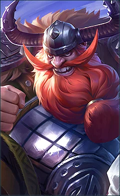
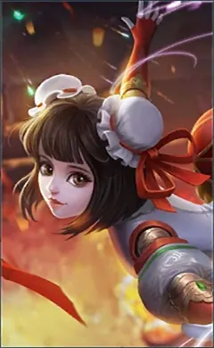

[Тир-лист](https://boostmlbb.ru/heroes/)

# Ангела

B

ПоддержкаРоум

Победы

49,6%

Выбор

1,9%

Баны

11,1%

[Обзор](https://boostmlbb.ru/#overview)[Сборка](https://boostmlbb.ru/#build)[Как играть](https://boostmlbb.ru/#howto)[Навыки](https://boostmlbb.ru/#skills)[Контрпики](https://boostmlbb.ru/#draft)[Скины](https://boostmlbb.ru/#skins)[История](https://boostmlbb.ru/#lore)

## Обзор

### Характеристики

-   Живучесть**30**
-   Атака**20**
-   Эффекты**50**
-   Сложность**60**

-   Защита
-   Поддержка

### Победы по рангам, 30 дней

1.  **51,7%**Эпик
2.  **50,8%**Легенда
3.  **50,0%**Мифик
4.  **49,6%**Честь
5.  **49,9%**Слава

Пунктир: 50% побед

### Другие герои поддержки этой линии

[Марсель](https://boostmlbb.ru/heroes/marcel.html)[Эстес](https://boostmlbb.ru/heroes/estes.html)[Кайя](https://boostmlbb.ru/heroes/kaja.html)[Флорин](https://boostmlbb.ru/heroes/floryn.html)[Рафаэль](https://boostmlbb.ru/heroes/rafaela.html)[Дигги](https://boostmlbb.ru/heroes/diggie.html)

### Места в рейтингах

-   [Лучшие роумеры MLBB**13 из 34**](https://boostmlbb.ru/heroes/best-roam.html)

## Сборка

Сборка 1Сборка 2Сборка 3

Победы

56,7%

Выбор

16,0%

#### Основные предметы

-   [

    

    Фляга Оазиса

    ](https://boostmlbb.ru/items/flask-of-the-oasis.html)
-   [

    

    Пылающий жезл

    ](https://boostmlbb.ru/items/glowing-wand.html)
-   [

    

    Зачарованный талисман

    ](https://boostmlbb.ru/items/enchanted-talisman.html)

#### Заклинание

Вспышка

#### Эмблема и таланты

Эмблема поддержки

-   

    Вдохновение

-   

    Охотник за скидками

-   

    Фокус-метка

Победы

55,6%

Выбор

9,1%

#### Основные предметы

-   [

    

    Фляга Оазиса

    ](https://boostmlbb.ru/items/flask-of-the-oasis.html)
-   [

    

    Мимолетное время

    ](https://boostmlbb.ru/items/fleeting-time.html)
-   [

    

    Пылающий жезл

    ](https://boostmlbb.ru/items/glowing-wand.html)

#### Заклинание

Вспышка

#### Эмблема и таланты

Эмблема поддержки

-   

    Вдохновение

-   

    Охотник за скидками

-   

    Фокус-метка

Победы

56,1%

Выбор

4,2%

#### Основные предметы

-   [

    

    Фляга Оазиса

    ](https://boostmlbb.ru/items/flask-of-the-oasis.html)
-   [

    

    Пылающий жезл

    ](https://boostmlbb.ru/items/glowing-wand.html)
-   [

    

    Мимолетное время

    ](https://boostmlbb.ru/items/fleeting-time.html)

#### Заклинание

Вспышка

#### Эмблема и таланты

Эмблема поддержки

-   

    Вдохновение

-   

    Охотник за скидками

-   

    Фокус-метка

## Как играть за Ангелу

### Комбо Ангелы

#### В драке

1.  Ульт
2.  1
3.  2
4.  1

В драке ультом прикрепитесь к сильному союзнику, первым навыком наносите урон или лечите. Тех, кто лезет вплотную, ловите вторым и добавляйте первый.

#### На линии

1.  1
2.  2
3.  1

На линии постоянно тревожьте первым навыком. Когда у цели мало здоровья, поймайте вторым и добивайте первым.

### Когда сильнее всего

Сильнее в долгой игре: на 16–18 минутах выигрывает 50,8%. Не рискуйте в начале, фармите и ввязывайтесь в драки вместе с командой.

1.  **44,4**10–12
2.  **50,6**12–14
3.  **51,8**14–16
4.  **50,8**16–18
5.  **50,2**18–20
6.  **49,6**20+

Проценты побед по длине матча в минутах, все ранги. Пунктир: 50%

### Приоритет прокачки

1.  Защитник сердца
2.  Марионетка
3.  Волны любви

## Навыки

Пассивный**Умное сердце**1-й навык**Волны любви**2-й навык**Марионетка**Ультимейт**Защитник сердца**

Пассивный

### Умное сердце

Каждый раз, когда Ангела использует навык, она получает 5% доп. скорости передвижения на 4 сек. (до 20%). Союзник, к которому она присоединена, также получает бонус к скорости передвижения.

1-й навык

### Волны любви

Перезарядка **2 Mana Cost: 60 с**

Ангела отправляет "Волны любви" в указанном направлении, нанося 170 (+80% общей магической силы) единиц магического урона пораженным врагам, ненадолго раскрывая их местоположение и накладывая заряд любовной метки (до 5 зарядов). Каждый заряд любовной метки увеличивает урон на 20% и замедляет пораженных врагов на 8% на 3 сек.

"Волны любви" также восстанавливают 150 (+75% общей магической силы) ОЗ союзным героям при попадании. Ангела может накопить до 5 зарядов этого навыка, а время накопления зависит от сокращения перезарядки.

Когда Ангела присоединена к союзникам, перезарядка этого навыка сокращается на 50%.

2-й навык

### Марионетка

Перезарядка **13 Mana Cost: 90 с**

Ангела запускает нить марионетки в указанного врага (кроме миньонов), нанося 300 (+40% общей магической силы) единиц магического урона и постепенно замедляя его вплоть до 80%. Если через 3 сек. враг еще находится в контакте с нитью, то он будет обездвижен на 1.5 сек. и получит 450 (+60% общей магической силы) единиц магического урона.

Каждый заряд любовной метки увеличивает окончательный урон на 20%.

Ультимейт

### Защитник сердца

Перезарядка **60 Mana Cost: 100 с**

Ангела начинает подготовку и дает указанному союзнику 600 (+150% общей магической силы) ед. щита вне зависимости от удаленности. Как только она присоединится к союзнику, щит останется до тех пор, пока она не отсоединится. По завершении подготовки она присоединяется к союзному герою на 20 сек. и на это время получает возможность использовать все навыки без затрат маны.

Ангела может использовать навык снова, чтобы прервать подготовку или отсоединиться от союзника. Присоединенное состояние закончится раньше, если союзник умрет.

## Контрпики Ангелы

### Кто контрит Ангелу

[Алиса](https://boostmlbb.ru/heroes/alice.html)[Марсель](https://boostmlbb.ru/heroes/marcel.html)[Бальмонд](https://boostmlbb.ru/heroes/balmond.html)[Ланселот](https://boostmlbb.ru/heroes/lancelot.html)[Фарамис](https://boostmlbb.ru/heroes/faramis.html)

### Кого контрит Ангела

[Сильвана](https://boostmlbb.ru/heroes/silvanna.html)[Франко](https://boostmlbb.ru/heroes/franco.html)

## Скины Ангелы

[Нити судьбыГрандиозный · 2025](https://boostmlbb.ru/skins/angela/strings-of-fate.html)[Аватар времениИзысканный · 2023](https://boostmlbb.ru/skins/angela/avatar-of-time.html)[Струны сердцаГрандиозный · 2022](https://boostmlbb.ru/skins/angela/heartstring.html)[Цветочная эльфийкаИзысканный · 2021](https://boostmlbb.ru/skins/angela/floral-elf.html)[Кибер-херувимГрандиозный · 2020](https://boostmlbb.ru/skins/angela/cyber-cherubin.html)[Кричащая куклаИсключительный · 2019](https://boostmlbb.ru/skins/angela/scream-doll.html)[Оса V.E.N.O.M.Делюкс · 2019](https://boostmlbb.ru/skins/angela/v-e-n-o-m-vespid.html)[Летнее настроениеИсключительный · 2019](https://boostmlbb.ru/skins/angela/summer-vibes.html)[Шанхайская деваИсключительный · 2018](https://boostmlbb.ru/skins/angela/shanghai-maiden.html)[Голубка любвиОбычный · 2018](https://boostmlbb.ru/skins/angela/dove-love.html)[Заводная курьерша](https://boostmlbb.ru/skins/angela/wind-up-courier.html)

[Все 11 скинов Ангелы: цены и как получить](https://boostmlbb.ru/skins/angela.html)

## История

> Искусственный человек, созданный в Лаборатории 1718.

[Читать полную историю ↗](https://kazukiofficial.com/stories/angela)Kazuki Official, английский [Характеристики на сайте игры ↗](https://www.mobilelegends.com/hero/detail?heroid=55)

**Поднимем ранг на герое «Ангела»**Цена считается в калькуляторе

[Рассчитать цену](https://boostmlbb.ru/order.html?type=hero)

## Частые вопросы

Кто контрит Ангелу в MLBB?

За последние 30 дней Ангелу чаще всего обыгрывают Алиса, Марсель, Бальмонд, Ланселот и Фарамис.

Как играть за Ангелу?

В первую очередь качайте «Марионетка», ульт берите, как только доступен. Сильнее в долгой игре: на 16–18 минутах выигрывает 50,8%. Не рискуйте в начале, фармите и ввязывайтесь в драки вместе с командой. Комбо для драки: В драке ультом прикрепитесь к сильному союзнику, первым навыком наносите урон или лечите. Тех, кто лезет вплотную, ловите вторым и добавляйте первый.

Какой процент побед у Ангелы сейчас?

49,58% в Мифической славе за последние 7 дней и 50,03% на всех рангах за 30 дней, данные на 27 ноября 2026 года.

Какая роль и линия у Ангелы?

Поддержка, играет в роуме.

Стоит ли брать Ангелу в текущей мете?

Тир B, 35-е место из 133 героев и 9-е среди героев поддержки. Тир учитывает, как часто героя берут и банят и как он выигрывает в Мифической славе за 7 дней: бан в 11,1% матчей, 49,6% побед. В профессиональных матчах за месяц героя драфтуют в 0,3% катков.

Какая сборка на Ангелу лучшая?

Самая популярная сборка в рейтинге: ключевые предметы «Фляга Оазиса», «Пылающий жезл» и «Зачарованный талисман», эмблема поддержки с талантами «Вдохновение», «Охотник за скидками» и «Фокус-метка» и заклинание «Вспышка». С ней выигрывают 56,70% матчей.
