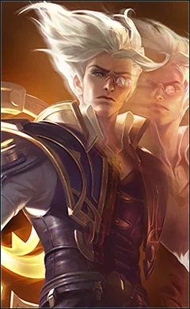

[Тир-лист](https://boostmlbb.ru/heroes/)[Новости и гайды](https://boostmlbb.ru/news/)

# Арлотт

B

БоецУбийцаЛиния опыта

Победы

48,1%

Выбор

0,7%

Баны

0,8%

[Обзор](https://boostmlbb.ru/#overview)[Сборка](https://boostmlbb.ru/#build)[Навыки](https://boostmlbb.ru/#skills)[Контрпики](https://boostmlbb.ru/#draft)[История](https://boostmlbb.ru/#lore)

## Обзор

### Характеристики

-   Живучесть**60**
-   Атака**60**
-   Эффекты**50**
-   Сложность**70**

-   Рывок
-   Разрушительный урон

### Победы по рангам, 30 дней

1.  **46,6%**Эпик
2.  **46,5%**Легенда
3.  **46,7%**Мифик
4.  **47,4%**Честь
5.  **48,1%**Слава

Пунктир: 50% побед

### Другие бойцы этой линии

[Фрейя](https://boostmlbb.ru/heroes/freya.html)[Аулус](https://boostmlbb.ru/heroes/aulus.html)[Пакито](https://boostmlbb.ru/heroes/paquito.html)[Сан](https://boostmlbb.ru/heroes/sun.html)[Лукас](https://boostmlbb.ru/heroes/lukas.html)[Чичи](https://boostmlbb.ru/heroes/cici.html)[Сора](https://boostmlbb.ru/heroes/sora.html)[Чонг](https://boostmlbb.ru/heroes/yu-zhong.html)

## Сборка

Сборка 1Сборка 2Сборка 3

Победы

56,3%

Выбор

4,2%

#### Основные предметы

-   

    Трезубец

-   

    Пронзающий небеса

-   

    Злобный рык

#### Заклинание

Окаменение

#### Эмблема и таланты

Эмблема убийцы

-   

    Разрыв

-   

    Мастер-убийца

-   

    Смертельное воспламенение

Победы

51,9%

Выбор

4,2%

#### Основные предметы

-   

    Пронзающий небеса

-   

    Трезубец

-   

    Злобный рык

#### Заклинание

Окаменение

#### Эмблема и таланты

Эмблема убийцы

-   

    Разрыв

-   

    Мастер-убийца

-   

    Смертельное воспламенение

Победы

56,4%

Выбор

1,3%

#### Основные предметы

-   

    Топор войны

-   

    Господство льда

-   

    Оракул

#### Заклинание

Окаменение

#### Эмблема и таланты

Эмблема бойца

-   

    Трепет

-   

    Кровавое пиршество

-   

    Отвага

## Навыки

Прокачка**Последний удар**_›_**Отмщение**_›_**Бесстрашный удар**

Пассивный**Демонический взгляд**1-й навык**Бесстрашный удар**2-й навык**Отмщение**Ультимейт**Последний удар**

Пассивный

### Демонический взгляд

Арлотт обладает демоническим глазом, который отмечает ближайших врагов, попавших под эффекты контроля, на 7 сек.

Глаз также автоматически отмечает ближайшего вражеского героя в поле зрения каждые 7 сек.

1-й навык

### Бесстрашный удар

Перезарядка **8 с**

Арлотт взмахивает копьем вперед, нанося 200 (+60% общей физической атаки) единиц физического урона и ненадолго оглушая цели в области. Цели, пораженные дальней частью области действия, будут оглушены на 1 сек.

2-й навык

### Отмщение

Перезарядка **10 с**

Арлотт совершает рывок к врагу, нанося 135 (+60% общей физической атаки) единиц физического урона (навык нельзя прервать во время движения).

Если цель Арлотта отмечена, он ненадолго увеличивает скорость передвижения, а этот навык наносит двойной урон, мгновенно сбрасывает перезарядку и восстанавливает ему 70 (+60% общей физической атаки) единиц ОЗ (восстанавливается только 50% от этого количества, если навык используется не на героях).

Ультимейт

### Последний удар

Перезарядка **24 с**

**Пассивный:** с каждым повышением уровня интервал "Демонического взгляда" уменьшается на 1 сек.

**Активный:** Арлотт рассекает врагов перед собой, нанося 400 (+80% общей физической атаки) единиц физического урона врагам в области, отталкивая их к краю области действия и ненадолго раскрывая их местоположение (этот навык можно прервать только подавлением).

## Контрпики

### Контрпики

Побеждают этого героя

[Икс.Борг](https://boostmlbb.ru/heroes/x-borg.html)[Чичи](https://boostmlbb.ru/heroes/cici.html)[Натан](https://boostmlbb.ru/heroes/natan.html)[Чжусинь](https://boostmlbb.ru/heroes/zhuxin.html)[Кимми](https://boostmlbb.ru/heroes/kimmy.html)

### Слабые цели

Этот герой побеждает их

[Лукас](https://boostmlbb.ru/heroes/lukas.html)[Аргус](https://boostmlbb.ru/heroes/argus.html)[Заск](https://boostmlbb.ru/heroes/zhask.html)[Кусака](https://boostmlbb.ru/heroes/jawhead.html)

## История

> Наполовину человек, наполовину демон, вооруженный двумя копьями. Жаждет отомстить как Церкви, так и демонам.

[Читать полную историю ↗](https://play.mobilelegends.com/lore/hero/Arlott)Официальный сайт Mobile Legends [Характеристики на сайте игры ↗](https://www.mobilelegends.com/hero/detail?heroid=120)

**Поднимем ранг на герое «Арлотт»**Цена считается в калькуляторе

[Рассчитать цену](https://boostmlbb.ru/order.html?type=hero)

## Частые вопросы

Кто контрпик для героя «Арлотт» в MLBB?

За последние 30 дней чаще всего героя обыгрывают Икс.Борг, Чичи, Натан, Чжусинь и Кимми.

Какой процент побед у героя «Арлотт» сейчас?

48,06% в Мифической славе за последние 7 дней и 47,49% на всех рангах за 30 дней, данные на 23 ноября 2026 года.

Какая роль и линия у героя «Арлотт»?

Боец и убийца, играет на линии опыта.

Силён ли герой «Арлотт» в текущей мете?

Тир B, 63-е место из 133 героев и 18-е среди бойцов. Тир учитывает, как часто героя берут и банят и как он выигрывает в Мифической славе за 7 дней: бан в 0,8% матчей, 48,1% побед. В профессиональных матчах за месяц героя драфтуют в 12,5% катков.

Какая сборка на героя «Арлотт» лучшая?

Самая популярная сборка в рейтинге: ключевые предметы «Трезубец», «Пронзающий небеса» и «Злобный рык», эмблема убийцы с талантами «Разрыв», «Мастер-убийца» и «Смертельное воспламенение» и заклинание «Окаменение». С ней выигрывают 56,26% матчей.
