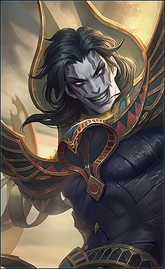
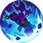
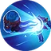

[Тир-лист](https://boostmlbb.ru/heroes/)[Новости и гайды](https://boostmlbb.ru/news/)

# Атлас

A

ТанкРоум

Победы

48,8%

Выбор

1,0%

Баны

8,5%

[Обзор](https://boostmlbb.ru/#overview)[Сборка](https://boostmlbb.ru/#build)[Навыки](https://boostmlbb.ru/#skills)[Контрпики](https://boostmlbb.ru/#draft)[История](https://boostmlbb.ru/#lore)

## Обзор

### Характеристики

-   Живучесть**80**
-   Атака**10**
-   Эффекты**90**
-   Сложность**50**

-   Массовый контроль
-   Инициатор

### Победы по рангам, 30 дней

1.  **55,5%**Эпик
2.  **54,5%**Легенда
3.  **53,2%**Мифик
4.  **51,7%**Честь
5.  **49,7%**Слава

Пунктир: 50% побед

### Другие танки этой линии

[Кармилла](https://boostmlbb.ru/heroes/carmilla.html)[Белерик](https://boostmlbb.ru/heroes/belerick.html)[Глу](https://boostmlbb.ru/heroes/gloo.html)[Минотавр](https://boostmlbb.ru/heroes/minotaur.html)[Хуфра](https://boostmlbb.ru/heroes/khufra.html)[Тигрил](https://boostmlbb.ru/heroes/tigreal.html)[Хильда](https://boostmlbb.ru/heroes/hilda.html)[Гатоткача](https://boostmlbb.ru/heroes/gatotkaca.html)

### Места в рейтингах

-   [Лучшие танки MLBB**4 из 25**](https://boostmlbb.ru/heroes/best-tank.html)
-   [Лучшие роумеры MLBB**5 из 34**](https://boostmlbb.ru/heroes/best-roam.html)

## Сборка

Сборка 1Сборка 2Сборка 3

Победы

56,3%

Выбор

8,9%

#### Основные предметы

-   

    Господство льда

-   

    Наплечник наказания

-   

    Древняя кираса

#### Заклинание

Вспышка

#### Эмблема и таланты

Эмблема танка

-   

    Ловкость

-   

    Благословение природы

-   

    Ударная волна

Победы

52,4%

Выбор

4,1%

#### Основные предметы

-   

    Господство льда

-   

    Мимолетное время

-   

    Сияющая броня

#### Заклинание

Вспышка

#### Эмблема и таланты

Эмблема танка

-   

    Ловкость

-   

    Благословение природы

-   

    Ударная волна

Победы

53,3%

Выбор

1,9%

#### Основные предметы

-   

    Господство льда

-   

    Мимолетное время

-   

    Щит Афины

#### Заклинание

Вспышка

#### Эмблема и таланты

Эмблема танка

-   

    Ловкость

-   

    Благословение природы

-   

    Ударная волна

## Навыки

Прокачка**Смертоносные цепи**_›_**Истребление**_›_**Идеальный дуэт**

Пассивный**Холодное дыхание**1-й навык**Истребление**2-й навык**Идеальный дуэт**Ультимейт**Смертоносные цепи**

Пассивный

### Холодное дыхание

При каждом использовании навыка Атлас создает вокруг себя "Холодное дыхание" на 4 сек. Враги под действием "Холодного дыхания" будут постепенно замедляться в течение 2 сек., после чего заморозятся на 0.5 сек.

Атлас получает 20 (+0.5% доп. макс. ОЗ) доп. , когда существует "Холодное дыхание".

1-й навык

### Истребление

Перезарядка **7 Mana Cost: 60 с**

Атлас бьет по земле и вызывает 3 взрыва, нанося врагам 400 (+100% общей магической силы) единиц магического урона.

**Извлеченное состояние:** если Атлас находится вне Механического стража, они оба одновременно используют "Истребление".

2-й навык

### Идеальный дуэт

Перезарядка **0 Mana Cost: 75 с**

Атлас входит в извлеченное состояние, получая 30% скорости передвижения и иммунитет к эффектам замедления. В этом состоянии механический страж будет следовать за Атласом с увеличенной скоростью (можно контролировать лишь подавлением). Когда они встретятся, Атлас вернется к стражу, нанося 320 (+80% общей магической силы) единиц мaгического урона врагам вблизи и оглушая их на 0.8 сек.

**Извлеченное состояние:** Атлас и его страж имеют одинаковую шкалу ОЗ и получают 50% снижения урона в этом состоянии.

Ультимейт

### Смертоносные цепи

Перезарядка **55 Mana Cost: 130 с**

Атлас набрасывает цепи на всех ближайших героев и начинает подготовку (можно прервать только подавлением), нанося 225 (+75% общей магической силы) единиц мaгического урона пораженным вражеским героям и замедляя их на 40% на 3 сек.

**Отпускание навыка во время подготовки:** Атлас притянет цели к себе и бросит их в указанное место, нанося 360 (+180% общей магической силы) единиц мaгического урона.

Использование навыка в извлеченном состоянии: механический страж вернется к Атласу немедленно, но эффект оглушения будет заменен на 40% эффекта замедления.

## Контрпики

### Контрпики

Побеждают этого героя

[Лейла](https://boostmlbb.ru/heroes/layla.html)[Пополь и Купа](https://boostmlbb.ru/heroes/popol-and-kupa.html)[Лолита](https://boostmlbb.ru/heroes/lolita.html)[Джонсон](https://boostmlbb.ru/heroes/johnson.html)[Эстес](https://boostmlbb.ru/heroes/estes.html)

### Слабые цели

Этот герой побеждает их

[Алиса](https://boostmlbb.ru/heroes/alice.html)[Москов](https://boostmlbb.ru/heroes/moskov.html)[Кимми](https://boostmlbb.ru/heroes/kimmy.html)[Ксавьер](https://boostmlbb.ru/heroes/xavier.html)[Кадита](https://boostmlbb.ru/heroes/kadita.html)[Линг](https://boostmlbb.ru/heroes/ling.html)[Чонг](https://boostmlbb.ru/heroes/yu-zhong.html)[Фанни](https://boostmlbb.ru/heroes/fanny.html)[Ланселот](https://boostmlbb.ru/heroes/lancelot.html)[Бенедетта](https://boostmlbb.ru/heroes/benedetta.html)

## История

> Создание из Ужасного моря, вырвавшееся из заточения.

[Читать полную историю ↗](https://kazukiofficial.com/stories/atlas)Kazuki Official, английский [Характеристики на сайте игры ↗](https://www.mobilelegends.com/hero/detail?heroid=93)

**Поднимем ранг на герое «Атлас»**Цена считается в калькуляторе

[Рассчитать цену](https://boostmlbb.ru/order.html?type=hero)

## Частые вопросы

Кто контрпик для героя «Атлас» в MLBB?

За последние 30 дней чаще всего героя обыгрывают Лейла, Пополь и Купа, Лолита, Джонсон и Эстес.

Какой процент побед у героя «Атлас» сейчас?

48,81% в Мифической славе за последние 7 дней и 51,29% на всех рангах за 30 дней, данные на 25 ноября 2026 года.

Какая роль и линия у героя «Атлас»?

Танк, играет в роуме.

Силён ли герой «Атлас» в текущей мете?

Тир A, 12-е место из 133 героев и 4-е среди танков. Тир учитывает, как часто героя берут и банят и как он выигрывает в Мифической славе за 7 дней: бан в 8,5% матчей, 48,8% побед. В профессиональных матчах за месяц героя драфтуют в 75,1% катков.

Какая сборка на героя «Атлас» лучшая?

Самая популярная сборка в рейтинге: ключевые предметы «Господство льда», «Наплечник наказания» и «Древняя кираса», эмблема танка с талантами «Ловкость», «Благословение природы» и «Ударная волна» и заклинание «Вспышка». С ней выигрывают 56,25% матчей.
