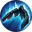

[Тир-лист](https://boostmlbb.ru/heroes/)[Предметы](https://boostmlbb.ru/items/)[Новости и гайды](https://boostmlbb.ru/news/)

# Баданг

B

БоецЛиния опытаРоум

Победы

49,9%

Выбор

1,5%

Баны

5,0%

[Обзор](https://boostmlbb.ru/#overview)[Сборка](https://boostmlbb.ru/#build)[Как играть](https://boostmlbb.ru/#howto)[Навыки](https://boostmlbb.ru/#skills)[Контрпики](https://boostmlbb.ru/#draft)[История](https://boostmlbb.ru/#lore)

## Обзор

### Характеристики

-   Живучесть**40**
-   Атака**70**
-   Эффекты**50**
-   Сложность**30**

-   Рывок
-   Разрушительный урон

### Победы по рангам, 30 дней

1.  **50,1%**Эпик
2.  **50,5%**Легенда
3.  **50,7%**Мифик
4.  **50,6%**Честь
5.  **49,7%**Слава

Пунктир: 50% побед

### Другие бойцы этой линии

[Фрейя](https://boostmlbb.ru/heroes/freya.html)[Калеа](https://boostmlbb.ru/heroes/kalea.html)[Аулус](https://boostmlbb.ru/heroes/aulus.html)[Пакито](https://boostmlbb.ru/heroes/paquito.html)[Сан](https://boostmlbb.ru/heroes/sun.html)[Лукас](https://boostmlbb.ru/heroes/lukas.html)[Чичи](https://boostmlbb.ru/heroes/cici.html)[Сора](https://boostmlbb.ru/heroes/sora.html)

### Места в рейтингах

-   [Лучшие бойцы MLBB**13 из 44**](https://boostmlbb.ru/heroes/best-fighter.html)
-   [Лучшие роумеры MLBB**14 из 34**](https://boostmlbb.ru/heroes/best-roam.html)

## Сборка

Сборка 1Сборка 2Сборка 3

Победы

57,3%

Выбор

1,8%

#### Основные предметы

-   [

    

    Штормовой пояс

    ](https://boostmlbb.ru/items/thunder-belt.html)
-   [

    

    Господство льда

    ](https://boostmlbb.ru/items/dominance-ice.html)
-   [

    

    Наплечник наказания

    ](https://boostmlbb.ru/items/chastise-pauldron.html)

#### Заклинание

Вспышка

#### Эмблема и таланты

Эмблема поддержки

-   

    Ловкость

-   

    Благословение природы

-   

    Ударная волна

Победы

57,2%

Выбор

1,4%

#### Основные предметы

-   [

    

    Штормовой пояс

    ](https://boostmlbb.ru/items/thunder-belt.html)
-   [

    

    Господство льда

    ](https://boostmlbb.ru/items/dominance-ice.html)
-   [

    

    Древняя кираса

    ](https://boostmlbb.ru/items/antique-cuirass.html)

#### Заклинание

Вспышка

#### Эмблема и таланты

Эмблема поддержки

-   

    Ловкость

-   

    Благословение природы

-   

    Ударная волна

Победы

57,6%

Выбор

1,2%

#### Основные предметы

-   [

    

    Штормовой пояс

    ](https://boostmlbb.ru/items/thunder-belt.html)
-   [

    

    Наплечник наказания

    ](https://boostmlbb.ru/items/chastise-pauldron.html)
-   [

    

    Меч охотника на демонов

    ](https://boostmlbb.ru/items/demon-hunter-sword.html)

#### Заклинание

Вспышка

#### Эмблема и таланты

Эмблема поддержки

-   

    Ловкость

-   

    Благословение природы

-   

    Ударная волна

## Как играть за Баданга

### Комбо Баданга

#### В драке

1.  2
2.  Ульт
3.  1
4.  Атака

В драке, когда враги кучно, заприте нескольких барьером второго навыка и ультом раз за разом вбивайте в него. Продолжайте первым и атаками.

#### На линии

1.  1
2.  2
3.  1
4.  Атака

На линии подтачивайте первым навыком, заприте вторым и первым вбейте в барьер с оглушением. Добивайте атаками.

### Когда сильнее всего

Сила ровная всю игру, от 48,2% до 50,2%. Выбирайте драки по готовым предметам, а не по минутам.

1.  **48,2**10–12
2.  **49,7**12–14
3.  **50,2**14–16
4.  **50,1**16–18
5.  **49,9**18–20
6.  **49,7**20+

Проценты побед по длине матча в минутах, все ранги. Пунктир: 50%

### Приоритет прокачки

1.  Раскалывающий кулак
2.  Кулачный ветер
3.  Пробивающий кулак

## Навыки

Пассивный**Рыцарский кулак**1-й навык**Кулачный ветер**2-й навык**Пробивающий кулак**Ультимейт**Раскалывающий кулак**

Пассивный

### Рыцарский кулак

Каждый раз, когда базовая атака Баданга попадает по цели, он получает заряд "Рыцарского кулака". После получения 4 зарядов его следующая базовая атака нанесет пораженным врагам 50 (+30% общей физической атаки) единиц дополнительного физического урона и отбросит их. Враги, отброшенные к препятствиям, будут оглушены на 0.6 сек. (миньоны и монстры будут оглушены сразу).

"Кулачный ветер", создаваемый навыками Баданга, напрямую активирует этот эффект, а "Кулачный ветер" от ультимейта увеличивает длительность оглушения до 1 сек.

1-й навык

### Кулачный ветер

Перезарядка **2 с**

Баданг выпускает порыв "Кулачного ветра" в указанном направлении, нанося 125 (+90% общей физической атаки) единиц физического урона пораженным врагам, отбрасывая и замедляя их на 30% на 1.5 сек. При столкновении с препятствием "Кулачный ветер" взрывается, нанося 100 (+60% общей физической атаки) единиц физического урона ближайшим врагам. "Кулачный ветер" активирует эффекты атаки и дает Бадангу 1 заряд "Рыцарского кулака".

Баданг накапливает до 2 зарядов "Кулачного ветра" и восстанавливает 1 заряд каждые 10.4 сек.

2-й навык

### Пробивающий кулак

Перезарядка **11 с**

Баданг совершает рывок в указанном направлении, нанося 230 (+50% общей физической атаки) единиц физического урона врагам на пути и получая 350 (+150% общей физической атаки) ед. щита на 5 сек. Он останавливается сразу же после попадания во вражеского героя, слегка отбрасывая его и создавая позади него препятствие, которое существует 4 сек. Враги, пораженные препятствием, получают 130 (+30% общей физической атаки) единиц физического урона.

**Повторное использование:** Баданг устраняет созданное им препятствие.

Ультимейт

### Раскалывающий кулак

Перезарядка **45 с**

Баданг совершает серию ударов в указанном направлении, нанося 60 (+54% общей физической атаки) единиц физического урона пораженным несколько раз врагам (может активировать эффекты атаки). "Кулачный ветер", создаваемый ударами, взрывается при попадании в препятствие, нанося 30 (+27% общей физической атаки) единиц физического урона ближайшим врагам.

Баданг невосприимчив к эффектам контроля во время навыка.

## Контрпики Баданга

### Кто контрит Баданга

[Фанни](https://boostmlbb.ru/heroes/fanny.html)[Сан](https://boostmlbb.ru/heroes/sun.html)[Зилонг](https://boostmlbb.ru/heroes/zilong.html)[Хаябуса](https://boostmlbb.ru/heroes/hayabusa.html)[Джой](https://boostmlbb.ru/heroes/joy.html)

## История

> Защитник острова Солари, обладающий невероятной мощью морского зверя.

[Читать полную историю ↗](https://kazukiofficial.com/stories/badang)Kazuki Official, английский [Характеристики на сайте игры ↗](https://www.mobilelegends.com/hero/detail?heroid=77)

**Поднимем ранг на герое «Баданг»**Цена считается в калькуляторе

[Рассчитать цену](https://boostmlbb.ru/order.html?type=hero)

## Частые вопросы

Кто контрит Баданга в MLBB?

За последние 30 дней Баданга чаще всего обыгрывают Фанни, Сан, Зилонг, Хаябуса и Джой.

Как играть за Баданга?

В первую очередь качайте «Кулачный ветер», ульт берите, как только доступен. Сила ровная всю игру, от 48,2% до 50,2%. Выбирайте драки по готовым предметам, а не по минутам. Комбо для драки: В драке, когда враги кучно, заприте нескольких барьером второго навыка и ультом раз за разом вбивайте в него. Продолжайте первым и атаками.

Какой процент побед у Баданга сейчас?

49,91% в Мифической славе за последние 7 дней и 50,18% на всех рангах за 30 дней, данные на 25 ноября 2026 года.

Какая роль и линия у Баданга?

Боец, играет на линии опыта или в роуме.

Стоит ли брать Баданга в текущей мете?

Тир B, 43-е место из 133 героев и 13-е среди бойцов. Тир учитывает, как часто героя берут и банят и как он выигрывает в Мифической славе за 7 дней: бан в 5,0% матчей, 49,9% побед. В профессиональных матчах за месяц героя драфтуют в 2,7% катков.

Какая сборка на Баданга лучшая?

Самая популярная сборка в рейтинге: ключевые предметы «Штормовой пояс», «Господство льда» и «Наплечник наказания», эмблема поддержки с талантами «Ловкость», «Благословение природы» и «Ударная волна» и заклинание «Вспышка». С ней выигрывают 57,33% матчей.
